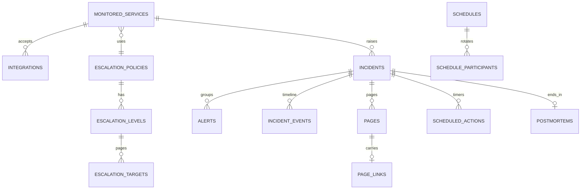
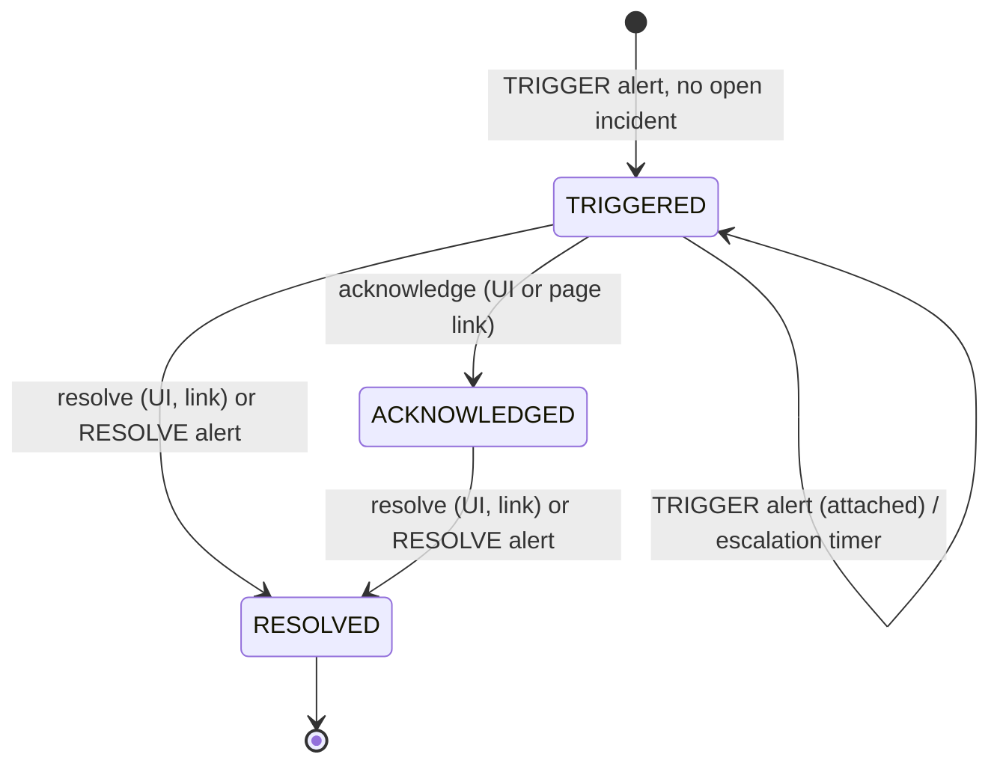

# Incident service plan

Status: **draft, 2026-11-24**. Nothing in this document is implemented. The open decisions in section 8 are taken one at a time, in order, before the related code is written, as was done for the Notification and gateway steps in [the decomposition plan](microservice-decomposition.md).

This replaces the Project/Task domain named in the decomposition plan (section 2 there). The business domain is now **incident management and on-call** in the style of PagerDuty: monitoring tools send alerts, alerts become incidents, incidents page the person on call, pages escalate until someone acknowledges, and a resolved incident ends in a postmortem. It was chosen over project/task because it has real rules (a state machine, timers, escalation, schedules), because it gives every planned piece of infrastructure a reason to exist (Notification, Kafka, Search, realtime), because the system can monitor itself as a demo, and because it has concrete AI use cases that can be evaluated (section 10).

This is also the first service that owns business data outside Account, so it forces the decision the decomposition plan left open: how a service other than Account knows what a user may do inside an organization (section 3).

## 1. Scope

In scope for this topic, in the order of section 7:

- A new Java/Spring service, `onward-incident`, with its own PostgreSQL database, reachable only through the gateway.
- Account publishing membership changes as events, through a transactional outbox, and the Incident service keeping a local copy of memberships from them.
- Monitored services with integration keys; an ingest endpoint for alerts; deduplication of alerts into incidents; the incident state machine and timeline; notes.
- Escalation policies, on-call schedules with a weekly or daily rotation, and a durable scheduler that escalates unacknowledged incidents.
- Pages delivered by the Go Notification service as email with acknowledge and resolve links, and the delivery result written back into the incident timeline.
- The frontend calling the gateway instead of Account directly, and an incidents UI.
- Postmortems, MTTA/MTTR per service, an Alertmanager-compatible ingest endpoint, and a prober in `docker-compose.yaml` so the stack pages its own developer when the gateway is down.

Out of scope for v1, deliberately: SMS, voice and push channels; schedule overrides and multi-layer schedules; maintenance windows; merging or splitting incidents; reopening a resolved incident; status pages; SLAs; urgency rules (every incident pages); realtime updates; Kafka; the Search and AI services (section 10 is their roadmap).

## 2. Domain model (v1)

Every rule below is enforced by the Incident service alone, against its own database; it never reads Account's tables.

### 2.1 Entities

| Entity | Notes |
| --- | --- |
| `OrganizationMember` | **Read model** of Account's memberships (section 4.1 and 4.2): `organizationId`, `userId`, `membershipId`, `email`, `role`, `status`, `updatedAt`. Never written by an Incident use case. |
| `MonitoredService` | A thing that is monitored (gateway, payment database). Belongs to an organization; has a name, a description and exactly one `EscalationPolicy`. Called "monitored service" in code to avoid the word *service* meaning two things. |
| `Integration` | A credential for sending alerts to one monitored service. The key is random, stored **hashed**, shown once at creation (the pattern of refresh and one-time tokens in identity). Status `ACTIVE` or `REVOKED`. |
| `EscalationPolicy` | Belongs to an organization. Ordered `levels`, each with a `timeout` (1 to 60 minutes) and one or more `targets`, a target being a user or a schedule. `repeatCount` (0 to 3) says how often the whole policy is repeated once the last level timed out. |
| `Schedule` | Belongs to an organization. `timeZone`, `rotationStart`, `rotationLength` (`DAILY` or `WEEKLY`), ordered `participants` (active members). Who is on call at instant `t` is `participants[floor((t − rotationStart) / rotationLength) mod n]`, computed in the schedule's time zone, and nobody before `rotationStart`. A pure function, unit-tested. |
| `Alert` | What arrived at the ingest endpoint: `dedupKey`, `action` (`TRIGGER` or `RESOLVE`), `severity` (`CRITICAL`, `ERROR`, `WARNING`, `INFO`), `summary`, `source`, `payload` (JSON as received), `receivedAt`, the integration and monitored service it came through, and the incident it was attached to (null for a `RESOLVE` that matched no open incident). Immutable once stored. |
| `Incident` | Opened by the first `TRIGGER` alert for a `(monitoredService, dedupKey)` with no open incident. `number` is a per-organization counter (`#42`), `title` is the first alert's summary, `severity` the highest of its alerts. Status `TRIGGERED → ACKNOWLEDGED → RESOLVED`; resolved is final, a later `TRIGGER` opens a new incident. Also `currentLevel`, `repeatsRemaining`, `acknowledgedBy/At`, `resolvedBy/At`. |
| `IncidentEvent` | The timeline, append-only: `TRIGGERED`, `ALERT_ATTACHED`, `PAGED` (level, target user), `PAGE_DELIVERED`, `PAGE_FAILED`, `ESCALATED`, `ESCALATION_EXHAUSTED`, `NO_ONE_ON_CALL`, `ACKNOWLEDGED`, `RESOLVED`, `AUTO_RESOLVED`, `NOTE`. Each has an optional actor, a JSON `data` and `occurredAt`. Notes are timeline entries; they cannot be edited in v1. |
| `Page` | One attempt to reach one user for one incident at one level: `pageId`, `userId`, `email`, `channel` (`EMAIL` only in v1), `requestedAt`, `deliveredAt`/`failedAt`. The unit that Notification acknowledges back. |
| `PageLink` | The credential inside a page email: a random token stored hashed, bound to one incident and one user, valid until the incident is resolved or 24 hours, whichever is first. Not single-use, because acknowledge and resolve are idempotent (8.8). |
| `ScheduledAction` | A durable timer: `incidentId`, `kind` (`ESCALATE`), `dueAt`, `executedAt`, `cancelledAt`. The scheduler in 5.2 runs them. |
| `Postmortem` | One per resolved incident: `summary`, `impact`, `rootCause`, `actionItems` (Markdown text fields), status `DRAFT` or `PUBLISHED`, author. The timeline is not copied into it; the UI renders both. |



Database rules that back the domain rules, in the spirit of migration V4 (partial unique index for the single owner):

- `incidents`: partial unique index on `(monitored_service_id, dedup_key) WHERE status <> 'RESOLVED'`. Deduplication is then a constraint, not just a code path; two concurrent `TRIGGER`s for the same key cannot open two incidents. The loser of the race retries and attaches.
- `incidents.number`: a per-organization counter kept in `incident_counters(organization_id, next_number)` updated under row lock in the opening transaction.
- `scheduled_actions`: index on `(due_at) WHERE executed_at IS NULL AND cancelled_at IS NULL` for the poller.
- Organization-scoped tables carry `organization_id` directly, even where it is derivable, so every query is scoped by one column, as the tenant-isolation rule in the authentication design asks.

No FK from `organization_id`, `user_id` or target user columns to `organization_members`: the read model may be rebuilt, and a removed member may still appear as a past acker or participant. Referential rules are checked in application services.

Domain classes follow the existing conventions ([data model doc, §1](data-and-domain-model.md)): immutable, no Spring or JPA annotations, transitions return a new object, UUIDv7 ids generated by the service that owns the row.

### 2.2 Incident lifecycle



What happens on each transition, all inside one transaction that locks the incident row (`SELECT ... FOR UPDATE`), the same serialization tenancy uses on the organization row:

| Event | Effect |
| --- | --- |
| `TRIGGER`, no open incident for the key | Insert incident at level 1 with `repeatsRemaining = policy.repeatCount`; attach the alert; timeline `TRIGGERED`; **page level 1** (below); schedule `ESCALATE` at `now + level1.timeout`. |
| `TRIGGER`, open incident exists | Attach the alert; raise `severity` if higher; timeline `ALERT_ATTACHED`. No new page. |
| `RESOLVE` alert, open incident exists | Status `RESOLVED`, `resolvedBy = null`; timeline `AUTO_RESOLVED`; cancel pending actions. |
| `RESOLVE` alert, no open incident | Store the alert with `incidentId = null`, respond `ignored`. |
| Acknowledge (user) | Only from `TRIGGERED`; from `ACKNOWLEDGED` it is an idempotent 200, from `RESOLVED` a `409 INCIDENT_ALREADY_RESOLVED`. Cancel pending actions; timeline `ACKNOWLEDGED`. |
| Resolve (user) | From `TRIGGERED` or `ACKNOWLEDGED`; idempotent from `RESOLVED`. Cancel pending actions; timeline `RESOLVED`. |
| `ESCALATE` timer fires | If the incident is no longer `TRIGGERED`, do nothing (belt and braces with cancellation). Otherwise `currentLevel + 1`; past the last level, if `repeatsRemaining > 0` decrement it and go back to level 1, else timeline `ESCALATION_EXHAUSTED` and stop. Page the new level; schedule the next `ESCALATE`. |

**Paging a level**: for each target, resolve it to a user (a user target is itself; a schedule target is the participant on call now). Every distinct active member resolved gets one `Page` and one `PAGED` timeline entry, and one `page.requested` message goes out through the outbox (4.5). A target that resolves to nobody (schedule before its start, user no longer an active member) produces a `NO_ONE_ON_CALL` timeline entry and escalation continues on the timer; a level with no reachable target does not block the policy.

### 2.3 Permission matrix

Every action requires an active membership in the organization, read from the local copy. Membership first (404 for outsiders; the organization and everything in it are indistinguishable from non-existent), then the role (403), the order `OrganizationAccessService.requirePermission` uses in tenancy.

| Action | OWNER | ADMIN | MEMBER |
| --- | --- | --- | --- |
| Read services, integrations (without keys), policies, schedules, incidents, timelines, postmortems, metrics | Yes | Yes | Yes |
| Create and update monitored services, policies, schedules; create and revoke integrations | Yes | Yes | No |
| Be a policy target or a schedule participant | Yes | Yes | Yes |
| Open a manual incident, acknowledge, resolve, add a note | Yes | Yes | Yes |
| Write and publish a postmortem | Yes | Yes | Yes |

Responders are deliberately not a separate role: whoever is a member can be on call and can act on any incident of the organization. An **integration key** is a second kind of principal, not a user: it may only send alerts to its own monitored service (section 4.3). A **page link** is a third: it may only acknowledge or resolve its own incident on behalf of its user.

## 3. How the Incident service knows the caller's role

The decomposition plan (6.2) listed three options and did not decide. Restating them against what now exists:

| Option | How it works | What it costs |
| --- | --- | --- |
| Ask Account on every request | Call an introspection endpoint such as `GET /internal/organizations/{id}/memberships/{userId}` | Account on the hot path of every request; the reason section 7 of the decomposition plan rejected introspection for sessions. A cache only hides it. |
| Roles in the access token | Account puts `[{org, role}]` into the JWT | A user in many organizations grows the token; a role change or removal is invisible until the token expires (5 minutes) and the denylist does not cover role changes. |
| **Local copy fed by events** | Account publishes every membership change; the Incident service keeps `organization_members` and reads it in its own transaction | Eventual consistency: a removed member keeps access for the propagation delay (well under a second normally). Account needs an outbox so a change cannot commit without its event. A new consumer needs a way to catch up on history. |

**Recommended: the local copy.** It is the only option that keeps Account off the hot path and keeps "subsequent requests use the current role" within seconds rather than minutes, and it is the step that teaches what this project set out to learn next: the transactional outbox (named in 6.2 as the thing to add "for events whose loss is a bug"), event-carried state transfer, and an idempotent, order-tolerant consumer.

```mermaid
sequenceDiagram
    participant O as Owner (client)
    participant G as Gateway
    participant A as Account
    participant DB as Account DB
    participant R as RabbitMQ
    participant I as Incident service
    participant IDB as Incident DB
    O->>G: DELETE /api/organizations/{org}/memberships/{m}
    G->>A: forward (token verified, denylist checked)
    A->>DB: UPDATE memberships ... ; INSERT outbox_messages (same transaction)
    A-->>O: 204
    A->>DB: poll outbox (every 500 ms, SKIP LOCKED)
    A->>R: publish membership.changed (persistent, publisher confirm)
    A->>DB: mark published
    R->>I: deliver
    I->>IDB: upsert organization_members where incoming updated_at >= stored
    I->>R: ack
```

## 4. Contracts

Same rules as section 4 of the decomposition plan: JSON, no `__TypeId__`, versioned type names, ISO-8601 UTC instants, UUIDv7 `messageId` also set as the AMQP `message_id`, `delivery_mode` 2. Producers serialize by hand, as `RabbitAuthNotifier` does.

### 4.1 Account → Incident: membership events

Topic exchange **`onward.account`** (durable), declared by Account. The Incident service declares its own quorum queue `incident.memberships` bound with `membership.#`, dead-letter exchange `onward.account.dlx` and queue `incident.memberships.dlq`, mirroring Notification.

One event type carries the **full current state** of the membership (event-carried state transfer); the consumer never needs to know whether it was an add, a role change or a removal. It upserts.

| Routing key | `type` |
| --- | --- |
| `membership.changed` | `onward.account.membership-changed.v1` |

```json
{
  "messageId": "01a1cb46-40e6-798d-b0e4-0c25206cfb0a",
  "type": "onward.account.membership-changed.v1",
  "occurredAt": "2026-11-24T09:12:33.120Z",
  "membershipId": "019a2f9c-0c3e-7d1a-9f30-1e2e5b5a6c01",
  "organizationId": "019a2f9b-4d21-7e8a-8a11-6b3f2c9d0e02",
  "userId": "019a2f8a-9b7e-7c3d-b2a4-0d1e2f3a4b03",
  "email": "alice@example.com",
  "role": "ADMIN",
  "status": "ACTIVE",
  "updatedAt": "2026-11-24T09:12:33.118Z"
}
```

Emitted, inside the same transaction, by every tenancy path that changes a membership row: organization creation (the owner membership), add member, reactivate, change role, remove, ownership transfer (two events), and `removeAllMembershipsOf` on account disable (one per membership). Membership writes are serialized by the organization row lock, so `updatedAt` is strictly increasing per membership and serves as the version.

Consumer rule: `INSERT ... ON CONFLICT (organization_id, user_id) DO UPDATE ... WHERE excluded.updated_at >= organization_members.updated_at`. Duplicates and out-of-order redeliveries are harmless, so no separate idempotency store is needed, unlike Notification whose side effect (a mail) is not idempotent. Invalid messages go to the dead-letter queue.

`email` is included so pages, timelines and schedules can show people without calling Account. There is no email-change feature today; if one is added, Account emits a `membership.changed` per membership of that user.

### 4.2 Account → Incident: membership snapshot (bootstrap and reconciliation)

RabbitMQ drops messages published before the consumer's queue exists and keeps nothing after acknowledgement, so a fresh Incident instance has no way to catch up from the broker. Account therefore exposes, outside the public API:

```text
GET /internal/memberships?page=0&size=500
Authorization: Bearer <internal token>
```

returning pages of the 4.1 objects (without `messageId`, `type`, `occurredAt`), all memberships including `REMOVED`, ordered by `updated_at`. The Incident service calls it at startup when `organization_members` is empty and on an operator-triggered resync. Start the consumer first, then load the snapshot; the upsert rule makes the overlap harmless.

Protection: the gateway has no route for `/internal/**`, and Account requires a static bearer token from the environment (`APP_INTERNAL_TOKEN`) on that path. Enough for one caller on a private network; client credentials are the upgrade when more services appear (8.4).

### 4.3 Monitoring tools → Incident: alert ingest

The public contract for anything that sends alerts, modelled on PagerDuty's Events API. Authenticated by the integration key, not by a user token; the gateway lists it as a public path and the Incident service checks the key itself.

```text
POST /api/ingest/v1/alerts
X-Integration-Key: <key shown once at integration creation>
Content-Type: application/json

{
  "dedupKey": "gateway-health",
  "action": "trigger",
  "severity": "critical",
  "summary": "Gateway health check failed (3 consecutive)",
  "source": "prober@dev-laptop",
  "occurredAt": "2026-11-24T10:00:03Z",
  "payload": { "url": "http://gateway:8081/actuator/health", "status": 0 }
}
```

| Response | When |
| --- | --- |
| `202 {"alertId", "incidentId", "result": "triggered" \| "attached" \| "resolved" \| "ignored"}` | Accepted. `202` even though v1 processes synchronously (8.7), so the contract survives the move to asynchronous ingest. |
| `401 INTEGRATION_KEY_INVALID` | Missing, unknown or revoked key. No hint which. |
| `400 VALIDATION_FAILED` | Missing `dedupKey`, `action` or `summary`; `dedupKey` over 255 characters; `payload` over 64 KB. |

`dedupKey` is the whole deduplication story in v1: a second `trigger` with the same key while the incident is open attaches to it. A monitoring tool that retries a webhook therefore does no harm; an exact-duplicate filter by event id is unnecessary. `occurredAt` is optional and defaults to receipt time.

A second endpoint, `POST /api/ingest/v1/alertmanager`, accepts the Prometheus Alertmanager webhook body and translates each entry into the shape above (`fingerprint` → `dedupKey`, `status` → action, `labels.severity` → severity, `annotations.summary` → summary). It exists for the self-monitoring demo (step 7) and keeps the translation out of the core.

Rate limit: the gateway limits `/api/ingest/**` per integration key (the header, hashed, as the bucket key) rather than per client address, since one tool with one key is one tenant. This is a second limiter configuration in the gateway with a different key resolver; the existing public-auth limiter is unchanged.

### 4.4 Incident service HTTP API

Behind the gateway, bearer token only, no cookies, so no CSRF. Errors use the `ApiError` shape; the codes are added to the documented contract, not to shared code.

| Method and path | Who | Notes |
| --- | --- | --- |
| `GET` / `POST /api/organizations/{organizationId}/services` | member / owner, admin | `{name, description, escalationPolicyId}` → 201 |
| `GET` / `PATCH /api/services/{serviceId}` | member / owner, admin | |
| `POST /api/services/{serviceId}/integrations` | owner, admin | `{name}` → 201 with the key, **once** |
| `DELETE /api/integrations/{integrationId}` | owner, admin | Revoke; idempotent 204 |
| `GET` / `POST /api/organizations/{organizationId}/escalation-policies` | member / owner, admin | |
| `GET` / `PUT /api/escalation-policies/{policyId}` | member / owner, admin | `PUT` replaces the levels wholesale; targets must be active members or schedules of the organization, else `409 TARGET_NOT_MEMBER` |
| `GET` / `POST /api/organizations/{organizationId}/schedules` | member / owner, admin | |
| `GET` / `PUT /api/schedules/{scheduleId}` | member / owner, admin | |
| `GET /api/schedules/{scheduleId}/on-call?at=` | member | Who is on call at `at` (default now) |
| `GET /api/organizations/{organizationId}/incidents` | member | Paged; filters `status`, `serviceId`; newest first |
| `POST /api/organizations/{organizationId}/incidents` | member | Manual incident `{serviceId, title, severity}`; pages like a trigger |
| `GET /api/incidents/{incidentId}` | member | With alerts count, current level, pages |
| `GET /api/incidents/{incidentId}/timeline` | member | Paged, oldest first |
| `POST /api/incidents/{incidentId}/acknowledge` | member | 200, idempotent; `409 INCIDENT_ALREADY_RESOLVED` |
| `POST /api/incidents/{incidentId}/resolve` | member | 200, idempotent |
| `POST /api/incidents/{incidentId}/notes` | member | `{body}` → 201 timeline entry |
| `GET` / `PUT /api/incidents/{incidentId}/postmortem` | member | Only once resolved: `409 INCIDENT_NOT_RESOLVED` |
| `POST /api/page-links/{token}/acknowledge`, `.../resolve` | **page link** | Public path at the gateway; `401 PAGE_LINK_INVALID` when unknown, expired or the incident is resolved. The frontend route `/p/{token}` calls these. |
| `GET /api/organizations/{organizationId}/metrics?from=&to=` | member | Per service: incidents, MTTA, MTTR |

New error codes: `SERVICE_NOT_FOUND`, `POLICY_NOT_FOUND`, `SCHEDULE_NOT_FOUND`, `INCIDENT_NOT_FOUND`, `INTEGRATION_KEY_INVALID`, `PAGE_LINK_INVALID`, `INCIDENT_ALREADY_RESOLVED`, `INCIDENT_NOT_RESOLVED`, `TARGET_NOT_MEMBER`. `INSUFFICIENT_PERMISSION` and `ORGANIZATION_NOT_FOUND` keep their meaning from Account.

### 4.5 Incident ↔ Notification: pages and delivery results

Topic exchange **`onward.incident`** (durable), declared by the Incident service, carrying two kinds of messages. Both are written through the Incident service's own outbox (section 5): a lost page is a bug, unlike a lost auth mail.

| Routing key | `type` | Consumer |
| --- | --- | --- |
| `page.requested` | `onward.incident.page-requested.v1` | Notification, queue `notification.pages` bound with `page.#` |
| `incident.changed` | `onward.incident.incident-changed.v1` | Nobody in v1; the hook for Search and AI (section 10). Full incident state, like 4.1. |

```json
{
  "messageId": "…",
  "type": "onward.incident.page-requested.v1",
  "occurredAt": "2026-11-24T10:00:04Z",
  "pageId": "…",
  "incidentId": "…",
  "incidentNumber": 42,
  "serviceName": "gateway",
  "title": "Gateway health check failed (3 consecutive)",
  "severity": "CRITICAL",
  "level": 1,
  "userId": "…",
  "email": "alice@example.com",
  "acknowledgeUrl": "http://localhost:5173/p/<token>?action=acknowledge",
  "resolveUrl": "http://localhost:5173/p/<token>?action=resolve",
  "incidentUrl": "http://localhost:5173/incidents/<id>"
}
```

The URLs are built by the Incident service because the token is its data; `app.frontend-base-url` therefore moves from Notification's configuration into the Incident service for these mails (Notification keeps its own for auth mails). Nothing in the message is a secret beyond the page token, which can only acknowledge or resolve one incident; the 6.1 reasoning applies with less at stake.

Notification handles a page exactly as it handles a token mail (dedup by `messageId` in Redis, remember then send) and then **publishes the result** on its own topic exchange **`onward.notification`**, declared by Notification:

| Routing key | `type` | Body |
| --- | --- | --- |
| `page.delivered` | `onward.notification.page-delivered.v1` | `messageId`, `occurredAt`, `pageId`, `channel: "email"` |
| `page.failed` | `onward.notification.page-failed.v1` | same plus `reason` |

The Incident service consumes them on queue `incident.page-results` and writes `PAGE_DELIVERED` / `PAGE_FAILED` to the timeline, idempotently by `pageId` (a result for an unknown or already-settled page is acknowledged and dropped). Notification publishes after sending, without an outbox: Go has no database, and a lost result only leaves a page without a delivery mark in the timeline, which is visible and harmless.

This makes Notification a producer for the first time and the Incident service a consumer of a Go service, which is new in both directions.

### 4.6 Gateway

One more route, **ordered before** Account's `/api/**` route: `Path=/api/organizations/*/services/**,/api/organizations/*/escalation-policies/**,/api/organizations/*/schedules/**,/api/organizations/*/incidents/**,/api/organizations/*/metrics,/api/services/**,/api/integrations/**,/api/escalation-policies/**,/api/schedules/**,/api/incidents/**,/api/ingest/**,/api/page-links/**` to `http://localhost:8082`. Public paths added: `/api/ingest/**` and `/api/page-links/**`. The ingest limiter of 4.3. The gateway does what it already does for everything else (JWKS, denylist); the Incident service verifies the token again through the same JWKS and nothing else.

## 5. Outbox and scheduler

### 5.1 Transactional outbox, in Account and in the Incident service

Why now: a membership removal whose event is lost leaves a removed member with access in the Incident service until the next change to that membership, which may never come. A lost page leaves an incident nobody knows about. Both are bugs, so the "publish after commit" shortcut taken for auth mails (decomposition plan 6.2) does not apply.

Table `outbox_messages`, the same shape in both services:

| Column | Notes |
| --- | --- |
| `id` uuid PK | UUIDv7; also the `messageId` of the published message |
| `exchange`, `routing_key`, `type` | What to publish and where |
| `payload` jsonb | The body as published, serialized when the row is written |
| `created_at` timestamptz | |
| `published_at` timestamptz null | Set by the publisher |

Mechanics:

- An `OutboxWriter` port in the application layer; its adapter inserts the row in the caller's transaction (`Propagation.MANDATORY`, like the access checks). Use cases call it right after saving the aggregate, so the change and its event commit or roll back together.
- An `OutboxPublisher` scheduled every 500 ms: `SELECT ... WHERE published_at IS NULL ORDER BY created_at LIMIT 100 FOR UPDATE SKIP LOCKED`, publishes each with **publisher confirms** (`spring.rabbitmq.publisher-confirm-type=correlated`), sets `published_at` only on confirmation. A crash between publish and mark re-publishes on the next tick; that is where at-least-once comes from and why every consumer in this plan is idempotent.
- A daily cleanup deletes published rows older than 7 days.
- `SKIP LOCKED` keeps several instances from publishing the same row at the same time; ordering across instances is not guaranteed, which the state-carrying events absorb.

Auth mails stay on the publish-after-commit path by the 6.1/6.2 decisions (the raw token must not be persisted). Two publishing paths exist on purpose.

The code is written twice, once per service, under the no-shared-library rule. It is about 150 lines; if it grows or diverges, that is the signal to reconsider the rule, not before.

### 5.2 Durable timers for escalation

Escalation needs "do X at time T unless cancelled", and it must survive a restart: an incident triggered one minute before a deploy must still escalate four minutes later. In-memory timers (`@Scheduled` with state, `ScheduledExecutorService`) are therefore out. Options in 8.5; the recommended one is the same mechanism as the outbox:

- `scheduled_actions` rows are inserted in the transaction that decides them (the trigger, each escalation).
- A poller every second: `SELECT ... WHERE due_at <= now() AND executed_at IS NULL AND cancelled_at IS NULL ORDER BY due_at LIMIT 50 FOR UPDATE SKIP LOCKED`, and for each row, in the same transaction, locks the incident row, re-checks the status, applies the escalation of 2.2, writes the next action and the outbox rows, marks the action executed.
- Acknowledge and resolve mark pending actions cancelled in their own transaction. The status re-check on execution covers the race where the timer and the acknowledgement run at the same moment: whichever gets the incident lock second sees the other's result.

Latency is up to one tick plus poll cost, fine for timeouts measured in minutes. New concepts: a persistent scheduler, idempotent timer execution, and the ack-versus-timer race.

## 6. Service layout

Repository `onward-incident`, next to `onward-gateway` and `onward-notification`, port **8082**. Spring Boot 4.1 on Java 21, the same Gradle setup and `shell.nix` as Account. Packages mirror Account's hexagonal layout:

```text
com.longdnh.onward.incident
├── common            copied, not shared: ApiError/ApiErrorWriter/GlobalExceptionHandler, Validation, IdGenerator, pagination
├── membership        read model: OrganizationMember, OrganizationAccessService, RabbitMQ consumer, snapshot loader
├── catalog           MonitoredService, Integration, EscalationPolicy, Schedule (configuration data) and their web layer
├── incident          Alert, Incident, IncidentEvent, Page, PageLink, Postmortem, ingest, escalation, scheduler, web
└── infrastructure    security (JWKS resource server, integration-key and page-link filters), messaging, outbox, persistence
```

`catalog` and `incident` are separate packages because they change at different speeds and because the ingest path only *reads* the catalog. They stay in one service and one database: an incident references its policy and schedule at escalation time and that read must be consistent with the catalog, which a separate service could not give without another read model.

Security: `spring.security.oauth2.resourceserver.jwt.jwk-set-uri=http://localhost:8080/.well-known/jwks.json`, issuer and audience validated as in the gateway; `sub` and `sid` read as `SessionJwtAuthenticationConverter` does but with **no database check** (the service has no `users` or `sessions` table). Two more authentication filters, each limited to its path prefix: the integration key on `/api/ingest/**` and the page link on `/api/page-links/**`. Consequence, written down: a token revoked at Account is rejected by the gateway at once but accepted by the Incident service when called directly on 8082 until it expires (5 minutes). The port is not exposed outside the development machine.

Database: a second PostgreSQL container `postgres-incident` on host port 5433 in `docker-compose.yaml`, database `onward_incident`. One instance with two databases would also satisfy "one database per service"; a second container makes the boundary visible and needs no init script. Flyway migrations live in the new repository.

Configuration: `spring.rabbitmq.*`; `app.account.internal-base-url` and `APP_INTERNAL_TOKEN` for the snapshot; `app.messaging.account-exchange` (`onward.account`), `app.messaging.incident-exchange` (`onward.incident`), `app.messaging.notification-exchange` (`onward.notification`); `app.frontend-base-url` for page links; `app.escalation.poll-interval` (1 s), `app.outbox.poll-interval` (500 ms).

Frontend: `proxy.conf.json` targets the gateway (`http://localhost:8081`) instead of Account, the point at which "clients keep calling Account directly until the gateway does everything they need" (decomposition plan 7.1) stops being true. The interceptors already send a bearer token on every call and CSRF only on token-less ones, so nothing changes for the new endpoints. New feature folders `features/catalog` (services, integrations, policies, schedules) and `features/incidents` (list, detail with timeline, acknowledge, resolve, notes, postmortem), plus the public route `/p/:token` for page links.

## 7. Implementation steps

Each step is one pull request per repository and is usable on its own. New concepts are limited to one or two per step, as before.

| Step | Repository | What is built | New concepts | Done when |
| --- | --- | --- | --- | --- |
| 1 | `onward` | Outbox table and publisher (5.1); `membership.changed` emitted from every tenancy write path (4.1); exchange `onward.account` declared; `/internal/memberships` snapshot endpoint with the internal token (4.2) | Transactional outbox, publisher confirms, event-carried state transfer | Every membership change shows up in the RabbitMQ management UI within a second with the documented body; stopping RabbitMQ during a change and starting it again publishes the event; the snapshot returns the same rows |
| 2 | `onward-incident`, `onward-gateway`, `onward-fe` | Service skeleton: repository, database, `organization_members` migration, JWKS resource server, consumer with the upsert rule, snapshot loader at startup, `GET /api/organizations/{id}/services` returning an empty page; gateway route; frontend proxy to the gateway | A second Java service; a service that trusts the gateway for session state; idempotent, order-tolerant consumer; gateway routing to two backends | Through the gateway: a member gets `[]`, a non-member 404, a removed member 404 within a second of removal; the existing frontend screens work unchanged through the gateway |
| 3 | `onward-incident`, `onward-gateway` | Monitored services and integrations (hashed keys); escalation policies and schedules as data with validation and the on-call function; ingest endpoint with the integration-key filter, deduplication via the partial unique index, incident open/attach/auto-resolve, timeline, manual acknowledge/resolve, notes; gateway public path and ingest limiter | A non-user principal (the integration key); deduplication as a database constraint | `curl` trigger opens `#1`; a second trigger attaches; `resolve` closes it; two concurrent triggers never open two incidents (tested with a small concurrent script); `GET .../on-call?at=` matches hand-computed rotations across a DST change |
| 4 | `onward-incident` | Incident outbox; paging of a level (2.2) producing `Page` rows and `page.requested` messages; the scheduler of 5.2 with escalation, repeats and exhaustion; cancellation on acknowledge/resolve; `incident.changed` events | Persistent scheduler, timer-versus-acknowledge race | With a policy of two levels and 1-minute timeouts: trigger → one `page.requested` for the level-1 on-call in the management UI; after a minute one for level 2; acknowledging in between produces none; restarting the service mid-timeout still escalates on time |
| 5 | `onward-notification`, `onward-incident`, `onward-gateway` | Go consumer for `notification.pages`, page email template with the two links, `onward.notification` exchange and results; Incident consumer for results into the timeline; page-link endpoints and filter; gateway public path | Go as a producer; a Java consumer of a Go service; a credential inside an email that is not a user token | Trigger → mail in Mailpit → clicking acknowledge marks the incident acknowledged and stops escalation; the timeline shows `PAGED`, `PAGE_DELIVERED`, `ACKNOWLEDGED` with timestamps |
| 6 | `onward-fe` | Catalog screens, incident list and detail, acknowledge, resolve, notes, `/p/:token` | | A member can do everything in 2.3 from the browser; the page-link route works logged out |
| 7 | `onward-incident`, `onward`, `onward-fe` | Postmortem endpoints and screen; metrics endpoint; Alertmanager-compatible ingest; a `prober` container in `docker-compose.yaml` that polls the gateway's health every 10 s and posts `trigger`/`resolve` with a fixed integration key read from `.env` | Nothing new in infrastructure; the exercise is the end-to-end demo | `docker compose stop gateway` → within 30 s a page email in Mailpit → `docker compose start gateway` → the incident auto-resolves; MTTA/MTTR show for the service |

Step 1 is testable with the RabbitMQ management UI before any Incident code exists, which is why it goes first. Step 3 is the largest and could be split at "ingest and incidents" versus "policies and schedules as data"; they are kept together because the ingest path needs a policy to exist and the on-call function is pure code with no infrastructure.

### Testing

Keep the current level and add what the new risks need: domain unit tests for the incident transitions, the on-call function (including time zones and DST) and the permission matrix; a consumer test that feeds duplicate and out-of-order `membership.changed` messages and asserts the read model; an outbox test that asserts a rolled-back change leaves no outbox row; a scheduler test that runs a due action against an already-acknowledged incident and asserts no page; and a documented manual end-to-end script (register two users, organization, add member, service with policy and schedule, trigger, observe page, acknowledge by link, resolve, remove member, observe 404) run through the gateway.

## 8. Open decisions

In this order. Each gets a "decided" line with the date, as in the decomposition plan.

### 8.1 Where the Incident service gets the caller's role

Options and costs in section 3. **Recommendation: local copy fed by events through an outbox.**

### 8.2 Broker for membership and incident events

| Option | For | Against |
| --- | --- | --- |
| **RabbitMQ, the existing broker** | Nothing new to run; producer code and the Go-side habits exist; one topic exchange per producing service scales to `onward.incident` and `onward.notification` | No history: a new consumer needs the snapshot endpoint (4.2); the dead-letter queue is the only replay |
| Kafka with a compacted topic keyed by membership id | Replay for free: a new consumer reads from the beginning and ends with the current state | A second broker, consumer groups, offsets, partitions and compaction, in the same step as the outbox and a new service; Notification would still be on RabbitMQ |

**Recommendation: RabbitMQ now.** Kafka is reserved for the alert stream once ingest becomes asynchronous and several consumers read it (section 10), where replay is the actual need. Switching membership events later changes one producer and one consumer, and the snapshot endpoint stays useful as the reconciliation tool.

### 8.3 Bootstrap of the read model

Snapshot endpoint (4.2); or operator discipline (start the Incident service before creating any organization), which breaks the first time the queue is deleted or the database reset; or Kafka (8.2). **Recommendation: the snapshot endpoint.** Small, the honest answer to "what if the consumer missed something", reused as-is if the broker changes.

### 8.4 Protecting the internal endpoint

Not routed by the gateway plus a static bearer token from the environment; or client-credentials tokens issued by Account, which makes Account an authorization server for services and is a topic on its own; or network only, which teaches nothing. **Recommendation: static token**, written down as a known gap.

### 8.5 Timer mechanism for escalation

| Option | For | Against |
| --- | --- | --- |
| **`scheduled_actions` table and a poller (5.2)** | Same pattern as the outbox, so one mechanism to learn and debug; the timer and the state change share a transaction; cancellation is an `UPDATE`; visible in SQL | One-second granularity; a poll per second per instance |
| RabbitMQ delayed delivery (per-message TTL and dead-lettering back, or the delayed-message plugin) | No poller | Cancellation is impossible, so every fired message must re-check state anyway; per-message TTL only expires at the head of the queue, a known trap; the plugin is not in the stock image |
| Quartz with the JDBC job store | Mature, clustered | A framework with its own tables and model to learn, for one job type |

**Recommendation: the table and poller.** The fired-timer-re-checks-state rule is needed in every option; the table makes the pending timers inspectable and cancellable.

### 8.6 Schedule overrides in v1

An override ("Bob covers Alice from Friday 18:00 to Monday 09:00") is a second table and a precedence rule in the on-call function. **Recommendation: not in v1.** Add it as its own small step after step 7, once the rotation function has been exercised; nothing in the contracts changes.

### 8.7 Ingest processing: synchronous now, asynchronous later

v1 validates, stores the alert and updates the incident inside the request, holding the incident row lock, and answers `202`. Under an alert storm this serializes on the lock per `dedupKey`, which is also the correctness guarantee; different keys do not contend. **Recommendation: synchronous in v1**, with the `202` contract reserved so that the move to "validate, publish to Kafka, answer" (section 10) changes no client.

### 8.8 Page link credential

A random token stored hashed, valid until the incident is resolved or 24 hours, reusable (recommended); or a signed JWT in the URL, which needs a signing key in the Incident service and cannot be revoked when the incident resolves; or a strict one-time token, which breaks when a mail client prefetches the link. **Recommendation: hashed reusable token.** Acknowledge and resolve are idempotent, so reuse has no effect beyond the first click.

### 8.9 Integration key storage

Hashed, shown once at creation, revocable (recommended, the pattern already used for refresh and one-time tokens); or stored in clear so the UI can show it again, which is what some products do and what a leaked database then exposes. **Recommendation: hashed.** Losing a key means creating a new integration; the monitoring tool is reconfigured, nothing else changes.

## 9. Known gaps, deliberately left

- A removed member keeps access to the organization's incidents for the event propagation delay (section 3), and stays a schedule participant or policy target until an admin edits the schedule or policy; paging resolves them to nobody and records `NO_ONE_ON_CALL`.
- Every incident pages, whatever its severity. Urgency rules (low-severity incidents do not page at night) are a later feature.
- Email is the only channel; Notification has no retry through the dead-letter queue (decomposition plan 5.3), so a permanent SMTP failure for one page restarts the Go process repeatedly.
- The internal token is a shared static secret (8.4).
- The Incident service called directly, bypassing the gateway, honours a revoked token until it expires (section 6).
- The outbox publisher and the scheduler are pollers; latency is up to one tick, and published events are not ordered across instances. Change data capture is the production-grade replacement and is not planned.
- Account keeps its per-request database session check (decomposition plan 7.1); revisit once the frontend goes through the gateway, which happens in step 2.
- Alertmanager groups alerts itself before sending; the translation in 4.3 takes each alert in the group separately and relies on `fingerprint` for deduplication. Group-level semantics are ignored.

## 10. After v1: the roadmap this domain enables

Not planned in detail; listed so that v1 decisions do not block them, in the intended order.

| Step | What | Why this domain makes it real |
| --- | --- | --- |
| AI 1: handoff summary | Consume `incident.changed` on acknowledge and resolve, send the timeline and alerts to an LLM, write the summary back as a timeline entry | Pure LLM call, no infrastructure; judged by reading it. Decides the language question: Spring AI in Java keeps the one-second-language rule; a Python service is the exception to write down if chosen. |
| Kafka for the alert stream | Ingest validates and publishes to a Kafka topic; the Incident service, Search and AI consume it | The first stream with several consumers and real volume (alert storms), where replay and partitioning by `dedupKey` matter. The `202` contract already fits. |
| Ingest in Go | The validate-and-publish part of ingest moves to a small Go service | The first split made for throughput rather than for a data boundary; the Incident service keeps the state. |
| Realtime | SSE or WebSocket from Notification, fed by `incident.changed` | The incident list updates without polling; the channel planned for Notification in the decomposition plan. |
| Search and AI 2: similar incidents | OpenSearch read model of incidents; embeddings of title and alert payloads; kNN query "similar past incidents and how they were resolved" | Precision@k on hand-labelled pairs; the Search service from the decomposition plan. |
| AI 3: runbooks | Markdown runbook per monitored service; RAG suggests steps on trigger | Judged by whether the suggested step matches what was done. |
| AI 4: alert grouping | Group alerts into one incident beyond exact `dedupKey` (fifty pods failing is one incident) | The hardest to evaluate; last. |
| AI 5: postmortem draft | From the timeline and notes | |
