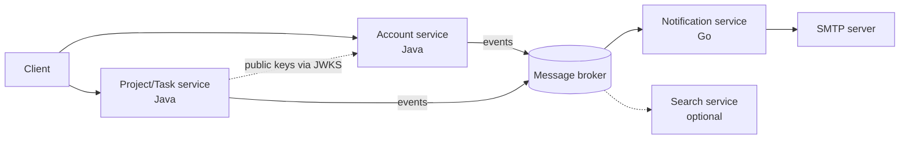

# Microservice decomposition plan

Status: **plan only, nothing implemented.** Agreed on 2026-11-10. The backend is still one Spring Boot application with two modules, `identity` and `tenancy`, sharing one PostgreSQL database.

This is a learning project. The goal is to move gradually from a modular monolith to microservices, learning one or two new concepts per step. New features are built as separate services next to the monolith rather than rewriting it first (the *strangler* approach).

## 1. Starting point

The current application already has hexagonal modules, but `identity` and `tenancy` deliberately rely on **one database transaction** for three guarantees:

| Coupling | Where | What it guarantees |
| --- | --- | --- |
| `UserDisabledEvent` handled synchronously by tenancy | `tenancy.infrastructure.event.UserDisabledListener` | Disabling a user and removing their memberships commit or roll back together |
| Tenancy locks the `users` row (`FOR SHARE`) before the organization row | `tenancy.infrastructure.persistence.adapter.UserAccountLookupAdapter` | Lock order user → organization; a disabled user can never become an owner |
| Identity reads `memberships` directly | `identity.infrastructure.persistence.adapter.OrganizationOwnershipCheckAdapter` | An owner cannot be disabled |

There is also a foreign key `memberships.user_id → users`. Splitting identity and tenancy into separate services would lose all of these guarantees and replace them with sagas and temporarily inconsistent states. **They stay together** as one service.

Things that already help the split:

- Access JWTs are signed with RS256. Other services can verify them with the public key alone.
- Auth emails are already sent after commit, asynchronously and fire-and-forget (`AuthMailListener`), so email is the cleanest boundary in the codebase.

## 2. Business domain

The application had no business domain. The chosen domain is **task and project management** (Trello-like), built on the existing organization, membership and role model: projects belong to an organization, and tasks are worked on by its members. The detailed domain model is not designed yet.

## 3. Target services

| Service | Responsibility | Technology | Data owned |
| --- | --- | --- | --- |
| **Account** | Registration, login, sessions, refresh tokens, email verification, password reset, organizations, memberships, roles, system admins | Java / Spring (the current application) | `users`, sessions, tokens, `organizations`, `memberships` |
| **Project/Task** | Projects, tasks, assignment, comments, task permissions | Java / Spring, PostgreSQL | Its own database |
| **Notification** | Sending email; later realtime push (WebSocket or SSE) | **Go** | Its own state only (for example, processed message IDs) |
| **Search** (optional, later) | Full-text task search fed by events | OpenSearch | A read model rebuilt from events |



Rules:

- **One database per service.** A service never reads another service's tables. The direct table reads in section 1 are acceptable only because Account is a single service.
- **One second language only.** Go is used for Notification because it is small, I/O-bound and has few business rules, so learning the language costs little. The core domain stays in Java, where the existing structure can be reused.
- **PostgreSQL by default.** Another database is added only when there is a concrete reason. OpenSearch is the one planned exception, as a way to learn how to keep a read model in sync.

## 4. Cross-service contracts

Anything that crosses a service boundary must be language-neutral, because Java and Go services must understand each other. No shared Java library (such as the current `common` package) is used between services.

| Concern | Agreement |
| --- | --- |
| Authentication | Each service verifies the RS256 access JWT itself (`iss`, `aud`, `exp`). Account publishes its public keys through a JWKS endpoint instead of distributing PEM files. |
| Event format | JSON with a written schema (JSON Schema or AsyncAPI), or Protobuf/Avro. Each event has a stable, explicit type name. Spring's JSON message converters for Kafka and RabbitMQ add a `__TypeId__` header containing the Java class name by default. This must be disabled, otherwise a Go consumer either breaks or depends on Java class names. |
| HTTP errors | The current `ApiError` shape and `ApiErrorCodes` become a documented contract (OpenAPI), not shared code. |
| Tracing | OpenTelemetry with the W3C `traceparent` header, so one request can be followed across services written in different languages. |
| IDs | UUIDv7 everywhere. Each service generates the IDs of the data it owns. |

## 5. First step: Notification service in Go

Auth emails move out of the Account process:

```text
Monolith (one process):  service → Spring event (in memory) → AuthNotificationListener → compose → SMTP
After the split:         Account (Java) → RabbitMQ (stored on disk) → Notification (Go) → compose → SMTP
```

Communication is **asynchronous through a message broker** because sending an email does not need to block the request. If Notification is down, messages wait in the broker and Account is unaffected. The cost is that a message no longer lives only in memory: the broker stores it on disk so it is not lost.

New concepts in this step: message broker, asynchronous messaging, at-least-once delivery, idempotent consumers, and Go itself.

### 5.1 Account side — implemented (2026-11-11)

`app.mail.mode` selects the delivery path; the services and events are unchanged.

| Mode | What happens after commit | Where |
| --- | --- | --- |
| `log` (default) | Mail composed in Account and written to the log | `identity.infrastructure.mail` |
| `smtp` | Mail composed in Account and sent through `spring.mail.*` | `identity.infrastructure.mail` |
| `rabbit` | The event itself is published to RabbitMQ; Notification composes and sends the mail | `identity.infrastructure.messaging` |

The `AuthNotifier` application port has one adapter per path. `AuthNotificationListener` still runs after commit and asynchronously, and still swallows failures after logging them, so the publish-after-commit decision (6.2) is the existing behaviour, not new code. With mode `rabbit`, Account declares the exchange at startup and `app.mail.frontend-base-url` is no longer used by Account: the link belongs to the Notification service's configuration.

The local profile uses mode `rabbit`; `docker-compose.yaml` runs RabbitMQ 4 with the management UI at <http://localhost:15672> (guest/guest). Switch back to `smtp` to test without the Go service.

### 5.2 Message contract

Topic exchange **`onward.auth`** (durable; configurable through `app.messaging.exchange`). Each message is a JSON body with standard AMQP properties and **no custom headers**: no `__TypeId__`, so the consumer needs nothing from the Java code base.

| Routing key | `type` (in the body and the AMQP `type` property) |
| --- | --- |
| `auth.email-verification-requested` | `onward.auth.email-verification-requested.v1` |
| `auth.password-reset-requested` | `onward.auth.password-reset-requested.v1` |

Body, identical for both types today:

```json
{
  "messageId": "01a1cb46-40e6-798d-b0e4-0c25206cfb0a",
  "type": "onward.auth.email-verification-requested.v1",
  "occurredAt": "2026-11-11T15:42:21.414012331Z",
  "email": "alice@example.com",
  "token": "<raw one-time token>",
  "expiresAt": "2026-11-12T15:42:21.398937438Z"
}
```

- `messageId` is a UUIDv7, also set as the AMQP `message_id` property. It is the key for duplicate detection in the consumer.
- Instants are ISO-8601 in UTC. The `expiresAt` is what the mail should show ("valid for …"); the consumer must not compute it from `occurredAt`.
- `delivery_mode` is 2 (persistent), `content_type` is `application/json`.
- A change of fields is a new type version (`.v2`); existing versions are never altered.

The exchange is owned and declared by Account. The queue, its binding (`auth.#` or the two keys above), and the dead-letter queue are owned and declared by Notification. Messages published before that queue exists are dropped by the exchange, which is acceptable for mails that can be re-requested.

### 5.3 Notification side — to be written in Go

Responsibilities of the Go service, in the order to build them:

1. Connect to RabbitMQ (`amqp091-go`), declare queue `notification.auth-mail` bound to `onward.auth`, consume with manual acknowledgement and a prefetch of a few messages.
2. Decode the JSON by `type`, compose the mail (its own templates, its own `FRONTEND_BASE_URL`), send it through SMTP (Mailpit locally), then `ack`. A failure before `ack` leaves the message in the queue, so delivery is **at least once**.
3. **Idempotency:** the same `messageId` may arrive twice (for example, a crash between SMTP send and `ack`). Remember processed IDs and skip repeats.
4. **Dead-letter queue:** a message that cannot be decoded is `nack`ed without requeue, so it moves to the dead-letter queue instead of being retried forever.
5. Never log the `token`. Drop messages whose `expiresAt` has already passed.

## 6. Open decisions

These are decided one at a time, in this order, before the related code is written.

### 6.1 The raw one-time token crosses the service boundary — decided: A

Decision (2026-11-11): **option A**. The raw token travels in the message, with the mitigations listed below. The code comments in `EmailVerificationRequested` and `OneTimeTokenIssuer` that say the raw token is never persisted are updated when the Notification split is implemented.

`EmailVerificationRequested` and `PasswordResetRequested` carry the **raw token** that goes into the email link. The current design keeps it in memory only and stores only its hash. Once Notification is a separate service, the raw token has to sit in the broker. Anyone who can read the broker while a token is still valid could reset another user's password (token lifetime 30 minutes) or verify an email address they do not own (token lifetime 24 hours).

| Option | Approach | Cost |
| --- | --- | --- |
| **A** | Keep the raw token in the message and reduce the risk: never log payloads, delete messages once processed, restrict who can read the broker. Tokens are already single-use and expire. | The "never persisted" decision is replaced; existing docs must be updated. |
| **B** | Encrypt the token for Notification only (JWE: Account encrypts with Notification's public key; only the Go service can decrypt). The broker sees only ciphertext. | Key management in both Java and Go; harder to debug; heavy for a first step. |
| **C** | Emails containing secrets stay in Account. Notification only receives events without secrets (task assigned, new comment, …). | Nothing can be moved yet; the Project/Task service has to be built first. |

Recommendation: **A**. The link already passes through SMTP servers, the mail provider and the user's mailbox, so it was never secret from infrastructure; the broker adds one place with comparable exposure, and the token loses its value once used or expired. B is a good advanced exercise later. C is the safest but postpones Notification.

### 6.2 Later decisions

| Decision | Options | Notes |
| --- | --- | --- |
| Message content — **decided (2026-11-11): the business event** | Publish the composed mail (`to`, `subject`, `body`), or the event (`email`, `token`, `expiresAt`) and let Notification compose it | With a composed mail, Notification is only an SMTP relay and every service would keep its own templates. Owning templates, languages and channels (mail today, push later) is what makes Notification a service. See 5.2 for the contract. |
| Outbox or direct publish — **decided (2026-11-11): publish after commit** | Account publishes the message after its transaction commits, as `AuthMailListener` does today. A crash or broker outage between commit and publish loses the email. | Accepted because the user can request a resend, and because an outbox would store the raw token in Account's database and backups, against the spirit of 6.1. An outbox is introduced later for events whose loss is a bug (for example, membership removal reaching the Project/Task service). The Go consumer must still tolerate duplicate messages. |
| Broker — **decided (2026-11-11): RabbitMQ** for the Notification step | RabbitMQ deletes a message once it is acknowledged, so the raw token (6.1) does not linger; sending an email is a command for one consumer, which is what a queue is for; fewer concepts to learn at once. | Kafka remains planned for later domain events that several consumers read and that need replay (Project/Task events feeding Notification, Search and audit). Running both brokers is acceptable. |
| Session checks in other services | Verify the JWT only, accepting that logout, revocation and account disable take effect up to 5 minutes late (access token lifetime); or ask Account on every request; or check once in a gateway | Today `SessionJwtAuthenticationConverter` checks the session and user in the database on every request, which another service cannot do on its own. |
| How Project/Task learns a user's role in an organization | Call Account on each request; keep a local copy of memberships updated from events; put roles in the JWT | Roles change and a user belongs to many organizations, so roles in the JWT go stale and grow the token. Not discussed yet. |
| Client entry point | Clients call each service directly, or go through an API gateway | Not discussed yet. |
