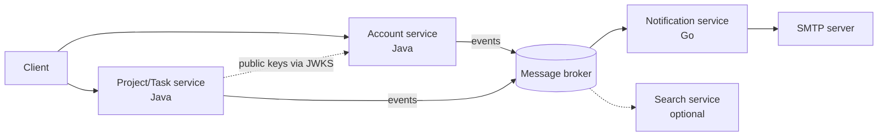

# Microservice decomposition plan

Status: **plan only, nothing implemented.** Agreed on 2026-11-10. The backend is still one Spring Boot application with two modules, `identity` and `tenancy`, sharing one PostgreSQL database.

This is a learning project. The goal is to move gradually from a modular monolith to microservices, learning one or two new concepts per step. New features are built as separate services next to the monolith rather than rewriting it first (the *strangler* approach).

## 1. Starting point

The current application already has hexagonal modules, but `identity` and `tenancy` deliberately rely on **one database transaction** for three guarantees:

| Coupling | Where | What it guarantees |
| --- | --- | --- |
| `UserDisabledEvent` handled synchronously by tenancy | `tenancy.infrastructure.event.UserDisabledListener` | Disabling a user and removing their memberships commit or roll back together |
| Tenancy locks the `users` row (`FOR SHARE`) before the organization row | `tenancy.infrastructure.persistence.adapter.UserAccountLookupAdapter` | Lock order user → organization; a disabled user can never become an owner |
| Identity reads `memberships` directly | `identity.infrastructure.persistence.adapter.OrganizationOwnershipCheckAdapter` | An owner cannot be disabled |

There is also a foreign key `memberships.user_id → users`. Splitting identity and tenancy into separate services would lose all of these guarantees and replace them with sagas and temporarily inconsistent states. **They stay together** as one service.

Things that already help the split:

- Access JWTs are signed with RS256. Other services can verify them with the public key alone.
- Auth emails are already sent after commit, asynchronously and fire-and-forget (`AuthMailListener`), so email is the cleanest boundary in the codebase.

## 2. Business domain

The application had no business domain. The chosen domain is **task and project management** (Trello-like), built on the existing organization, membership and role model: projects belong to an organization, and tasks are worked on by its members. The detailed domain model is not designed yet.

## 3. Target services

| Service | Responsibility | Technology | Data owned |
| --- | --- | --- | --- |
| **Account** | Registration, login, sessions, refresh tokens, email verification, password reset, organizations, memberships, roles, system admins | Java / Spring (the current application) | `users`, sessions, tokens, `organizations`, `memberships` |
| **Project/Task** | Projects, tasks, assignment, comments, task permissions | Java / Spring, PostgreSQL | Its own database |
| **Notification** | Sending email; later realtime push (WebSocket or SSE) | **Go** | Its own state only (for example, processed message IDs) |
| **Search** (optional, later) | Full-text task search fed by events | OpenSearch | A read model rebuilt from events |



Rules:

- **One database per service.** A service never reads another service's tables. The direct table reads in section 1 are acceptable only because Account is a single service.
- **One second language only.** Go is used for Notification because it is small, I/O-bound and has few business rules, so learning the language costs little. The core domain stays in Java, where the existing structure can be reused.
- **PostgreSQL by default.** Another database is added only when there is a concrete reason. OpenSearch is the one planned exception, as a way to learn how to keep a read model in sync.

## 4. Cross-service contracts

Anything that crosses a service boundary must be language-neutral, because Java and Go services must understand each other. No shared Java library (such as the current `common` package) is used between services.

| Concern | Agreement |
| --- | --- |
| Authentication | Each service verifies the RS256 access JWT itself (`iss`, `aud`, `exp`). Account publishes its public keys through a JWKS endpoint instead of distributing PEM files. |
| Event format | JSON with a written schema (JSON Schema or AsyncAPI), or Protobuf/Avro. Each event has a stable, explicit type name. Spring's JSON message converters for Kafka and RabbitMQ add a `__TypeId__` header containing the Java class name by default. This must be disabled, otherwise a Go consumer either breaks or depends on Java class names. |
| HTTP errors | The current `ApiError` shape and `ApiErrorCodes` become a documented contract (OpenAPI), not shared code. |
| Tracing | OpenTelemetry with the W3C `traceparent` header, so one request can be followed across services written in different languages. |
| IDs | UUIDv7 everywhere. Each service generates the IDs of the data it owns. |

## 5. First step: Notification service in Go

Auth emails move out of the Account process:

```text
Today (one process):   service → Spring event (in memory) → AuthMailListener → SMTP
After the split:       Account (Java) → message broker (stored on disk) → Notification (Go) → SMTP
```

Communication is **asynchronous through a message broker** because sending an email does not need to block the request. If Notification is down, messages wait in the broker and Account is unaffected. The cost is that a message no longer lives only in memory: the broker stores it on disk so it is not lost.

New concepts in this step: message broker, asynchronous messaging, at-least-once delivery, idempotent consumers, and Go itself.

## 6. Open decisions

These are decided one at a time, in this order, before the related code is written.

### 6.1 The raw one-time token crosses the service boundary — pending

`EmailVerificationRequested` and `PasswordResetRequested` carry the **raw token** that goes into the email link. The current design keeps it in memory only and stores only its hash. Once Notification is a separate service, the raw token has to sit in the broker. Anyone who can read the broker while a token is still valid could reset another user's password (token lifetime 30 minutes) or verify an email address they do not own (token lifetime 24 hours).

| Option | Approach | Cost |
| --- | --- | --- |
| **A** | Keep the raw token in the message and reduce the risk: never log payloads, delete messages once processed, restrict who can read the broker. Tokens are already single-use and expire. | The "never persisted" decision is replaced; existing docs must be updated. |
| **B** | Encrypt the token for Notification only (JWE: Account encrypts with Notification's public key; only the Go service can decrypt). The broker sees only ciphertext. | Key management in both Java and Go; harder to debug; heavy for a first step. |
| **C** | Emails containing secrets stay in Account. Notification only receives events without secrets (task assigned, new comment, …). | Nothing can be moved yet; the Project/Task service has to be built first. |

Recommendation: **A**. The link already passes through SMTP servers, the mail provider and the user's mailbox, so it was never secret from infrastructure; the broker adds one place with comparable exposure, and the token loses its value once used or expired. B is a good advanced exercise later. C is the safest but postpones Notification.

### 6.2 Later decisions

| Decision | Options | Notes |
| --- | --- | --- |
| Outbox or direct publish | Write events to an outbox table in the same transaction and relay them, or publish after commit | Today a lost email is acceptable because the user can request a resend. Depends on 6.1, since an outbox stores the payload in the database. |
| Broker | RabbitMQ or Kafka | RabbitMQ deletes a message once it is acknowledged; Kafka keeps messages for a configured retention period. Interacts with option A of 6.1. |
| Session checks in other services | Verify the JWT only, accepting that logout, revocation and account disable take effect up to 5 minutes late (access token lifetime); or ask Account on every request; or check once in a gateway | Today `SessionJwtAuthenticationConverter` checks the session and user in the database on every request, which another service cannot do on its own. |
| How Project/Task learns a user's role in an organization | Call Account on each request; keep a local copy of memberships updated from events; put roles in the JWT | Roles change and a user belongs to many organizations, so roles in the JWT go stale and grow the token. Not discussed yet. |
| Client entry point | Clients call each service directly, or go through an API gateway | Not discussed yet. |
