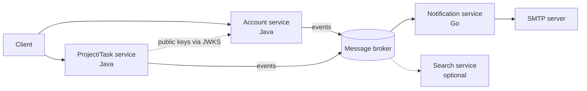

# Microservice decomposition plan

Status: plan agreed on 2026-11-10; **step 5 (Notification service in Go) implemented on 2026-11-16**, see 5.1 and 5.3; **JWKS endpoint implemented on 2026-11-17** and the authentication model for further services decided, see 4 and 7. The backend is still one Spring Boot application with two modules, `identity` and `tenancy`, sharing one PostgreSQL database; auth mails are now sent by the separate Go service through RabbitMQ.

This is a learning project. The goal is to move gradually from a modular monolith to microservices, learning one or two new concepts per step. New features are built as separate services next to the monolith rather than rewriting it first (the *strangler* approach).

## 1. Starting point

The current application already has hexagonal modules, but `identity` and `tenancy` deliberately rely on **one database transaction** for three guarantees:

| Coupling | Where | What it guarantees |
| --- | --- | --- |
| `UserDisabledEvent` handled synchronously by tenancy | `tenancy.infrastructure.event.UserDisabledListener` | Disabling a user and removing their memberships commit or roll back together |
| Tenancy locks the `users` row (`FOR SHARE`) before the organization row | `tenancy.infrastructure.persistence.adapter.UserAccountLookupAdapter` | Lock order user → organization; a disabled user can never become an owner |
| Identity reads `memberships` directly | `identity.infrastructure.persistence.adapter.OrganizationOwnershipCheckAdapter` | An owner cannot be disabled |

There is also a foreign key `memberships.user_id → users`. Splitting identity and tenancy into separate services would lose all of these guarantees and replace them with sagas and temporarily inconsistent states. **They stay together** as one service.

Things that already help the split:

- Access JWTs are signed with RS256. Other services can verify them with the public key alone.
- Auth emails are already sent after commit, asynchronously and fire-and-forget (`AuthMailListener`), so email is the cleanest boundary in the codebase.

## 2. Business domain

The application had no business domain. The chosen domain is **task and project management** (Trello-like), built on the existing organization, membership and role model: projects belong to an organization, and tasks are worked on by its members. The detailed domain model is not designed yet.

## 3. Target services

| Service | Responsibility | Technology | Data owned |
| --- | --- | --- | --- |
| **Account** | Registration, login, sessions, refresh tokens, email verification, password reset, organizations, memberships, roles, system admins | Java / Spring (the current application) | `users`, sessions, tokens, `organizations`, `memberships` |
| **Project/Task** | Projects, tasks, assignment, comments, task permissions | Java / Spring, PostgreSQL | Its own database |
| **Notification** | Sending email; later realtime push (WebSocket or SSE) | **Go** | Its own state only (for example, processed message IDs) |
| **Search** (optional, later) | Full-text task search fed by events | OpenSearch | A read model rebuilt from events |



Rules:

- **One database per service.** A service never reads another service's tables. The direct table reads in section 1 are acceptable only because Account is a single service.
- **One second language only.** Go is used for Notification because it is small, I/O-bound and has few business rules, so learning the language costs little. The core domain stays in Java, where the existing structure can be reused.
- **PostgreSQL by default.** Another database is added only when there is a concrete reason. OpenSearch is the one planned exception, as a way to learn how to keep a read model in sync.

## 4. Cross-service contracts

Anything that crosses a service boundary must be language-neutral, because Java and Go services must understand each other. No shared Java library (such as the current `common` package) is used between services.

| Concern | Agreement |
| --- | --- |
| Authentication | Each service verifies the RS256 access JWT itself (`iss`, `aud`, `exp`). Account publishes its public keys through a JWKS endpoint instead of distributing PEM files. **Implemented (2026-11-17):** `GET /.well-known/jwks.json`, public, cacheable for 5 minutes. The key pair is held as one JWK whose `kid` is the RFC 7638 thumbprint of the public key; every token header carries that `kid`, and Account verifies its own tokens from the same set, selected by `kid`, exactly as a remote consumer would. Rotation means adding the next key to the set and keeping the old one until its tokens have expired. A consumer in Spring sets `jwk-set-uri`; one in Go uses any JWKS client library. |
| Event format | JSON with a written schema (JSON Schema or AsyncAPI), or Protobuf/Avro. Each event has a stable, explicit type name. Spring's JSON message converters for Kafka and RabbitMQ add a `__TypeId__` header containing the Java class name by default. This must be disabled, otherwise a Go consumer either breaks or depends on Java class names. |
| HTTP errors | The current `ApiError` shape and `ApiErrorCodes` become a documented contract (OpenAPI), not shared code. |
| Tracing | OpenTelemetry with the W3C `traceparent` header, so one request can be followed across services written in different languages. |
| IDs | UUIDv7 everywhere. Each service generates the IDs of the data it owns. |

## 5. First step: Notification service in Go

Auth emails move out of the Account process:

```text
Monolith (one process):  service → Spring event (in memory) → AuthNotificationListener → compose → SMTP
After the split:         Account (Java) → RabbitMQ (stored on disk) → Notification (Go) → compose → SMTP
```

Communication is **asynchronous through a message broker** because sending an email does not need to block the request. If Notification is down, messages wait in the broker and Account is unaffected. The cost is that a message no longer lives only in memory: the broker stores it on disk so it is not lost.

New concepts in this step: message broker, asynchronous messaging, at-least-once delivery, idempotent consumers, and Go itself.

### 5.1 Account side — implemented (2026-11-11)

`app.mail.mode` selects the delivery path; the services and events are unchanged.

| Mode | What happens after commit | Where |
| --- | --- | --- |
| `log` (default) | Mail composed in Account and written to the log | `identity.infrastructure.mail` |
| `smtp` | Mail composed in Account and sent through `spring.mail.*` | `identity.infrastructure.mail` |
| `rabbit` | The event itself is published to RabbitMQ; Notification composes and sends the mail | `identity.infrastructure.messaging` |

The `AuthNotifier` application port has one adapter per path. `AuthNotificationListener` still runs after commit and asynchronously, and still swallows failures after logging them, so the publish-after-commit decision (6.2) is the existing behaviour, not new code. With mode `rabbit`, Account declares the exchange at startup and `app.mail.frontend-base-url` is no longer used by Account: the link belongs to the Notification service's configuration.

The local profile uses mode `rabbit`; `docker-compose.yaml` runs RabbitMQ 4 with the management UI at <http://localhost:15672> (guest/guest). Switch back to `smtp` to test without the Go service.

### 5.2 Message contract

Topic exchange **`onward.auth`** (durable; configurable through `app.messaging.exchange`). Each message is a JSON body with standard AMQP properties and **no custom headers**: no `__TypeId__`, so the consumer needs nothing from the Java code base.

| Routing key | `type` (in the body and the AMQP `type` property) |
| --- | --- |
| `auth.email-verification-requested` | `onward.auth.email-verification-requested.v1` |
| `auth.password-reset-requested` | `onward.auth.password-reset-requested.v1` |

Body, identical for both types today:

```json
{
  "messageId": "01a1cb46-40e6-798d-b0e4-0c25206cfb0a",
  "type": "onward.auth.email-verification-requested.v1",
  "occurredAt": "2026-11-11T15:42:21.414012331Z",
  "email": "alice@example.com",
  "token": "<raw one-time token>",
  "expiresAt": "2026-11-12T15:42:21.398937438Z"
}
```

- `messageId` is a UUIDv7, also set as the AMQP `message_id` property. It is the key for duplicate detection in the consumer.
- Instants are ISO-8601 in UTC. The `expiresAt` is what the mail should show ("valid for …"); the consumer must not compute it from `occurredAt`.
- `delivery_mode` is 2 (persistent), `content_type` is `application/json`.
- A change of fields is a new type version (`.v2`); existing versions are never altered.

The exchange is owned and declared by Account. The queue, its binding (`auth.#` or the two keys above), and the dead-letter queue are owned and declared by Notification. Messages published before that queue exists are dropped by the exchange, which is acceptable for mails that can be re-requested.

### 5.3 Notification side — implemented in Go (2026-11-16)

Repository `onward-notification`, one binary, configured only through environment variables (defaults match `docker-compose.yaml` on localhost; the `notification` service in that file overrides the hostnames). Build and run locally with `go run ./cmd/notification`, or `docker compose up -d --build` from `onward-be`.

Packages, with the import direction `main → rabbit, mail, dedup, config` and `rabbit, mail → event`:

| Package | Owns |
| --- | --- |
| `event` | The message contract: the `TokenMail` struct, the two type names, decoding and validation (all fields present, known type). Imports nothing from the other packages. |
| `rabbit` | Connection, queue and dead-letter declarations, the consume loop. Declares the `Handler` and `Dedup` interfaces it needs; implementations are injected from `main`. |
| `mail` | Templates (mirroring Account's former composer), SMTP delivery, and the handler that picks the template by type. |
| `dedup` | Redis adapter: `SET NX EX` to claim a `messageId`, `DEL` to release it. |
| `config` | Reads `RABBITMQ_URL`, `RABBITMQ_EXCHANGE`, `RABBITMQ_QUEUE`, `RABBITMQ_PREFETCH`, `SMTP_HOST`, `SMTP_PORT`, `MAIL_FROM`, `FRONTEND_BASE_URL`, `REDIS_ADDR`, `DEDUP_TTL`. |

Broker objects declared by Notification: quorum queue `notification.auth-mail` bound to `onward.auth` with `auth.#`, argument `x-dead-letter-exchange` = `onward.auth.dlx`; fanout exchange `onward.auth.dlx`; quorum queue `notification.auth-mail.dlq` bound to it. Queue arguments are immutable on the broker: changing them means deleting the queue first (acceptable in development; production would use a policy instead).

What happens to one delivery, with prefetch 10 and manual acknowledgement:

| Outcome | Action | Reason |
| --- | --- | --- |
| Invalid JSON, missing field, unknown type | `nack` without requeue → dead-letter queue | Permanent; a person has to look at it. The `x-death` header records the origin. |
| `messageId` already claimed in Redis | `ack`, skip | Already handled (6.2: remember first, then send). |
| `expiresAt` in the past | `ack`, skip | Sending is useless and nobody needs to inspect it. |
| SMTP or Redis unreachable | release the claim, return, process exits with status 1 | Transient. The message stays unacknowledged and is redelivered after the restart (compose `restart: unless-stopped`). |
| Mail sent | `ack` | |

Shutdown: `SIGINT`/`SIGTERM` cancel a context that is checked only between messages; the message in flight runs on a context without that cancellation and a 30-second timeout, so it is finished and acknowledged before the process exits with status 0. Unacknowledged prefetched messages return to the queue when the connection closes. The `token` is never logged.

**Known gaps, deliberately left:** a permanent SMTP failure for one message (for example, a rejected address) is treated as transient and would restart the process repeatedly; the fix is a retry loop through the dead-letter queue with a TTL back to the main queue and a cap on the `x-death` count. The dead-letter queue has no TTL and no alerting. No reconnect logic: the process exits and is restarted.

## 6. Open decisions

These are decided one at a time, in this order, before the related code is written.

### 6.1 The raw one-time token crosses the service boundary — decided: A

Decision (2026-11-11): **option A**. The raw token travels in the message, with the mitigations listed below. The code comments in `EmailVerificationRequested` and `OneTimeTokenIssuer` that say the raw token is never persisted are updated when the Notification split is implemented.

`EmailVerificationRequested` and `PasswordResetRequested` carry the **raw token** that goes into the email link. The current design keeps it in memory only and stores only its hash. Once Notification is a separate service, the raw token has to sit in the broker. Anyone who can read the broker while a token is still valid could reset another user's password (token lifetime 30 minutes) or verify an email address they do not own (token lifetime 24 hours).

| Option | Approach | Cost |
| --- | --- | --- |
| **A** | Keep the raw token in the message and reduce the risk: never log payloads, delete messages once processed, restrict who can read the broker. Tokens are already single-use and expire. | The "never persisted" decision is replaced; existing docs must be updated. |
| **B** | Encrypt the token for Notification only (JWE: Account encrypts with Notification's public key; only the Go service can decrypt). The broker sees only ciphertext. | Key management in both Java and Go; harder to debug; heavy for a first step. |
| **C** | Emails containing secrets stay in Account. Notification only receives events without secrets (task assigned, new comment, …). | Nothing can be moved yet; the Project/Task service has to be built first. |

Recommendation: **A**. The link already passes through SMTP servers, the mail provider and the user's mailbox, so it was never secret from infrastructure; the broker adds one place with comparable exposure, and the token loses its value once used or expired. B is a good advanced exercise later. C is the safest but postpones Notification.

### 6.2 Later decisions

| Decision | Options | Notes |
| --- | --- | --- |
| Message content — **decided (2026-11-11): the business event** | Publish the composed mail (`to`, `subject`, `body`), or the event (`email`, `token`, `expiresAt`) and let Notification compose it | With a composed mail, Notification is only an SMTP relay and every service would keep its own templates. Owning templates, languages and channels (mail today, push later) is what makes Notification a service. See 5.2 for the contract. |
| Outbox or direct publish — **decided (2026-11-11): publish after commit** | Account publishes the message after its transaction commits, as `AuthMailListener` does today. A crash or broker outage between commit and publish loses the email. | Accepted because the user can request a resend, and because an outbox would store the raw token in Account's database and backups, against the spirit of 6.1. An outbox is introduced later for events whose loss is a bug (for example, membership removal reaching the Project/Task service). The Go consumer must still tolerate duplicate messages. |
| Broker — **decided (2026-11-11): RabbitMQ** for the Notification step | RabbitMQ deletes a message once it is acknowledged, so the raw token (6.1) does not linger; sending an email is a command for one consumer, which is what a queue is for; fewer concepts to learn at once. | Kafka remains planned for later domain events that several consumers read and that need replay (Project/Task events feeding Notification, Search and audit). Running both brokers is acceptable. |
| Idempotency store — **decided (2026-11-15): Redis**, processed IDs kept 48 hours | Where Notification remembers processed `messageId`s: in memory (useless, duplicates arrive exactly after a restart); PostgreSQL table with a cleanup job; Redis key per ID with a TTL; SQLite file | Redis is the exception to "PostgreSQL by default" because the need is exactly what `SET NX EX` does: check, write and schedule the expiry in one atomic command, safe with several consumer instances. Losing this data only causes a duplicate mail, so Postgres durability buys nothing. Retention is derived from when a duplicate becomes harmless: a late copy is dropped anyway once `expiresAt` (at most 24 hours) has passed, so 24 hours suffice and 48 give slack. Redis runs in `docker-compose.yaml`; Notification reads `REDIS_ADDR` and `DEDUP_TTL`. |
| Order of "remember" and "send" — **decided (2026-11-15): remember first, then send** (at-most-once) | Record the ID before sending: a crash in between loses the mail. Send before recording: a crash in between sends it twice. | Same reasoning as the outbox decision: a lost mail can be re-requested, a duplicate confuses the user. The loss window is only a crash between the two steps; when SMTP merely fails, Notification deletes the ID again before exiting, so the redelivery is not treated as a duplicate. |
| Session checks in other services — **decided (2026-11-17): once, in an API gateway, against a denylist that Account maintains in Redis**; see section 7 | Verify the JWT only, accepting that logout, revocation and account disable take effect up to 5 minutes late (access token lifetime); or ask Account on every request; or check once in a gateway | Today `SessionJwtAuthenticationConverter` checks the session and user in the database on every request, which another service cannot do on its own. Asking Account on every request keeps that behaviour but makes Account a runtime dependency of every call, which defeats the split. |
| How Project/Task learns a user's role in an organization | Call Account on each request; keep a local copy of memberships updated from events; put roles in the JWT | Roles change and a user belongs to many organizations, so roles in the JWT go stale and grow the token. Not discussed yet. |
| Client entry point — **decided (2026-11-17): an API gateway** | Clients call each service directly, or go through an API gateway | Follows from the session-check decision: the gateway is where the session check runs once. |

## 7. Authentication for every service behind a gateway

Decided 2026-11-17. Authentication today has two layers, both inside Account: the signature and claims of the access token (needs only the public key), and a database check that the session is still active, the user is not disabled, the last activity is recorded and the system role is current (needs Account's `sessions` and `users` tables). A second service can repeat the first layer through JWKS but, by the one-database-per-service rule, never the second. Something has to take over that second layer.

| Option | What a second service does | Cost |
| --- | --- | --- |
| Verify the JWT only | First layer only; trusts the claims in the token | Logout, revocation and disable take effect up to the access-token lifetime late (5 minutes); idle timeout cannot be enforced. |
| Ask Account on every request | Calls an introspection endpoint of Account | Keeps today's semantics, but every service depends on Account's latency and availability for every call. |
| Check once in a gateway | A gateway in front of all services does the second layer; services behind it only verify the signature | One more component; the gateway still needs session state from somewhere. |

Chosen: the gateway, with the session state supplied as a **denylist in Redis owned by Account**:

- Account writes to Redis when a session ends or is revoked (key by session id) and when a user is disabled (key by user id), with a TTL equal to the access-token lifetime, since after that the token is invalid anyway.
- The gateway verifies the token through JWKS, then checks that neither the session id nor the subject is denied. A valid request never touches Account.
- Idle timeout and last activity move to the gateway, which writes the last activity to Redis, because only the gateway sees every request.
- Services behind the gateway still verify the token signature and claims themselves through JWKS. It is cheap and means a service called directly, bypassing the gateway, does not accept forged tokens. Only the session check is skipped there.

Why this over the alternatives: the direct-call option gives up "logout takes effect immediately", which the current design deliberately provides; the introspection option keeps Account on the hot path of every request. The denylist keeps the guarantee and keeps Account off the hot path. Two processes share one Redis, which bends "one database per service"; it is accepted because Redis here is a cache of decisions whose source of truth stays in Account's PostgreSQL, and losing it only means a revoked token is honoured for at most 5 minutes, the same as the first option.

### 7.1 Gateway skeleton — implemented (2026-11-18)

Technology decided 2026-11-18: **Spring Cloud Gateway (WebFlux)**, Spring Cloud 2025.1.x on Boot 4.1. Considered: the Server MVC variant (same programming model as Account, fewer features and examples), a hand-written Go reverse proxy (small and instructive, but it teaches writing a proxy rather than using a gateway, and mixes proxy bugs with design mistakes while the design is still moving), and an off-the-shelf product such as Kong, Traefik or Envoy (the denylist check would need a plugin in yet another ecosystem). The WebFlux variant is chosen because the only custom logic is the denylist check, a filter of a few dozen lines, and it brings a Redis rate limiter that can later replace `PublicAuthRateLimitFilter`. Rewriting the gateway in Go once its behaviour is settled is a reasonable later exercise; it would replace this one, not run beside it.

Repository `onward-gateway`, port 8081 while Account stays on 8080; clients keep calling Account directly until the gateway does everything they need. What it does today:

- One route: `/api/**` and `/.well-known/**` to Account.
- Verifies the access token through Account's JWKS (`gateway.auth.jwk-set-uri`), with the same rules as Account: RS256, issuer, audience, expiry required, no clock skew. Keys are cached; an unknown `kid` triggers one refetch, which is how rotation is picked up.
- A configured list of public paths (`gateway.auth.public-paths`) needs no token: Account's public auth flows and the JWKS document. Everything else is rejected with 401 before reaching a service. Every service behind the gateway therefore has to declare its public routes to the gateway; that is inherent in the gateway doing authentication.
- 401 and 403 use Account's `ApiError` JSON shape, so clients see one error contract whoever rejects them.
- CSRF is not enforced by the gateway; it forwards cookies and headers, and Account keeps enforcing it on its cookie-backed endpoints. Verified end to end: register, verify, login, refresh (cookie), logout and `/api/auth/me` through the gateway behave as when called directly.

Not done yet, in order: the denylist and idle-timeout check in the gateway (7.3), and the decision whether Account drops its own per-request database check once it sits behind the gateway. Known consequence to handle before clients switch to the gateway: `PublicAuthRateLimitFilter` keys on the connection address and will see only the gateway's address, so either Account trusts `X-Forwarded-For` from the gateway only, or the rate limit moves to the gateway.

### 7.2 Denylist written by Account — implemented (2026-11-18)

Decided 2026-11-18: Account writes the denylist **directly into Redis** rather than publishing an event for the gateway to consume. The denylist exists to make a revocation visible immediately; putting a broker between the two would add latency and, with the gateway down, leave revocations waiting in a queue. The cost is a key format shared by two services, written down here as a contract like the message contract in 5.2. Also decided: the gateway is **fail-open** when Redis is unreachable. It then falls back to verifying the token alone, so a revoked token is honoured for at most the access-token lifetime, the same loss as the "verify the JWT only" option in section 7, while a fail-closed gateway would make Redis a single point of failure for every request.

Key contract, Redis database 0:

| Key | Value | Expiry | Meaning for the gateway |
| --- | --- | --- | --- |
| `denied:session:<sessionId>` | `1` | access-token lifetime (5 minutes) | Reject every token whose `sid` claim equals `<sessionId>`. |
| `denied:user:<userId>` | Unix time in seconds of the revocation | access-token lifetime (5 minutes) | Reject every token whose `sub` claim equals `<userId>` and whose `iat` is **not after** that instant. A session opened later carries a later `iat` and passes, so a user who resets their password can log in again at once. |

The expiry follows from the token lifetime: after it, every token issued before the revocation has expired on its own, so the entry has nothing left to block. Any service that changes the access-token lifetime must keep both in step.

Where Account writes, all inside the identity module:

| Trigger | Entry |
| --- | --- |
| Logout | session |
| Refresh-token reuse detected (the session is revoked as compromised) | session |
| Password reset (all sessions revoked) | user |
| Account disabled, by the user or by an admin (all sessions revoked) | user |

Mechanics: the service publishes an application event (`SessionRevoked`, `UserTokensRevoked`) inside the transaction that revokes in PostgreSQL; a listener runs **after commit** and calls the `SessionDenylist` port, whose Redis adapter issues one `SET ... EX`. After commit, so that a rolled-back revocation never blocks a live session; synchronous, unlike the mail listener, so the entry exists before the client receives the response. A failed write is logged and swallowed: the revocation is already durable in PostgreSQL, only the early rejection at the gateway is lost, for at most one token lifetime. Redis runs from `docker-compose.yaml`; Account reads `spring.data.redis.*` from the local profile with a 500 ms command timeout, so a hung Redis cannot hold a logout request.

Storage is bounded by traffic within the expiry window, not by time: the number of logouts, resets and disables in five minutes, at roughly a hundred bytes each. Account verifies its own tokens against the database as before; it does not read the denylist.
