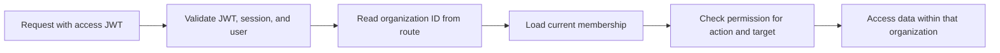

# Xác thực và phân quyền đa tenant đơn giản

Bản tiếng Anh (bản gốc): [../en/authentication-authorization.md](../en/authentication-authorization.md).

Trạng thái: các HTTP endpoint đăng ký và CSRF, rate limit cho đăng ký, service đăng ký và chính sách đầu vào, sinh UUIDv7, băm mật khẩu và lưu trữ user đã được triển khai. Các API đăng nhập, refresh, đăng xuất và quản lý tenant vẫn đang trong kế hoạch. Xem [hướng dẫn API đăng ký](registration-api.md) để biết cách dùng ở môi trường local.

Xác thực dự kiến dùng kết hợp access JWT, session do ứng dụng sở hữu và refresh token xoay vòng. [Mô hình domain](data-and-domain-model.md#authsession--one-login) của chúng đã được định nghĩa. CSRF cookie đã triển khai không đại diện cho một session đăng nhập; Spring Security không lưu trạng thái xác thực trong servlet `HttpSession`.

Xây dựng một backend cho phép người dùng đăng ký, đăng nhập, thuộc về nhiều tenant và thực hiện thao tác theo role của mình trong từng tenant. Ứng dụng chưa chọn lĩnh vực nghiệp vụ cụ thể. Tài liệu này dùng **organization** (tổ chức) làm tên gọi cho một tenant.

Project hiện tại dùng Java 21, Spring Boot, Spring Security, Spring Data JPA, Flyway và PostgreSQL.

## 1. Phiên bản đầu tiên

Triển khai:

- Đăng ký, đăng nhập, tra cứu user hiện tại và đăng xuất.
- Tạo organization và liệt kê các organization mà user thuộc về.
- Thêm user đã đăng ký vào organization, thay đổi role và gỡ membership.
- Cách ly tenant và ba role cố định: `OWNER`, `ADMIN` và `MEMBER`.
- Các test chứng minh cả trường hợp được phép và bị từ chối truy cập.

Dùng một backend và một database PostgreSQL với schema dùng chung. Access JWT sẽ định danh user và session đăng nhập do ứng dụng sở hữu; thông tin refresh trên trình duyệt sẽ dùng cookie. Curl hoặc Postman có thể giữ cookie và gửi header, nên frontend là tùy chọn.

Giữ lời mời qua email, xác minh email, khôi phục mật khẩu, MFA, đăng nhập mạng xã hội, role tùy chỉnh và bảng điều khiển audit làm các phần mở rộng tùy chọn. Phiên bản đầu tiên là một project học tập chạy local.

## 2. Định danh, tenant và role

| Khái niệm | Ý nghĩa | Ví dụ |
| --- | --- | --- |
| User | Tài khoản toàn cục có thể đăng nhập | Alice |
| Organization | Một tenant và ranh giới truy cập của nó | Organization A |
| Membership | Mối liên kết của một user với một organization | Alice thuộc Organization A |
| Role | Các permission được cấp thông qua membership đó | Alice là owner của nó |

**Xác thực** định danh user. **Phân quyền** kiểm tra xem user đó có được thực hiện một thao tác trong organization được yêu cầu hay không.

Alice có thể là `OWNER` ở Organization A và là `MEMBER` ở Organization B. Đăng nhập định danh Alice; nó không cho cô ấy quyền owner ở mọi nơi. Role thuộc về membership, không thuộc về bản ghi user.

## 3. Mô hình dữ liệu tối thiểu

Hiện có ba bảng ứng dụng. Các lớp domain `AuthSession` và `RefreshToken` đã được định nghĩa; bảng database và repository của chúng là bước tiếp theo.

| Entity | Trường | Ràng buộc |
| --- | --- | --- |
| `User` | `id`, `email`, `passwordHash`, `status`, `createdAt`, `updatedAt` | Email chuẩn hóa là duy nhất; status là `ACTIVE` hoặc `DISABLED` |
| `Organization` | `id`, `name`, `createdAt`, `updatedAt` | Tên không cấp quyền truy cập và không xác lập định danh |
| `Membership` | `id`, `organizationId`, `userId`, `role`, `status`, `createdAt`, `updatedAt` | `(organizationId, userId)` là duy nhất; status là `ACTIVE` hoặc `REMOVED` |

Dùng ID UUIDv7, timestamp UTC, foreign key tới users và organizations, và ràng buộc database cho role và status hợp lệ. UUID không thay thế cho việc kiểm tra permission.

[Đặc tả dữ liệu và mô hình domain](data-and-domain-model.md) định nghĩa các mô hình Java, phần lưu trữ đã triển khai và migration PostgreSQL ban đầu. Đăng ký đã được triển khai; các service đăng nhập/session và tenancy vẫn là công việc trong kế hoạch.

Với ứng dụng này, chuẩn hóa email bằng cách cắt khoảng trắng hai đầu và chuyển sang chữ thường theo quy tắc không phụ thuộc locale, sau đó giới hạn tối đa 254 code point Unicode. Tên organization được cắt khoảng trắng và giới hạn 200 code point Unicode. Không bỏ dấu chấm hay hậu tố `+` khỏi email. Không bao giờ biến đổi hay cắt ngắn âm thầm mật khẩu.

Một user bắt đầu với không membership nào. Tạo organization sẽ cấp cho user đó membership owner. Gỡ membership vẫn giữ lại dòng của nó; thêm lại người đó sẽ kích hoạt lại membership với role mới được cấp.

Permission là một ánh xạ cố định trong mã ứng dụng ở phiên bản này. Các bảng role và permission riêng là không cần thiết cho đến khi role tùy chỉnh trở thành yêu cầu.

## 4. Xác thực

### Đăng ký và mật khẩu

Điểm vào đã triển khai là `RegisterService.register(email, rawPassword)`, trả về UUID của user vừa tạo. `RegistrationPolicy` chuẩn hóa và kiểm tra email bằng `@Email` của Jakarta Bean Validation, kiểm tra giới hạn mật khẩu hiện tại 10–128 code point, và kiểm tra một blocklist local không phân biệt hoa thường. Băm mật khẩu nhận đầu vào gốc, bao gồm khoảng trắng và chữ hoa/thường. Blocklist tại `src/main/resources/security/common-passwords.txt` là một danh sách khởi đầu nhỏ cho project học tập này, không phải tập dữ liệu rò rỉ đầy đủ. Kiểm tra email chỉ xét cú pháp; nó không xác minh quyền sở hữu hộp thư.

Service dùng `IdGenerator`, `PasswordHasher`, `UserRepository` và một `Clock` UTC được inject. Tầng infrastructure cung cấp UUIDv7 thông qua Java UUID Generator và băm Argon2id có salt thông qua Spring Security. Hash lưu trữ mang định danh encoder `{argon2}` cùng các tham số Argon2 và salt. Chi phí được cấu hình là 19 MiB bộ nhớ, 2 vòng lặp và parallelism 1. [Java UUID Generator](https://github.com/cowtowncoder/java-uuid-generator)

Một lần tra cứu email ban đầu cho kết quả trùng lặp sớm. Thao tác chỉ-insert `UserRepository.create` dùng `persist` và `flush` trong một transaction ghi, với ràng buộc `uq_users_email` của database giải quyết các đăng ký đồng thời. Cả hai đường trùng lặp đều ném `EmailAlreadyExistsException`. Các lỗi database khác được lan truyền riêng. Băm mật khẩu chạy trước khi transaction ghi bắt đầu. Đăng ký không tạo membership lẫn session đã xác thực.

`AuthController` cung cấp `POST /api/auth/register`. Một request DTO riêng nhận thông tin đăng nhập và che chúng trong `toString()`; một response DTO riêng chỉ chứa `userId`. Bean Validation kiểm tra các trường bắt buộc, còn chính sách của service xử lý chuẩn hóa, cú pháp email và quy tắc mật khẩu. `GlobalExceptionHandler` chuyển đầu vào đăng ký không hợp lệ thành `400`, trùng lặp thành `409`, và lỗi không mong đợi thành `500` chung chung mà không trả về chi tiết exception hay giá trị bị từ chối.

Đăng ký nhận `{email, password}` dưới dạng chuỗi JSON và tạo một user đang hoạt động không có organization hay role. Các trường không xác định như `role`, `organizationId` hoặc `status`, khóa trùng lặp, giá trị JSON thừa ở cuối, và thông tin đăng nhập dạng số/boolean đều bị từ chối. Các content type khác trả về `415` sau khi các kiểm tra bảo mật đã qua.

Trả về `201` khi tạo thành công và `409 EMAIL_ALREADY_EXISTS` khi trùng email chuẩn hóa. Hợp đồng đơn giản này tiết lộ việc một địa chỉ đã được đăng ký hay chưa; một luồng đăng ký công khai sau này có thể dùng response chung chung và xác minh email. Không bao giờ ghi đè thông tin đăng nhập của user đã tồn tại.

Ở phiên bản này email chỉ là định danh đăng nhập. Không có xác minh, nó không phải bằng chứng sở hữu hộp thư. Gán membership bằng ID của user đã đăng ký; không tự động gia nhập organization dựa trên email hay domain email.

Chính sách mật khẩu hiện tại của project chấp nhận 10–128 code point Unicode, bao gồm khoảng trắng, không bắt buộc tổ hợp ký tự. Nó dùng một blocklist mật khẩu phổ biến local. Hash dùng `PasswordEncoder` của Spring Security, được cấu hình cho Argon2id với 19 MiB bộ nhớ, 2 vòng lặp và parallelism 1, với Bouncy Castle cung cấp phần triển khai cần thiết. Xem [OWASP Password Storage](https://cheatsheetseries.owasp.org/cheatsheets/Password_Storage_Cheat_Sheet.html) và [Spring password storage](https://docs.spring.io/spring-security/reference/features/authentication/password-storage.html).

### Đăng nhập, session, refresh và đăng xuất — trong kế hoạch

[Hướng dẫn triển khai xác thực](authentication-implementation.md) mô tả các luồng đăng nhập, request được bảo vệ, refresh và đăng xuất, ranh giới transaction và mã cấu hình gợi ý. Đó là hướng dẫn để user tự triển khai, không phải khẳng định rằng các tính năng này đã tồn tại. Dùng một record cấu hình infrastructure đã được kiểm tra cho các thiết lập timeout; một lớp `SessionPolicy` riêng là không cần thiết ở giai đoạn này.

1. Đăng nhập nhận `{email, password}` và kiểm tra thông tin đăng nhập cùng trạng thái tài khoản hiện tại.
2. Trả về cùng một `401 Invalid credentials` cho user không tồn tại, mật khẩu sai hoặc tài khoản bị vô hiệu hóa. Thực hiện một phép so sánh hash giả cho user không tồn tại để tránh chênh lệch thời gian rõ rệt.
3. Khi thành công, tạo một `AuthSession` mới, lưu hash của refresh token, phát hành access JWT có hiệu lực năm phút và đặt cookie refresh token. Các claim của access token gồm `sub`, `sid`, `iss`, `aud`, `iat` và `exp`.
4. Kiểm tra JWT và kiểm tra rằng session của nó thuộc về user của nó, đang hoạt động và chưa hết hạn. Kiểm tra trạng thái tài khoản hiện tại và nạp các membership tenant hiện tại để phân quyền; role vẫn gắn riêng với organization được yêu cầu.
5. Dùng 30 phút hết hạn do không hoạt động và thời gian sống tuyệt đối của session là 12 giờ. Hoạt động được chấp nhận không thể kéo dài hạn tuyệt đối.
6. Refresh tiêu thụ refresh token cũ và chèn token thay thế một cách nguyên tử. Dùng lại token đã tiêu thụ sẽ thu hồi session, và việc thu hồi đó phải commit trước khi trả về lỗi.
7. Đăng xuất thu hồi session hiện tại và làm hết hạn refresh cookie của nó. Các request được bảo vệ sau đó thất bại ở bước kiểm tra session ngay cả khi access JWT chưa hết hạn.

Dùng refresh cookie chỉ cho host với `HttpOnly`, `Secure` và `SameSite=Lax`. Access JWT được gửi trong header `Authorization: Bearer`. Sinh refresh token, ký và kiểm tra JWT, lưu trữ session và các endpoint này chưa được triển khai. Form login, HTTP Basic và endpoint logout mặc định của Spring đều bị tắt.

Giới hạn đăng nhập dự kiến: 5 lần thất bại trên mỗi định danh và 30 lần trên mỗi IP trong 15 phút, tính cả định danh không tồn tại. Giới hạn đã triển khai cho register, resend-verification và forgot-password: 10 request trên mỗi client trên mỗi path mỗi giờ, được gateway thực thi dưới dạng token bucket trong Redis (dùng chung cho mọi instance gateway), trả lời bằng `429 RATE_LIMITED` và `Retry-After`. Nó khóa theo địa chỉ kết nối tại gateway và bỏ qua các header forwarded-IP. Account không còn tự giới hạn các endpoint này nữa; xem `microservice-decomposition.md`, 7.4.

### CSRF

Bảo vệ CSRF được bật. `GET /api/auth/csrf` trả về `{headerName, token}` và đặt cookie `XSRF-TOKEN` chỉ cho host với `HttpOnly`, `SameSite=Lax` và `Path=/`. Cookie mặc định là `Secure`; profile `local` tường minh tắt `Secure` cho HTTP trên localhost. Dùng cookie CSRF repository của Spring và XOR request handler mặc định. Giữ cookie và gửi token từ response JSON trong header `X-CSRF-TOKEN` được trả về; bản thân giá trị cookie không phải là token response đã che. CSRF không hợp lệ hoặc thiếu trả về `403 CSRF_INVALID`. Các luồng đăng nhập và đăng xuất tương lai phải xoay vòng trạng thái CSRF và client phải lấy token mới sau đó.

Các response xác thực dùng `Cache-Control: no-store`. Bắt đầu với truy cập trình duyệt cùng origin. Một frontend tương lai ở origin khác cần một CORS allowlist tường minh kèm credentials; CORS không cấp permission tenant. Xem [Spring CSRF protection](https://docs.spring.io/spring-security/reference/servlet/exploits/csrf.html).

## 5. Role và vòng đời membership

Mọi permission dưới đây đều yêu cầu user đang hoạt động và membership đang hoạt động trong organization được yêu cầu.

Mỗi organization có đúng một `OWNER` đang hoạt động (mô hình một owner). Database bắt buộc "tối đa một" bằng partial unique index trên các membership owner đang hoạt động (migration V4). Ứng dụng giữ "ít nhất một" bằng cách tạo owner cùng lúc với organization và chỉ thay đổi người làm owner thông qua chuyển quyền sở hữu.

| Thao tác | OWNER | ADMIN | MEMBER |
| --- | --- | --- | --- |
| Đọc hồ sơ organization | Có | Có | Có |
| Cập nhật tên organization | Có | Có | Không |
| Đọc membership của chính mình | Có | Có | Có |
| Liệt kê membership của organization | Có | Có | Không |
| Thêm user đã đăng ký làm `MEMBER` | Có | Có | Không |
| Thêm user đã đăng ký làm `ADMIN` | Có | Không | Không |
| Đổi role của một membership giữa `ADMIN` và `MEMBER` | Có | Không | Không |
| Gỡ một `MEMBER` | Có | Có | Không |
| Gỡ một `ADMIN` | Có | Không | Không |
| Chuyển quyền sở hữu cho một thành viên đang hoạt động | Có | Không | Không |

Bất kỳ user đã xác thực và đang hoạt động nào cũng có thể tạo organization và liệt kê các organization của mình. Admin không thể tự thăng cấp, tạo admin khác, đổi role hay gỡ admin. Không role nào cấp quyền truy cập mọi tenant hay quyền kiểm soát tài khoản toàn cục của user khác. Membership của chính owner không bao giờ bị hạ cấp hay bị gỡ, kể cả bởi owner; quyền sở hữu chỉ chuyển đi thông qua chuyển quyền.

- **Tạo organization:** tạo organization và membership owner của người gọi trong một transaction. Xác định owner từ thông tin xác thực.
- **Thêm thành viên:** nhận `{userId, role}` cho một user đang hoạt động đã tồn tại; `role` là `ADMIN` hoặc `MEMBER`, không bao giờ là `OWNER`. Áp dụng ma trận role trước khi tạo hoặc kích hoạt lại membership. Membership đã đang hoạt động trả về `409 MEMBERSHIP_ALREADY_ACTIVE`; việc thêm không thể âm thầm đổi role của nó. Membership đã bị gỡ được kích hoạt lại với role mới được gán, giữ nguyên ID.
- **Đổi role:** `ADMIN` sang `MEMBER` hoặc ngược lại. `OWNER` làm role mới trả về `400`. Nhắm vào membership của owner trả về `409 OWNER_PROTECTED`; nhắm vào membership đã bị gỡ trả về `409 MEMBERSHIP_NOT_ACTIVE`. Đặt lại đúng role mà membership đang có là no-op `200`.
- **Gỡ thành viên:** đánh dấu `REMOVED`. Các request sau đó mất quyền truy cập organization này; đăng nhập và các membership khác vẫn hợp lệ. Gỡ một membership đã bị gỡ là `204` idempotent. Nhắm vào owner trả về `409 OWNER_PROTECTED`.
- **Chuyển quyền sở hữu:** owner chỉ định một membership đang hoạt động của cùng organization mà tài khoản user của nó đang hoạt động. Trong một transaction, owner hiện tại trở thành `ADMIN` trước rồi mục tiêu trở thành `OWNER` sau, để unique index luôn đúng sau mỗi câu lệnh. Chuyển cho chính mình là no-op `200`.
- Các request sau đó dùng role hiện tại, kể cả với session đã có từ trước.

Để học ở môi trường local, user mới lấy ID của mình từ `/api/auth/me` và chia sẻ với một owner hoặc admin. Biết ID không đồng nghĩa với được phép tạo thành viên. Không cần endpoint danh bạ user toàn cục. Chấp nhận lời mời có thể thay thế việc gán trực tiếp sau này.

Tuần tự hóa các thay đổi membership bằng cách lock dòng organization trong một transaction và thực hiện mọi kiểm tra sau khi lock: role của người thực hiện, role và status hiện tại của mục tiêu, và status của tài khoản nhận. Điều này ngăn, ví dụ, một admin gỡ một thành viên vừa nhận quyền sở hữu trong lúc request đó đang chờ. Các thao tác ghi membership được flush ngay lập tức để các câu lệnh tới database theo đúng thứ tự gọi.

Hạn chế được chấp nhận: với một owner duy nhất, tài khoản owner bị mất hoặc bị vô hiệu hóa khiến organization không còn ai có thể chuyển quyền sở hữu. Hệ thống production sẽ cần một thao tác hỗ trợ ngoài luồng; project học tập này thì không. Phiên bản này không có API xóa organization hay quản lý tài khoản toàn cục.

### Quản trị viên hệ thống và vòng đời tài khoản

**System role** là một thuộc tính của bản ghi user (`users.system_role`, migration V5), không liên quan tới role tenant trên membership. Giá trị duy nhất là `ADMIN`. Nó được đọc từ database ở mỗi request đã xác thực và được đưa vào Spring Security dưới dạng authority `ROLE_SYSTEM_ADMIN`, nên việc cấp hay thu hồi có hiệu lực ngay ở request tiếp theo mà không cần đăng nhập lại. Các route dưới `/api/admin/**` yêu cầu authority đó trong security filter chain: khác với role tenant, system role không phụ thuộc vào route, nên filter chain có đủ mọi thông tin cần thiết.

Quản trị viên đầu tiên không được seed bằng migration và không được chèn thủ công. Khi khởi động, nếu chưa có quản trị viên nào và `app.bootstrap.system-admin-email` trỏ tới một user đã đăng ký, user đó được thăng cấp (idempotent; không có gì xảy ra ở các lần khởi động sau). Các quản trị viên tiếp theo được thăng cấp thông qua admin API.

Vô hiệu hóa tài khoản, dù bởi chính user (với mật khẩu của họ) hay bởi quản trị viên:

- bị từ chối với `409 OWNERSHIP_MUST_BE_TRANSFERRED` khi user còn sở hữu bất kỳ organization nào, để hệ thống không bao giờ tự tạo ra organization không có owner;
- đánh dấu user là `DISABLED`, thu hồi toàn bộ session của họ và gỡ các membership còn lại (`ADMIN` hoặc `MEMBER`) trong mọi organization;
- là idempotent; quản trị viên không thể vô hiệu hóa tài khoản của chính mình qua admin API (`409 SELF_ACTION_NOT_ALLOWED`).

Kích hoạt lại chỉ khôi phục khả năng đăng nhập. Các membership đã bị gỡ vẫn ở trạng thái đã gỡ; gia nhập lại organization là quyết định của owner hoặc admin của organization đó.

Identity biết về quyền sở hữu thông qua một port do nó sở hữu (`OrganizationOwnershipCheck`) và thông báo cho tenancy thông qua `UserDisabledEvent` được phát trong cùng transaction; listener của tenancy gỡ các membership trước khi transaction đó commit, nên cả hai module thay đổi cùng nhau hoặc không thay đổi gì cả. Outbox chỉ cần thiết nếu bên tiêu thụ nằm ngoài process này.

**Thứ tự lock.** Vô hiệu hóa tài khoản lock dòng user để update. Thêm thành viên và chuyển quyền sở hữu lock dòng user mục tiêu ở chế độ share *trước khi* lock dòng organization, và phần dọn dẹp membership của việc vô hiệu hóa lock các organization theo thứ tự id sau user. Do đó mọi đường đi đều lấy lock theo thứ tự user → organization, loại trừ deadlock, và một lần chuyển quyền chạy đua với một lần vô hiệu hóa hoặc hoàn thành trước (khi đó vô hiệu hóa thất bại với `409`) hoặc chờ rồi thất bại vì user không còn hoạt động (`404`). Một user bị vô hiệu hóa không bao giờ có thể trở thành owner.

## 6. Cách ly tenant

Dùng các route như `/api/organizations/{organizationId}/memberships`. Route chọn tenant được yêu cầu; đó là đầu vào không đáng tin, không phải bằng chứng truy cập.

Với mỗi request tenant:

1. Xác thực user và kiểm tra trạng thái tài khoản.
2. Nạp membership đang hoạt động dùng cả `organizationId` và `userId` đã xác thực.
3. Kiểm tra xem role của người thực hiện có cho phép thao tác không.
4. Nạp mục tiêu dùng cả ID của nó và ID organization được yêu cầu.
5. Kiểm tra các hạn chế riêng theo mục tiêu, chẳng hạn admin có được gỡ role của thành viên đó không.
6. Với thao tác ghi, lặp lại các kiểm tra liên quan bên trong transaction.

Giới hạn phạm vi các truy vấn membership, ví dụ `findByOrganizationIdAndId(...)`. Danh sách và đếm phải dùng cùng bộ lọc organization. Một membership ID của B không được dùng được trong URL của A, kể cả khi người gọi thuộc cả hai.

Xác định organization từ route đã kiểm tra. Chỉ tạo thành viên mới nhận `userId` mục tiêu; chỉ tạo thành viên và đổi role có thẩm quyền mới nhận role. Từ chối các trường đầu vào không xác định hoặc do server kiểm soát. Mỗi route tenant mang ID organization của nó; session không có tenant đang hoạt động toàn cục có thể thay đổi.

Giữ kiểm tra permission trong `OrganizationAccessService` hoặc `AuthorizationPolicy`, do các application service thực thi. `SecurityFilterChain` xử lý xác thực và CSRF. Một kiểm tra `hasRole('OWNER')` toàn cục đơn lẻ không thể xác lập quyền truy cập tenant. Nếu dùng `@PreAuthorize`, bật method security một cách tường minh và tính đến hạn chế tự gọi qua proxy. Xem [OWASP Authorization](https://cheatsheetseries.owasp.org/cheatsheets/Authorization_Cheat_Sheet.html), [OWASP Multi-Tenant Security](https://cheatsheetseries.owasp.org/cheatsheets/Multi_Tenant_Security_Cheat_Sheet.html) và [Spring method security](https://docs.spring.io/spring-security/reference/servlet/authorization/method-security.html).

## 7. Hợp đồng API

Mọi endpoint dưới đây đều đã được triển khai. Chỉ `GET /api/auth/csrf` và các endpoint `POST` `register`, `login`, `refresh` và `logout` cho phép request ẩn danh; mọi route khác yêu cầu Bearer access token. Các method không an toàn công khai yêu cầu CSRF. Request mang Bearer token được miễn CSRF (mặc định của resource server trong Spring Security), nên một request không có token tới endpoint không an toàn được bảo vệ bị CSRF từ chối trước và trả về `403` thay vì `401`. Role dưới đây luôn có nghĩa là role trong organization được yêu cầu.

| Method và path | Quyền truy cập | Đầu vào / kết quả thành công |
| --- | --- | --- |
| `GET /api/auth/csrf` | Công khai | `200 {headerName, token}`; cookie khi cần |
| `POST /api/auth/register` | Công khai | `{email, password}` → `201 {userId}` |
| `POST /api/auth/login` | Công khai | `{email, password}` → `200 {accessToken, tokenType, expiresIn}` và refresh cookie |
| `POST /api/auth/refresh` | Refresh cookie hợp lệ, kèm CSRF | `200 {accessToken, tokenType, expiresIn}` và refresh cookie thay thế |
| `GET /api/auth/me` | Đã xác thực | `200 {userId, email}` |
| `POST /api/auth/logout` | Công khai, kèm CSRF | Vô hiệu hóa session hiện tại nếu có → `204` |
| `POST /api/auth/account/disable` | Đã xác thực | `{password}` → `204`; `401` khi sai mật khẩu, `409` khi còn sở hữu organization |
| `GET /api/admin/users/{userId}` | System admin | `200 {id, email, status, systemRole}` |
| `POST /api/admin/users/{userId}/disable` | System admin | → `200` user; `409` nếu mục tiêu sở hữu organization hoặc là chính người gọi |
| `POST /api/admin/users/{userId}/enable` | System admin | → `200` user |
| `POST /api/admin/users/{userId}/promote` | System admin | Cấp system role `ADMIN` → `200` user |
| `POST /api/organizations` | Đã xác thực | `{name}` → `201` organization và membership owner |
| `GET /api/organizations` | Đã xác thực | `200` các organization đang hoạt động và role của người gọi |
| `GET /api/organizations/{orgId}` | Bất kỳ thành viên đang hoạt động | `200` hồ sơ |
| `PATCH /api/organizations/{orgId}` | Owner hoặc admin | `{name}` → `200` hồ sơ |
| `GET /api/organizations/{orgId}/memberships/me` | Bất kỳ thành viên đang hoạt động | `200` membership của chính mình |
| `GET /api/organizations/{orgId}/memberships` | Owner hoặc admin | `200` danh sách membership |
| `POST /api/organizations/{orgId}/memberships` | Owner hoặc admin, áp dụng hạn chế theo role | `{userId, role}` → `201` membership được tạo hoặc kích hoạt lại |
| `PATCH /api/organizations/{orgId}/memberships/{id}/role` | Owner | `{role}` (`ADMIN` hoặc `MEMBER`) → `200` membership |
| `DELETE /api/organizations/{orgId}/memberships/{id}` | Owner, hoặc admin gỡ một member | Đánh dấu đã gỡ → `204`; idempotent |
| `POST /api/organizations/{orgId}/memberships/ownership-transfer` | Owner | `{membershipId}` → `200 {newOwner, previousOwner}` |

Response membership chứa `id`, `organizationId`, `userId`, `role` và `status`. Danh sách được phân trang: mặc định page 0 và size 20, size tối đa 100, thứ tự ổn định. Không bao giờ trả về hash mật khẩu hay chi tiết session. Danh sách thành viên bỏ qua địa chỉ email và membership ở các tenant khác.

| Status | Dùng khi |
| --- | --- |
| `400` | Đầu vào không hợp lệ, role không được hỗ trợ, hoặc trường không nhận dạng được |
| `401` | Thông tin đăng nhập không hợp lệ hoặc thiếu/hết hạn xác thực |
| `403` | Thành viên tenant thiếu permission; cũng dùng khi thiếu/sai CSRF |
| `404` | Organization không truy cập được, tài nguyên nằm ngoài tenant được yêu cầu, hoặc user mục tiêu không khả dụng để tạo thành viên |
| `409` | Đăng ký trùng, membership đã đang hoạt động, membership của owner bị nhắm bởi đổi role hoặc gỡ, hoặc membership đã gỡ bị nhắm bởi đổi role hoặc chuyển quyền |
| `429` | Request bị giới hạn, kèm `Retry-After` |

Dùng lỗi nhất quán dạng `{code, message}`. Người không phải thành viên nhận cùng một `404` dù organization có tồn tại hay không. Sau khi xác lập membership, kiểm tra permission của thao tác trước khi thay đổi và giới hạn phạm vi tra cứu mục tiêu trong organization đó. Thiếu xác thực thường trả về `401`, nhưng việc từ chối CSRF có thể xảy ra trước và trả về `403`.

## 8. Test chấp nhận

Dùng organization A và B. Alice sở hữu A và là member của B; Bob là admin của A; Carol là member của A; Eve chỉ thuộc B.

| Kịch bản | Kết quả mong đợi |
| --- | --- |
| Đăng ký và đăng nhập | Mật khẩu được băm; request sau đó nhận ra user |
| Đăng ký trùng email chuẩn hóa | `409`; mật khẩu gốc không đổi |
| User không tồn tại, sai mật khẩu, hoặc user bị vô hiệu hóa đăng nhập | Cùng một dạng response `401` |
| Đăng nhập thành công | Tạo session mới do ứng dụng sở hữu và phát hành token |
| Request không an toàn thiếu CSRF hợp lệ | `403`; không có thay đổi |
| Đăng xuất hoặc đến hạn session | Request được bảo vệ sau đó trả về `401` |
| Tạo organization | Người gọi nhận membership owner một cách nguyên tử |
| Alice cố quản lý thành viên của B | `403`; role của cô ấy ở A không áp dụng |
| Eve yêu cầu A | `404`; không rò rỉ thông tin tenant |
| Dùng membership ID của B trong route của A | `404`; không đọc hay thay đổi |
| Bob thêm hoặc gỡ một thành viên thường | Được phép |
| Bob thêm admin, đổi role, hoặc gỡ admin | `403` |
| Bất kỳ ai, kể cả Alice, hạ cấp hoặc gỡ owner | `409`; quyền sở hữu chỉ thay đổi qua chuyển quyền |
| Đăng ký kèm role hoặc tenant ID tự cung cấp | `400`; không cấp đặc quyền |
| Liệt kê organization hoặc membership | Chỉ dữ liệu và số đếm được phép xuất hiện |
| Hạ cấp hoặc gỡ một thành viên đang có session | Request tiếp theo phản ánh membership hiện tại |
| Alice chuyển quyền sở hữu cho Carol | Carol trở thành `OWNER` và Alice trở thành `ADMIN` trong một transaction; Alice không còn chuyển quyền được nữa |
| Chuyển quyền cho membership đã gỡ hoặc tài khoản bị vô hiệu hóa | `409` hoặc `404`; owner không đổi |
| Chèn trực tiếp owner đang hoạt động thứ hai vào database | Bị partial unique index từ chối |
| Chuyển quyền sở hữu và admin gỡ cùng một thành viên đồng thời | Đúng một thao tác thành công; organization giữ đúng một owner đang hoạt động |
| Thăng cấp lên `ADMIN` và admin gỡ cùng một thành viên đồng thời | Kiểm tra được tuần tự hóa: thăng cấp thắng và gỡ trả về `403`, hoặc gỡ thắng và thăng cấp trả về `409` |
| Người không phải admin gọi `/api/admin/**` | `403`; không có token thì `401` |
| Quản trị viên vô hiệu hóa owner của một organization | `409`; owner phải chuyển quyền sở hữu trước |
| Quản trị viên vô hiệu hóa admin hoặc member của một organization | User `DISABLED`, session bị thu hồi, membership `REMOVED`; token cũ và đăng nhập mới trả về `401` |
| Thăng cấp user lên system admin | Request tiếp theo của họ đã mang authority admin |
| Chuyển quyền sở hữu cho một user và vô hiệu hóa user đó đồng thời | Đúng một thao tác thành công; không user bị vô hiệu hóa nào là owner đang hoạt động; không deadlock |

Dùng unit test cho policy, integration test Spring Security cho JWT/CSRF, và integration test PostgreSQL cho giới hạn phạm vi, ràng buộc và đồng thời. Các kịch bản trên đã được chạy thủ công trên PostgreSQL local, bao gồm cả các kịch bản đồng thời (20 vòng mỗi kịch bản); bao phủ bằng test tự động là bước tiếp theo.

## 9. Thứ tự triển khai

1. Đã hoàn thành: ba bảng ban đầu, service đăng ký và HTTP API, băm mật khẩu, endpoint CSRF và giới hạn đăng ký.
2. Đã hoàn thành: lưu trữ session/refresh token, đăng nhập kèm giới hạn, kiểm tra JWT/session và `/auth/me`, xoay vòng refresh và đăng xuất. Xem [hướng dẫn triển khai](authentication-implementation.md).
3. Đã hoàn thành: tạo, liệt kê, hồ sơ và đổi tên organization.
4. Đã hoàn thành: ma trận role, quản lý thành viên và mô hình một owner với chuyển quyền sở hữu (migration V4).
5. Đã hoàn thành: quản trị viên hệ thống với bootstrap khi khởi động, vô hiệu hóa/kích hoạt tài khoản và thứ tự lock user → organization (migration V5).
6. Hoãn lại: test tự động cho các kịch bản trên.

Phiên bản đầu tiên hoàn thành khi một user có thể đăng nhập, thuộc nhiều organization với các role khác nhau, và chỉ truy cập được các thao tác và dữ liệu tenant mà các membership hiện tại cho phép.
