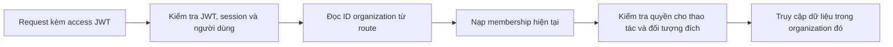

# Xác thực và phân quyền multi-tenant đơn giản

Trạng thái: các endpoint HTTP đăng ký và CSRF, rate limit cho đăng ký, service đăng ký cùng chính sách kiểm tra đầu vào, sinh UUIDv7, hash mật khẩu và lưu trữ người dùng đã được triển khai (implemented). Các API đăng nhập, refresh, đăng xuất và quản lý tenant vẫn ở trạng thái dự kiến (planned). Xem [hướng dẫn sử dụng API đăng ký](registration-api.md) để chạy thử cục bộ.

Xác thực dự kiến dùng kết hợp access JWT, session do ứng dụng tự quản lý và refresh token xoay vòng. [Mô hình domain](data-and-domain-model.md#authsession--one-login) của chúng đã được định nghĩa. Cookie CSRF đã triển khai không đại diện cho một login session; Spring Security không lưu trạng thái xác thực trong `HttpSession` của servlet.

Mục tiêu là xây dựng một backend cho phép người dùng đăng ký, đăng nhập, thuộc về nhiều tenant và thực hiện thao tác theo role của họ trong từng tenant. Ứng dụng chưa chọn một nghiệp vụ cụ thể. Tài liệu này dùng **organization** (tổ chức) làm tên gọi cho một tenant.

Dự án hiện tại dùng Java 21, Spring Boot, Spring Security, Spring Data JPA, Flyway và PostgreSQL.

## 1. Phiên bản đầu tiên

Triển khai:

- Đăng ký, đăng nhập, tra cứu người dùng hiện tại và đăng xuất.
- Tạo organization và liệt kê các organization mà một người dùng thuộc về.
- Thêm người dùng đã đăng ký vào organization, đổi role và gỡ membership.
- Cô lập tenant và ba role cố định: `OWNER`, `ADMIN` và `MEMBER`.
- Các test chứng minh cả trường hợp được phép lẫn bị từ chối truy cập.

Dùng một backend và một cơ sở dữ liệu PostgreSQL với schema dùng chung. Access JWT sẽ định danh người dùng và login session do ứng dụng quản lý; thông tin refresh trên trình duyệt sẽ dùng cookie. Curl hoặc Postman có thể giữ cookie và gửi header, nên frontend là tùy chọn.

Giữ lời mời qua email, xác minh email, khôi phục mật khẩu, MFA, đăng nhập qua mạng xã hội, role tùy chỉnh và dashboard audit làm các phần mở rộng tùy chọn. Phiên bản đầu tiên là một dự án học tập chạy cục bộ.

## 2. Định danh, tenant và role

| Khái niệm | Ý nghĩa | Ví dụ |
| --- | --- | --- |
| User | Một tài khoản toàn cục có thể đăng nhập | Alice |
| Organization | Một tenant và ranh giới truy cập của nó | Organization A |
| Membership | Mối liên kết giữa một người dùng và một organization | Alice thuộc Organization A |
| Role | Quyền hạn được cấp thông qua membership đó | Alice là owner của nó |

**Xác thực** (authentication) định danh người dùng. **Phân quyền** (authorization) kiểm tra người dùng đó có được phép thực hiện một thao tác trong organization được yêu cầu hay không.

Alice có thể là `OWNER` ở Organization A và là `MEMBER` ở Organization B. Đăng nhập chỉ định danh Alice; nó không cho cô ấy quyền owner ở mọi nơi. Role thuộc về membership, không thuộc về bản ghi người dùng.

## 3. Mô hình dữ liệu tối thiểu

Hiện có ba bảng ứng dụng. Các lớp domain `AuthSession` và `RefreshToken` đã được định nghĩa; bảng cơ sở dữ liệu và repository của chúng là bước tiếp theo.

| Entity | Trường | Ràng buộc |
| --- | --- | --- |
| `User` | `id`, `email`, `passwordHash`, `status`, `createdAt`, `updatedAt` | Email chuẩn hóa là duy nhất; status là `ACTIVE` hoặc `DISABLED` |
| `Organization` | `id`, `name`, `createdAt`, `updatedAt` | Tên không cấp quyền truy cập và không dùng để định danh |
| `Membership` | `id`, `organizationId`, `userId`, `role`, `status`, `createdAt`, `updatedAt` | Cặp `(organizationId, userId)` là duy nhất; status là `ACTIVE` hoặc `REMOVED` |

Dùng ID UUIDv7, timestamp theo UTC, khóa ngoại tới users và organizations, cùng các ràng buộc trong cơ sở dữ liệu cho role và status hợp lệ. UUID không thay thế việc kiểm tra quyền.

[Đặc tả dữ liệu và mô hình domain](data-and-domain-model.md) định nghĩa các model Java, phần lưu trữ đã triển khai và migration PostgreSQL ban đầu. Đăng ký đã được triển khai; service đăng nhập/session và tenancy vẫn là việc dự kiến.

Với ứng dụng này, chuẩn hóa email bằng cách cắt khoảng trắng hai đầu và chuyển về chữ thường theo quy tắc không phụ thuộc locale, sau đó áp giới hạn tối đa 254 code point Unicode. Tên organization được cắt khoảng trắng và giới hạn 200 code point Unicode. Không bỏ dấu chấm hay hậu tố `+` khỏi email. Không bao giờ biến đổi hay âm thầm cắt ngắn mật khẩu.

Người dùng khởi đầu không có membership nào. Tạo một organization sẽ cấp cho người dùng đó membership owner của organization ấy. Gỡ một membership vẫn giữ nguyên dòng dữ liệu; thêm lại người đó sẽ kích hoạt lại membership với role vừa được cấp.

Trong phiên bản này, quyền hạn là một ánh xạ cố định trong mã ứng dụng. Chưa cần các bảng role và permission riêng cho đến khi role tùy chỉnh trở thành yêu cầu.

## 4. Xác thực

### Đăng ký và mật khẩu

Điểm vào đã triển khai là `RegisterService.register(email, rawPassword)`, trả về UUID của người dùng vừa tạo. `RegistrationPolicy` chuẩn hóa và kiểm tra email bằng `@Email` của Jakarta Bean Validation, kiểm tra giới hạn độ dài mật khẩu hiện tại là 10–128 code point, và đối chiếu với một blocklist cục bộ không phân biệt hoa thường. Hash mật khẩu nhận đúng đầu vào gốc, bao gồm cả khoảng trắng và chữ hoa/thường. Blocklist tại `src/main/resources/security/common-passwords.txt` là một danh sách khởi đầu nhỏ cho dự án học tập này, không phải một kho dữ liệu rò rỉ đầy đủ. Kiểm tra email chỉ xét cú pháp; nó không xác minh quyền sở hữu hộp thư.

Service dùng `IdGenerator`, `PasswordHasher`, `UserRepository` và một `Clock` UTC được inject. Tầng hạ tầng cung cấp UUIDv7 thông qua Java UUID Generator và hash Argon2id có salt thông qua Spring Security. Hash lưu trữ mang định danh encoder `{argon2}` cùng các tham số Argon2 và salt. Chi phí được cấu hình là 19 MiB bộ nhớ, 2 vòng lặp và parallelism 1. [Java UUID Generator](https://github.com/cowtowncoder/java-uuid-generator)

Một lần tra cứu email ban đầu cho kết quả trùng lặp sớm. Thao tác chỉ-chèn `UserRepository.create` dùng `persist` và `flush` trong một transaction ghi, với ràng buộc `uq_users_email` của cơ sở dữ liệu giải quyết các đăng ký đồng thời. Cả hai đường trùng lặp đều ném `EmailAlreadyExistsException`. Các lỗi cơ sở dữ liệu khác được lan truyền riêng. Hash mật khẩu chạy trước khi transaction ghi bắt đầu. Đăng ký không tạo membership lẫn session đã xác thực.

`AuthController` công bố `POST /api/auth/register`. Một DTO request riêng nhận thông tin đăng nhập và che giấu chúng trong `toString()`; một DTO response riêng chỉ chứa `userId`. Bean Validation kiểm tra các trường bắt buộc, còn policy của service xử lý chuẩn hóa, cú pháp email và quy tắc mật khẩu. `GlobalExceptionHandler` chuyển đầu vào đăng ký không hợp lệ thành `400`, trùng lặp thành `409`, và lỗi không mong đợi thành `500` chung chung mà không trả về chi tiết exception hay giá trị bị từ chối.

Đăng ký nhận `{email, password}` dưới dạng chuỗi JSON và tạo một người dùng active không có organization hay role. Các trường không xác định như `role`, `organizationId` hoặc `status`, khóa trùng lặp, giá trị JSON thừa ở cuối, và thông tin đăng nhập dạng số/boolean đều bị từ chối. Các content type khác trả về `415` sau khi các kiểm tra bảo mật đã qua.

Trả về `201` khi tạo thành công và `409 EMAIL_ALREADY_EXISTS` khi email chuẩn hóa bị trùng. Hợp đồng đơn giản này để lộ việc một địa chỉ đã đăng ký hay chưa; một luồng đăng ký công khai sau này có thể dùng phản hồi chung chung và xác minh email. Không bao giờ ghi đè thông tin đăng nhập của người dùng đã tồn tại.

Trong phiên bản này, email chỉ là định danh đăng nhập. Khi chưa xác minh, nó không phải bằng chứng sở hữu hộp thư. Gán membership bằng ID của người dùng đã đăng ký; không tự động đưa vào organization dựa trên email hay tên miền email.

Chính sách mật khẩu hiện tại của dự án chấp nhận 10–128 code point Unicode, bao gồm cả khoảng trắng, không bắt buộc tổ hợp ký tự. Nó dùng một blocklist mật khẩu phổ biến cục bộ. Hash dùng `PasswordEncoder` của Spring Security, cấu hình cho Argon2id với 19 MiB bộ nhớ, 2 vòng lặp và parallelism 1, với Bouncy Castle cung cấp phần triển khai cần thiết. Xem [OWASP Password Storage](https://cheatsheetseries.owasp.org/cheatsheets/Password_Storage_Cheat_Sheet.html) và [Spring password storage](https://docs.spring.io/spring-security/reference/features/authentication/password-storage.html).

### Đăng nhập, session, refresh và đăng xuất — dự kiến

[Hướng dẫn triển khai xác thực](authentication-implementation.md) mô tả các luồng đăng nhập, request được bảo vệ, refresh và đăng xuất, ranh giới transaction và mã cấu hình gợi ý. Đó là hướng dẫn để người dùng tự triển khai, không phải khẳng định rằng các tính năng này đã tồn tại. Dùng một record cấu hình hạ tầng đã được kiểm tra hợp lệ cho các thiết lập timeout; chưa cần một lớp `SessionPolicy` riêng ở giai đoạn này.

1. Đăng nhập nhận `{email, password}` và kiểm tra thông tin đăng nhập cùng trạng thái tài khoản hiện tại.
2. Trả về cùng một `401 Invalid credentials` cho người dùng không tồn tại, sai mật khẩu hoặc tài khoản bị vô hiệu hóa. Thực hiện một phép so sánh hash giả cho người dùng không tồn tại để tránh chênh lệch thời gian rõ rệt.
3. Khi thành công, tạo một `AuthSession` mới, lưu hash của refresh token, phát hành access JWT có hạn năm phút và đặt cookie refresh token. Các claim của access token gồm `sub`, `sid`, `iss`, `aud`, `iat` và `exp`.
4. Kiểm tra JWT và xác nhận session của nó thuộc về đúng người dùng, đang active và chưa hết hạn. Kiểm tra trạng thái tài khoản hiện tại và nạp các membership tenant hiện tại để phân quyền; role vẫn gắn với organization được yêu cầu.
5. Dùng thời gian hết hạn do không hoạt động là 30 phút và vòng đời tuyệt đối của session là 12 giờ. Hoạt động được chấp nhận không thể kéo dài hạn tuyệt đối.
6. Refresh tiêu thụ refresh token cũ và chèn token thay thế một cách nguyên tử. Dùng lại một token đã tiêu thụ sẽ thu hồi session, và việc thu hồi đó phải commit trước khi trả về lỗi.
7. Đăng xuất thu hồi session hiện tại và làm hết hạn cookie refresh của nó. Các request được bảo vệ sau đó sẽ trượt kiểm tra session ngay cả khi access JWT chưa hết hạn.

Dùng cookie refresh chỉ theo host với `HttpOnly`, `Secure` và `SameSite=Lax`. Access JWT được gửi trong header `Authorization: Bearer`. Sinh refresh token, ký và kiểm tra JWT, lưu trữ session và các endpoint này chưa được triển khai. Form login, HTTP Basic và endpoint logout mặc định của Spring đều bị tắt.

Giới hạn đăng nhập dự kiến: 5 lần thất bại cho mỗi định danh và 30 lần cho mỗi IP trong 15 phút, tính cả các định danh không tồn tại. Giới hạn đã triển khai cho register, resend-verification và forgot-password: 10 request cho mỗi client cho mỗi path mỗi giờ, do gateway thực thi dưới dạng token bucket trong Redis (dùng chung cho mọi instance gateway), trả lời bằng `429 RATE_LIMITED` và `Retry-After`. Nó khóa theo địa chỉ kết nối tại gateway và bỏ qua các header forwarded-IP. Account không còn tự giới hạn các endpoint này nữa; xem `microservice-decomposition.md`, mục 7.4.

### CSRF

Bảo vệ CSRF được bật. `GET /api/auth/csrf` trả về `{headerName, token}` và đặt cookie `XSRF-TOKEN` chỉ theo host với `HttpOnly`, `SameSite=Lax` và `Path=/`. Cookie mặc định là `Secure`; profile `local` tường minh sẽ tắt `Secure` cho HTTP trên localhost. Dùng cookie CSRF repository của Spring và XOR request handler mặc định. Giữ cookie và gửi token từ phản hồi JSON trong header `X-CSRF-TOKEN` được trả về; bản thân giá trị cookie không phải là token phản hồi đã che. CSRF không hợp lệ hoặc thiếu trả về `403 CSRF_INVALID`. Các luồng đăng nhập và đăng xuất trong tương lai phải xoay vòng trạng thái CSRF và client phải lấy token mới sau đó.

Các phản hồi auth dùng `Cache-Control: no-store`. Bắt đầu với truy cập trình duyệt cùng origin. Một frontend tương lai ở origin khác cần một CORS allowlist tường minh kèm credentials; CORS không cấp quyền tenant. Xem [Spring CSRF protection](https://docs.spring.io/spring-security/reference/servlet/exploits/csrf.html).

## 5. Role và vòng đời membership

Mọi quyền dưới đây đều yêu cầu người dùng active và membership active trong organization được yêu cầu.

Mỗi organization có đúng một `OWNER` active (mô hình một owner). Cơ sở dữ liệu đảm bảo "nhiều nhất một" bằng một partial unique index trên các membership owner active (migration V4). Ứng dụng giữ "ít nhất một" bằng cách tạo owner cùng lúc với organization và chỉ thay đổi ai là owner thông qua chuyển giao quyền sở hữu.

| Thao tác | OWNER | ADMIN | MEMBER |
| --- | --- | --- | --- |
| Đọc hồ sơ organization | Có | Có | Có |
| Cập nhật tên organization | Có | Có | Không |
| Đọc membership của chính mình | Có | Có | Có |
| Liệt kê các membership của organization | Có | Có | Không |
| Thêm người dùng đã đăng ký làm `MEMBER` | Có | Có | Không |
| Thêm người dùng đã đăng ký làm `ADMIN` | Có | Không | Không |
| Đổi role của một membership giữa `ADMIN` và `MEMBER` | Có | Không | Không |
| Gỡ một `MEMBER` | Có | Có | Không |
| Gỡ một `ADMIN` | Có | Không | Không |
| Chuyển quyền sở hữu cho một member active | Có | Không | Không |

Bất kỳ người dùng active đã xác thực nào cũng có thể tạo organization và liệt kê các organization của chính mình. Admin không thể tự thăng cấp, tạo admin khác, đổi role hay gỡ admin. Không role nào cấp quyền truy cập mọi tenant hay quyền kiểm soát tài khoản toàn cục của người dùng khác. Membership của chính owner không bao giờ bị hạ cấp hay bị gỡ, kể cả bởi owner; quyền sở hữu chỉ dịch chuyển thông qua chuyển giao.

- **Tạo organization:** tạo organization và membership owner của người gọi trong một transaction. Suy ra owner từ thông tin xác thực.
- **Thêm member:** nhận `{userId, role}` cho một người dùng active đã tồn tại; `role` là `ADMIN` hoặc `MEMBER`, không bao giờ là `OWNER`. Áp dụng ma trận role trước khi tạo hoặc kích hoạt lại membership. Membership đã active trả về `409 MEMBERSHIP_ALREADY_ACTIVE`; thao tác thêm không thể âm thầm đổi role của nó. Membership đã bị gỡ được kích hoạt lại với role mới được gán, giữ nguyên ID.
- **Đổi role:** từ `ADMIN` sang `MEMBER` hoặc ngược lại. Role mới là `OWNER` trả về `400`. Nhắm vào membership của owner trả về `409 OWNER_PROTECTED`; nhắm vào membership đã bị gỡ trả về `409 MEMBERSHIP_NOT_ACTIVE`. Đặt đúng role mà membership đang có là một no-op `200`.
- **Gỡ member:** đánh dấu là `REMOVED`. Các request sau đó mất quyền truy cập organization này; đăng nhập và các membership khác vẫn hợp lệ. Gỡ một membership đã bị gỡ là một `204` idempotent. Nhắm vào owner trả về `409 OWNER_PROTECTED`.
- **Chuyển quyền sở hữu:** owner chỉ định một membership active của cùng organization mà tài khoản người dùng tương ứng đang active. Trong một transaction, owner hiện tại trở thành `ADMIN` trước rồi đích mới trở thành `OWNER` sau, nhờ đó unique index vẫn đúng sau mỗi câu lệnh. Chuyển cho chính mình là một no-op `200`.
- Các request sau đó dùng role hiện tại, kể cả với session có từ trước.

Để học tập cục bộ, người dùng mới lấy ID của mình từ `/api/auth/me` và chia sẻ với một owner hoặc admin. Biết một ID không đồng nghĩa với được phép tạo member. Không cần endpoint danh bạ người dùng toàn cục. Sau này có thể thay việc gán trực tiếp bằng chấp nhận lời mời.

Tuần tự hóa các thay đổi membership bằng cách lock dòng organization trong một transaction và thực hiện mọi kiểm tra sau khi lock: role của người thực hiện, role và status hiện tại của đối tượng đích, và status của tài khoản nhận. Điều này ngăn chặn, ví dụ, việc một admin gỡ một member vừa nhận quyền sở hữu trong lúc request đó đang chờ. Các thao tác ghi membership được flush ngay lập tức để các câu lệnh tới cơ sở dữ liệu theo đúng thứ tự gọi.

Hạn chế được chấp nhận: với mô hình một owner, tài khoản owner bị mất hoặc bị vô hiệu hóa sẽ khiến organization không còn ai có thể chuyển giao quyền sở hữu. Một hệ thống production sẽ cần một thao tác hỗ trợ ngoài luồng; dự án học tập này thì không. Phiên bản này không có API xóa organization hay quản lý tài khoản toàn cục.

### Quản trị viên hệ thống và vòng đời tài khoản

**System role** (role hệ thống) là một thuộc tính của bản ghi người dùng (`users.system_role`, migration V5), không liên quan đến các role tenant trên membership. Giá trị duy nhất là `ADMIN`. Nó được đọc từ cơ sở dữ liệu ở mỗi request đã xác thực và được đưa vào Spring Security dưới dạng authority `ROLE_SYSTEM_ADMIN`, nên việc cấp hay thu hồi có hiệu lực ngay ở request kế tiếp mà không cần đăng nhập lại. Các route dưới `/api/admin/**` yêu cầu authority đó trong security filter chain: khác với role tenant, system role không phụ thuộc vào route, nên filter chain có đủ mọi thông tin cần thiết.

Quản trị viên đầu tiên không được seed bằng migration và không được chèn thủ công. Lúc khởi động, nếu chưa có quản trị viên nào và `app.bootstrap.system-admin-email` trỏ tới một người dùng đã đăng ký, người dùng đó được thăng cấp (idempotent; không có gì xảy ra ở các lần khởi động sau). Các quản trị viên tiếp theo được thăng cấp thông qua API admin.

Vô hiệu hóa một tài khoản, dù do chính người dùng (kèm mật khẩu của họ) hay do quản trị viên:

- bị từ chối với `409 OWNERSHIP_MUST_BE_TRANSFERRED` khi người dùng còn sở hữu bất kỳ organization nào, nhờ đó hệ thống không bao giờ tự tạo ra một organization không có owner;
- đánh dấu người dùng là `DISABLED`, thu hồi toàn bộ session của họ và gỡ các membership còn lại (`ADMIN` hoặc `MEMBER`) ở mọi organization;
- là idempotent; quản trị viên không thể vô hiệu hóa tài khoản của chính mình qua API admin (`409 SELF_ACTION_NOT_ALLOWED`).

Kích hoạt lại chỉ khôi phục khả năng đăng nhập. Các membership đã gỡ vẫn ở trạng thái đã gỡ; việc tham gia lại một organization là quyết định của owner hoặc các admin của organization đó.

Identity biết về quyền sở hữu thông qua một port do nó sở hữu (`OrganizationOwnershipCheck`) và thông báo cho tenancy qua một `UserDisabledEvent` được phát hành trong cùng transaction; listener của tenancy gỡ các membership trước khi transaction đó commit, nên cả hai module cùng thay đổi hoặc không thay đổi gì cả. Chỉ cần đến outbox nếu bên tiêu thụ nằm ngoài process này.

**Thứ tự lock.** Vô hiệu hóa tài khoản lock dòng người dùng ở chế độ for update. Thêm member và chuyển quyền sở hữu lock dòng người dùng đích ở chế độ for share *trước khi* lock dòng organization, còn bước dọn membership của thao tác vô hiệu hóa lock các organization theo thứ tự id sau người dùng. Vì vậy mọi đường đi đều lấy lock theo thứ tự user → organization, loại trừ deadlock, và một thao tác chuyển giao chạy đua với một thao tác vô hiệu hóa hoặc hoàn thành trước (thao tác vô hiệu hóa khi đó thất bại với `409`) hoặc phải chờ rồi thất bại vì người dùng không còn active (`404`). Người dùng đã bị vô hiệu hóa không bao giờ có thể trở thành owner.

## 6. Cô lập tenant

Dùng các route như `/api/organizations/{organizationId}/memberships`. Route chọn tenant được yêu cầu; đó là đầu vào không đáng tin, không phải bằng chứng về quyền truy cập.

Với mọi request tới tenant:

1. Xác thực người dùng và kiểm tra trạng thái tài khoản.
2. Nạp membership active bằng cả `organizationId` lẫn `userId` đã xác thực.
3. Kiểm tra role của người thực hiện có cho phép thao tác không.
4. Nạp đối tượng đích bằng cả ID của nó lẫn ID organization được yêu cầu.
5. Kiểm tra các ràng buộc riêng cho đối tượng đích, chẳng hạn admin có được gỡ role của member đó không.
6. Với thao tác ghi, lặp lại các kiểm tra liên quan bên trong transaction.

Giới hạn phạm vi các truy vấn membership, ví dụ `findByOrganizationIdAndId(...)`. Danh sách và phép đếm phải dùng cùng bộ lọc organization. Một ID membership của B không được dùng được trong URL của A, kể cả khi người gọi thuộc cả hai.

Suy ra organization từ route đã được kiểm tra hợp lệ. Chỉ thao tác tạo member nhận `userId` đích; chỉ thao tác tạo member và đổi role đã được phân quyền mới nhận role. Từ chối các trường đầu vào không xác định hoặc do server kiểm soát. Mỗi route tenant mang ID organization của nó; session không có tenant active toàn cục có thể thay đổi.

Giữ các kiểm tra quyền trong một `OrganizationAccessService` hoặc `AuthorizationPolicy`, được các application service thực thi. `SecurityFilterChain` xử lý xác thực và CSRF. Một kiểm tra `hasRole('OWNER')` toàn cục không thể tự nó xác lập quyền truy cập tenant. Nếu dùng `@PreAuthorize`, hãy bật method security tường minh và lưu ý hạn chế của proxy khi tự gọi nội bộ. Xem [OWASP Authorization](https://cheatsheetseries.owasp.org/cheatsheets/Authorization_Cheat_Sheet.html), [OWASP Multi-Tenant Security](https://cheatsheetseries.owasp.org/cheatsheets/Multi_Tenant_Security_Cheat_Sheet.html) và [Spring method security](https://docs.spring.io/spring-security/reference/servlet/authorization/method-security.html).

## 7. Hợp đồng API

Tất cả các endpoint dưới đây đã được triển khai. Chỉ `GET /api/auth/csrf` và các endpoint `POST` `register`, `login`, `refresh` và `logout` cho phép request ẩn danh; mọi route khác yêu cầu Bearer access token. Các method không an toàn ở endpoint công khai yêu cầu CSRF. Request mang Bearer token được miễn CSRF (mặc định resource-server của Spring Security), nên một request không có token tới một endpoint không an toàn được bảo vệ sẽ bị CSRF từ chối trước và trả về `403` thay vì `401`. Role dưới đây luôn là role trong organization được yêu cầu.

| Method và path | Quyền truy cập | Đầu vào / kết quả thành công |
| --- | --- | --- |
| `GET /api/auth/csrf` | Công khai | `200 {headerName, token}`; cookie khi cần |
| `POST /api/auth/register` | Công khai | `{email, password}` → `201 {userId}` |
| `POST /api/auth/login` | Công khai | `{email, password}` → `200 {accessToken, tokenType, expiresIn}` và cookie refresh |
| `POST /api/auth/refresh` | Cookie refresh hợp lệ, kèm CSRF | `200 {accessToken, tokenType, expiresIn}` và cookie refresh thay thế |
| `GET /api/auth/me` | Đã xác thực | `200 {userId, email}` |
| `POST /api/auth/logout` | Công khai, kèm CSRF | Vô hiệu hóa session hiện tại nếu có → `204` |
| `POST /api/auth/account/disable` | Đã xác thực | `{password}` → `204`; `401` nếu sai mật khẩu, `409` khi còn sở hữu organization |
| `GET /api/admin/users/{userId}` | System admin | `200 {id, email, status, systemRole}` |
| `POST /api/admin/users/{userId}/disable` | System admin | → `200` user; `409` nếu đích sở hữu organization hoặc là chính người gọi |
| `POST /api/admin/users/{userId}/enable` | System admin | → `200` user |
| `POST /api/admin/users/{userId}/promote` | System admin | Cấp system role `ADMIN` → `200` user |
| `POST /api/organizations` | Đã xác thực | `{name}` → `201` organization và membership owner |
| `GET /api/organizations` | Đã xác thực | `200` các organization active và role của người gọi |
| `GET /api/organizations/{orgId}` | Bất kỳ member active nào | `200` hồ sơ |
| `PATCH /api/organizations/{orgId}` | Owner hoặc admin | `{name}` → `200` hồ sơ |
| `GET /api/organizations/{orgId}/memberships/me` | Bất kỳ member active nào | `200` membership của chính mình |
| `GET /api/organizations/{orgId}/memberships` | Owner hoặc admin | `200` danh sách membership |
| `POST /api/organizations/{orgId}/memberships` | Owner hoặc admin, có áp dụng giới hạn theo role | `{userId, role}` → `201` membership được tạo hoặc kích hoạt lại |
| `PATCH /api/organizations/{orgId}/memberships/{id}/role` | Owner | `{role}` (`ADMIN` hoặc `MEMBER`) → `200` membership |
| `DELETE /api/organizations/{orgId}/memberships/{id}` | Owner, hoặc admin gỡ một member | Đánh dấu đã gỡ → `204`; idempotent |
| `POST /api/organizations/{orgId}/memberships/ownership-transfer` | Owner | `{membershipId}` → `200 {newOwner, previousOwner}` |

Phản hồi membership chứa `id`, `organizationId`, `userId`, `role` và `status`. Danh sách được phân trang: mặc định page 0 và size 20, size tối đa 100, thứ tự ổn định. Không bao giờ trả về hash mật khẩu hay chi tiết session. Danh sách member không chứa địa chỉ email và membership ở các tenant khác.

| Trạng thái | Dùng khi |
| --- | --- |
| `400` | Đầu vào không hợp lệ, role không được hỗ trợ, hoặc có trường không nhận dạng được |
| `401` | Thông tin đăng nhập không hợp lệ hoặc thiếu/hết hạn xác thực |
| `403` | Member của tenant thiếu quyền; cũng dùng khi thiếu/sai CSRF |
| `404` | Organization không truy cập được, tài nguyên nằm ngoài tenant được yêu cầu, hoặc người dùng đích không khả dụng để tạo member |
| `409` | Đăng ký trùng, membership đã active, membership của owner bị nhắm bởi đổi role hoặc gỡ, hoặc membership đã gỡ bị nhắm bởi đổi role hoặc chuyển giao |
| `429` | Request bị giới hạn, kèm `Retry-After` |

Dùng lỗi `{code, message}` nhất quán. Người không phải member nhận cùng một `404` dù organization có tồn tại hay không. Sau khi xác lập membership, kiểm tra quyền của thao tác trước khi thay đổi dữ liệu và giới hạn việc tra cứu đối tượng đích trong organization đó. Thiếu xác thực thường trả về `401`, nhưng từ chối CSRF có thể xảy ra trước và trả về `403`.

## 8. Kiểm thử chấp nhận

Dùng hai organization A và B. Alice sở hữu A và là member của B; Bob là admin của A; Carol là member của A; Eve chỉ thuộc B.

| Kịch bản | Kết quả mong đợi |
| --- | --- |
| Đăng ký rồi đăng nhập | Mật khẩu được hash; request sau đó nhận diện được người dùng |
| Đăng ký trùng email chuẩn hóa | `409`; mật khẩu gốc không đổi |
| Người dùng không tồn tại, sai mật khẩu hoặc người dùng bị vô hiệu hóa đăng nhập | Cùng một dạng phản hồi `401` |
| Đăng nhập thành công | Tạo session mới do ứng dụng quản lý và phát hành token |
| Request không an toàn thiếu CSRF hợp lệ | `403`; không thay đổi dữ liệu |
| Đăng xuất hoặc session hết hạn | Request được bảo vệ sau đó trả về `401` |
| Tạo organization | Người gọi nhận membership owner một cách nguyên tử |
| Alice cố quản lý member của B | `403`; role của cô ấy ở A không áp dụng |
| Eve truy vấn A | `404`; không rò rỉ thông tin tenant |
| Dùng ID membership của B trong route của A | `404`; không đọc hay thay đổi được gì |
| Bob thêm hoặc gỡ một member thường | Được phép |
| Bob thêm admin, đổi role hoặc gỡ admin | `403` |
| Bất kỳ ai, kể cả Alice, hạ cấp hoặc gỡ owner | `409`; quyền sở hữu chỉ thay đổi qua chuyển giao |
| Đăng ký kèm role hoặc ID tenant | `400`; không cấp đặc quyền nào |
| Liệt kê organization hoặc membership | Chỉ dữ liệu và số đếm được phép mới xuất hiện |
| Hạ cấp hoặc gỡ member đang có session | Request kế tiếp phản ánh membership hiện tại |
| Alice chuyển quyền sở hữu cho Carol | Carol trở thành `OWNER` và Alice trở thành `ADMIN` trong một transaction; Alice không còn chuyển giao được nữa |
| Chuyển giao cho membership đã gỡ hoặc tài khoản bị vô hiệu hóa | `409` hoặc `404`; owner không đổi |
| Chèn trực tiếp một owner active thứ hai vào cơ sở dữ liệu | Bị partial unique index từ chối |
| Chuyển quyền sở hữu và admin gỡ cùng một member đồng thời | Đúng một thao tác thành công; organization giữ đúng một owner active |
| Thăng cấp lên `ADMIN` và admin gỡ cùng một member đồng thời | Kiểm tra được tuần tự hóa: thăng cấp thắng và thao tác gỡ trả về `403`, hoặc thao tác gỡ thắng và thăng cấp trả về `409` |
| Người không phải admin gọi `/api/admin/**` | `403`; không có token thì `401` |
| Quản trị viên vô hiệu hóa owner của một organization | `409`; owner phải chuyển giao quyền sở hữu trước |
| Quản trị viên vô hiệu hóa admin hoặc member của một organization | Người dùng `DISABLED`, session bị thu hồi, membership `REMOVED`; token cũ và đăng nhập mới trả về `401` |
| Thăng cấp một người dùng lên system admin | Request kế tiếp của họ đã mang authority admin |
| Chuyển quyền sở hữu cho một người dùng và vô hiệu hóa người dùng đó đồng thời | Đúng một thao tác thành công; không bao giờ có người dùng bị vô hiệu hóa là owner active; không deadlock |

Dùng unit test cho policy, integration test Spring Security cho JWT/CSRF, và integration test PostgreSQL cho giới hạn phạm vi, ràng buộc và xử lý đồng thời. Các kịch bản trên đã được chạy thủ công trên PostgreSQL cục bộ, bao gồm cả các kịch bản đồng thời (mỗi kịch bản 20 vòng); phủ test tự động là bước tiếp theo.

## 9. Thứ tự triển khai

1. Đã hoàn thành: ba bảng ban đầu, service đăng ký và API HTTP, hash mật khẩu, endpoint CSRF và giới hạn đăng ký.
2. Đã hoàn thành: lưu trữ session/refresh token, đăng nhập kèm giới hạn, kiểm tra JWT/session và `/auth/me`, xoay vòng refresh, và đăng xuất. Xem [hướng dẫn triển khai](authentication-implementation.md).
3. Đã hoàn thành: tạo, liệt kê, xem hồ sơ và đổi tên organization.
4. Đã hoàn thành: ma trận role, quản lý member, và mô hình một owner với chuyển giao quyền sở hữu (migration V4).
5. Đã hoàn thành: quản trị viên hệ thống với bootstrap lúc khởi động, vô hiệu hóa/kích hoạt tài khoản, và thứ tự lock user → organization (migration V5).
6. Hoãn lại: test tự động cho các kịch bản ở trên.

Phiên bản đầu tiên hoàn tất khi một người dùng có thể đăng nhập, thuộc về nhiều organization với các role khác nhau, và chỉ truy cập được các thao tác và dữ liệu tenant mà các membership hiện tại cho phép.
