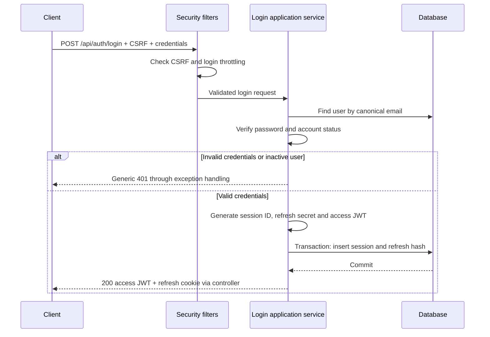
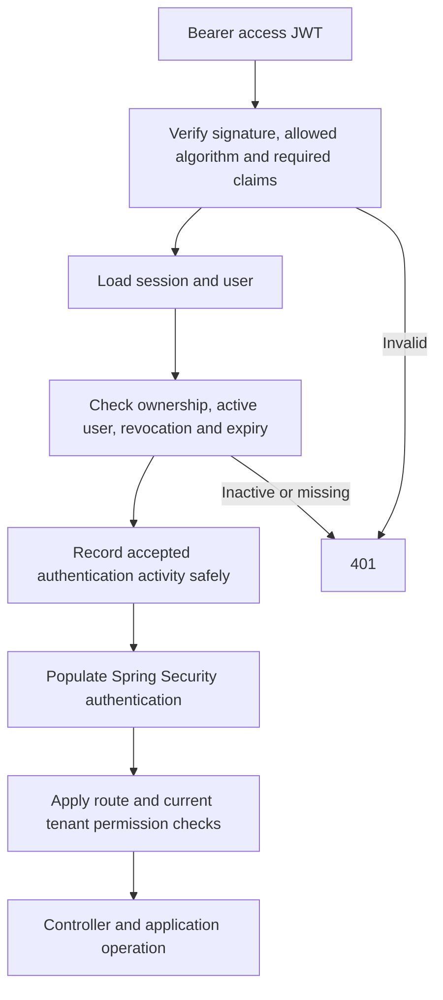

# Hướng dẫn triển khai xác thực

Bản tiếng Anh (bản gốc): [../en/authentication-implementation.md](../en/authentication-implementation.md).

Trạng thái: đề xuất triển khai để người dùng làm theo. Đăng ký và CSRF đã hoạt động trong code; đăng nhập, xác thực bằng JWT, refresh và đăng xuất chưa hoàn thiện. Các domain model `AuthSession` và `RefreshToken` đã tồn tại. Các interface repository đang được thêm vào không tự cung cấp phần lưu trữ. Hướng dẫn này không thêm code ứng dụng chạy được. Các test tự động vẫn được hoãn lại theo yêu cầu của người dùng.

[Đặc tả xác thực](authentication-authorization.md) định nghĩa API và các quy tắc tenant. Hướng dẫn này giải thích các quyết định triển khai và luồng xử lý request.

## 1. Giữ thiết kế nhỏ gọn

Sử dụng các domain model và lớp cấu hình hiện có. Chỉ thêm lớp khi chúng có trách nhiệm cụ thể, không phải chỉ để thêm một tầng nữa.

`SessionPolicy` từng được đề xuất để gom các giá trị timeout và kiểm tra chúng một lần. Nó không bắt buộc bởi Java, Spring, JWT hay domain model. Hiện tại, dùng một record `AuthProperties` duy nhất ở tầng infrastructure để bind và kiểm tra cấu hình. Không thêm một đối tượng policy thứ hai mang cùng các giá trị đó, cũng không thêm một helper kiểm tra dùng chung chỉ cho những trường này.

Cấu hình ở tầng infrastructure có thể truyền các giá trị `Duration` thông thường vào constructor của application service. Code ở tầng application và domain không cần import record của tầng infrastructure. Thêm tham số constructor khi service cần, thay vì xây dựng các abstraction mang tính phỏng đoán.

## 2. Code cấu hình đề xuất

File đề xuất: `identity/infrastructure/configuration/AuthProperties.java`. Code này chỉ mang tính tài liệu.

```java
package com.longdnh.onward.identity.infrastructure.configuration;

import java.time.Duration;

import org.hibernate.validator.constraints.time.DurationMin;
import org.springframework.boot.context.properties.ConfigurationProperties;
import org.springframework.validation.annotation.Validated;

import jakarta.validation.constraints.AssertTrue;
import jakarta.validation.constraints.NotNull;

@Validated
@ConfigurationProperties(prefix = "app.auth")
public record AuthProperties(
        @NotNull @DurationMin(inclusive = false)
        Duration accessTokenLifetime,

        @NotNull @DurationMin(inclusive = false)
        Duration idleTimeout,

        @NotNull @DurationMin(inclusive = false)
        Duration absoluteLifetime) {

    @AssertTrue(message = "Access-token lifetime and idle timeout must not exceed absolute lifetime")
    public boolean isLifetimeOrderValid() {
        if (accessTokenLifetime == null || idleTimeout == null || absoluteLifetime == null) {
            return true; // @NotNull reports missing values separately.
        }
        return accessTokenLifetime.compareTo(absoluteLifetime) <= 0
                && idleTimeout.compareTo(absoluteLifetime) <= 0;
    }
}
```

Mỗi phần làm gì:

- Record gom các thiết lập liên quan và sinh ra các accessor như `idleTimeout()`.
- `@ConfigurationProperties` bind các property dưới `app.auth`.
- `@Validated` bật kiểm tra trong lúc Spring Boot bind cấu hình.
- `@NotNull` từ chối các giá trị bị thiếu.
- `@DurationMin(inclusive = false)` của Hibernate Validator yêu cầu một khoảng thời gian lớn hơn hẳn giá trị tối thiểu mặc định là 0. Đây là annotation riêng của nhà cung cấp, không phải tính năng của ngôn ngữ Java hay một ràng buộc chuẩn của Jakarta cho duration.
- `@AssertTrue` kiểm tra getter trả về boolean. Phép so sánh vẫn cần code: các annotation kiểm tra số dương không thể so sánh các trường khác nhau với nhau. Trả về true khi có trường bị thiếu để tránh lỗi null-pointer; `@NotNull` vẫn sẽ từ chối chúng.

Project đã khai báo `spring-boot-starter-validation`. Không cần lớp validator tùy chỉnh cho đề xuất này. Lỗi cấu hình là thông báo chẩn đoán lúc khởi động, không phải thông điệp cho frontend.

Đăng ký record bằng cách thêm import và annotation sau vào `IdentityConfiguration` hiện có, giữ nguyên các method hiện tại của nó:

```java
import org.springframework.boot.context.properties.EnableConfigurationProperties;

@Configuration(proxyBeanMethods = false)
@EnableConfigurationProperties(AuthProperties.class)
public class IdentityConfiguration {
    // Keep the existing beans here.
}
```

Các mục đề xuất cho `application.properties`:

```properties
app.auth.access-token-lifetime=5m
app.auth.idle-timeout=30m
app.auth.absolute-lifetime=12h
```

Spring chuyển các giá trị này thành `Duration`; thiết lập không hợp lệ làm khởi động thất bại. Phần này không tính hạn của session hay phát hành token. Những thao tác đó thuộc về các luồng ở tầng application bên dưới. Xem [Spring Boot configuration binding and validation](https://docs.spring.io/spring-boot/reference/features/external-config.html#features.external-config.typesafe-configuration-properties.validation) và [Hibernate Validator DurationMin](https://docs.hibernate.org/stable/validator/api/org/hibernate/validator/constraints/time/DurationMin.html).

### Khi nào annotation được chạy

Các annotation ràng buộc chỉ là metadata. Java không tự động kiểm tra một đối tượng khi `new` được thực thi. Spring gọi kiểm tra tại các ranh giới đã cấu hình, chẳng hạn `@Valid @RequestBody` và bind cấu hình có kiểm tra; code Java thuần có thể gọi `Validator.validate(...)` một cách tường minh.

`@Positive` chuẩn phù hợp với các giá trị số như `long timeoutSeconds`; nó không phải ràng buộc khả chuyển cho `Duration`. Giữ `Duration` tránh mơ hồ về đơn vị và các phép chuyển đổi lặp lại. Cấu hình theo số giây với `@Positive` là một phương án thay thế, không phải một model bổ sung cần triển khai.

Giữ các kiểm tra domain hiện có trong `AuthSession` và `RefreshToken`. Chúng bảo vệ các đối tượng được tạo bên ngoài Spring và thực thi các chuyển trạng thái, chẳng hạn từ chối hồi sinh một session đã hết hạn hoặc dùng một token hai lần. Kiểm tra tại ranh giới và bất biến của domain phục vụ các mục đích khác nhau.

## 3. Thông tin xác thực và trạng thái

| Mục | Nằm ở đâu | Mục đích |
| --- | --- | --- |
| Access JWT | Trả về trong JSON; gửi trong `Authorization: Bearer` | Danh tính user/session đã ký, có hiệu lực tối đa năm phút |
| Session ứng dụng | Database | Quyền sở hữu phiên đăng nhập hiện tại, hoạt động, hết hạn, thu hồi |
| Refresh credential thô | Cookie HttpOnly của trình duyệt | Bí mật dùng để lấy token thay thế |
| Hash của refresh credential | Database | Tìm và xác minh trạng thái refresh mà không lưu bí mật thô |
| CSRF token | Cookie CSRF và luồng response/header hiện có | Bảo vệ các request không an toàn từ trình duyệt; không xác thực user |

Dùng UUIDv7 cho ID trong database. Sinh refresh secret một cách độc lập bằng bộ sinh ngẫu nhiên an toàn về mặt mật mã; ID của bản ghi không phải là credential. Lưu hash SHA-256 như model `RefreshToken` hiện có mong đợi. Mật khẩu tiếp tục dùng hash mật khẩu chậm, có salt hiện có.

Các claim của JWT: `sub` là ID của user, `sid` là ID của session, `iss` định danh issuer, `aud` định danh API này, còn `iat`/`exp` xác định thời điểm phát hành và hết hạn. Không đưa mật khẩu hay refresh credential vào JWT. Việc ký không mã hóa các claim. Vai trò trong tenant hiện tại đến từ kiểm tra membership, không phải từ một claim vai trò toàn cục.

`SessionCreationPolicy.STATELESS` liên quan đến cách Spring Security xử lý `HttpSession` của servlet. Nó không ngăn các dòng session do ứng dụng sở hữu. Thiết kế này chủ ý thực hiện kiểm tra database trên các request đã xác thực.

## 4. Luồng đăng nhập



1. Lấy trạng thái CSRF bằng endpoint hiện có trước khi gửi request đăng nhập không an toàn. Thêm đăng nhập vào các quy tắc cấp quyền công khai khi endpoint của nó được triển khai; `permitAll` không bỏ qua CSRF.
2. Áp dụng giới hạn đăng nhập trước khi thực hiện hash tốn kém. Đặc tả dự kiến năm lần thất bại trên mỗi định danh và ba mươi lần trên mỗi IP trong mười lăm phút, bao gồm cả các định danh không tồn tại.
3. Chuẩn hóa email nhất quán với đăng ký. Giữ nguyên mật khẩu. Không áp dụng quy tắc mật khẩu của đăng ký mới để từ chối các credential hiện có vốn hợp lệ.
4. Dùng `PasswordHasher.matches`. Với user không tồn tại, so sánh với một hash giả được tính sẵn có chi phí tương đương. User không tồn tại, sai mật khẩu và tài khoản bị vô hiệu hóa đều nhận cùng một lỗi phía client; điều này giảm các khác biệt dễ thấy giúp dò tài khoản, chứ không loại bỏ mọi khác biệt về thời gian.
5. Đặt `createdAt` và `lastSeenAt` từ clock UTC được inject. Đặt hạn tuyệt đối là `now + absoluteLifetime`. Đặt hạn ban đầu của refresh không muộn hơn hạn đó. Hết hạn do không hoạt động vẫn là một kiểm tra session riêng.
6. Sinh và ký access token trước khi trả về thành công. Đặt hạn của nó là giá trị sớm hơn giữa `now + accessTokenLifetime` và hạn tuyệt đối của session.
7. Lưu session và bản ghi refresh trong một transaction. Kiểm tra lại điều kiện của tài khoản bên trong transaction đó trước khi insert. Việc hash mật khẩu nên nằm ngoài transaction ghi database. Nếu lưu trữ thất bại, không trả về credential.
8. Sau khi commit, tầng web trả về access token và đặt cookie refresh host-only với `HttpOnly`, `Secure` trong môi trường HTTPS, và `SameSite=Lax`. Dùng `Cache-Control: no-store`. Xoay vòng trạng thái CSRF khi đăng nhập thành công và yêu cầu client lấy token mới.

Tên và path chính xác của cookie phải được dùng chung bởi phát hành, xoay vòng và xóa. Path của nó phải bao phủ cả refresh lẫn logout. Transaction bao quanh các thao tác ở tầng application, không bao riêng từng lần insert; hai lần gọi repository thành công tự chúng không đảm bảo tính nguyên tử.

## 5. Luồng request được bảo vệ



Kiểm tra chữ ký bằng các khóa tin cậy, issuer và audience đã cấu hình, kiểu của các claim bắt buộc, thời điểm hết hạn và thời điểm phát hành hợp lý. Không bao giờ coi các claim đã giải mã nhưng chưa xác minh là danh tính. `userId` của session phải bằng `sub` của JWT; `sid` của JWT chọn session. Kiểm tra trạng thái hiện tại của user và `AuthSession.isActiveAt(now, idleTimeout)`.

Với thiết kế ban đầu này, xác thực được chấp nhận được tính là hoạt động, kể cả khi kiểm tra quyền tenant sau đó từ chối thao tác. Cập nhật hoạt động phải đơn điệu tăng và có điều kiện là session vẫn còn hoạt động. Dùng lock hoặc cập nhật database có điều kiện; không bao giờ lưu nguyên một đối tượng cũ có thể xóa mất một thu hồi đang diễn ra đồng thời. Không gia hạn hạn tuyệt đối.

Chỉ thiết lập xác thực cho request sau khi các kiểm tra này thành công. Sự cố database là lỗi server, không phải bằng chứng mật khẩu sai hay lý do để chấp nhận riêng JWT. Cấp quyền tenant vẫn là một kiểm tra riêng ở tầng application dựa trên membership hiện tại và ID của organization từ route.

Logout ảnh hưởng đến các kiểm tra diễn ra sau khi thu hồi của nó được commit. Nó không thể rút lại một request đã qua xác thực; các thao tác thay đổi đặc biệt nhạy cảm có thể cần một kiểm tra nữa bên trong transaction của chính chúng.

## 6. Luồng refresh

1. Client gửi `POST /api/auth/refresh` kèm cookie refresh và CSRF token hợp lệ. Không bắt buộc có access JWT đã hết hạn; refresh credential xác thực thao tác này.
2. Hash bí mật được gửi lên và tìm bản ghi của nó. Giữ các bản ghi token đã dùng đủ lâu để phát hiện replay trong suốt vòng đời của session.
3. Trong một transaction, tuần tự hóa các thao tác trên session (ví dụ bằng cách lock dòng của nó), rồi đọc lại trạng thái token. Mọi đường refresh phải dùng cùng một thứ tự lock.
4. Kiểm tra session, tài khoản, liên kết sở hữu và hạn của token. Token đã dùng là một replay: thu hồi session, commit thu hồi, và chỉ sau đó mới trả về `401`. Ném một exception gây rollback bên trong transaction đó không được làm mất thu hồi.
5. Với token dùng được, sinh bí mật thay thế và bản ghi token mới. Đánh dấu token cũ đã dùng, insert token thay thế và cập nhật hoạt động session được chấp nhận một cách nguyên tử. Giới hạn hạn của token theo hạn tuyệt đối ban đầu của session.
6. Trả về access JWT mới và thay cookie refresh chỉ sau khi hoàn tất thành công. Không trả về refresh secret thô trong JSON hay log.

Hai lần refresh đồng thời không thể cùng thành công. Với chính sách replay nghiêm ngặt này, lần thứ hai có thể thu hồi session sau khi lần thứ nhất thành công. Frontend phải điều phối các request refresh; một response bị mất rồi dùng lại cookie cũ có thể buộc phải đăng nhập lại. Đây là đánh đổi có chủ ý của phiên bản đầu, không phải một race bị bỏ qua.

## 7. Luồng đăng xuất

1. Client gửi `POST /api/auth/logout` kèm CSRF và cookie refresh của nó. Cho phép route này mà không cần access JWT còn hạn, để logout vẫn hoạt động sau khi JWT hết hạn.
2. Hash refresh credential và tìm session liên quan, kể cả thông qua bản ghi token đã dùng còn được giữ lại. Không bao giờ tin ID session do client cung cấp như bằng chứng sở hữu.
3. Thu hồi session đó trong một transaction. Logout lặp lại giữ nguyên thu hồi ban đầu. Credential bị thiếu hoặc không xác định vẫn trả về cùng response `204`; lỗi database thực sự vẫn là lỗi server.
4. Sau khi xử lý thành công, cho hết hạn cookie refresh bằng tên và path ban đầu của nó. Xoay vòng/xóa trạng thái CSRF; client bỏ access JWT của mình và lấy trạng thái CSRF mới trước thao tác xác thực không an toàn tiếp theo.
5. Các request sau đó dùng access JWT cũ sẽ thất bại ở kiểm tra session, kể cả khi chữ ký và hạn của nó vẫn hợp lệ.

## 8. Các mốc triển khai

1. Triển khai record cấu hình có kiểm tra duy nhất ở trên và phần đăng ký của nó.
2. Thêm bảng session và refresh-token, mapping JPA và các adapter cho các hợp đồng repository. Định nghĩa các thao tác thay đổi an toàn khi đồng thời theo từng use case được xây dựng.
3. Thêm sinh refresh-secret và ký/kiểm tra JWT bằng các thư viện bảo mật đã được công nhận. Giữ khóa ngoài hệ thống quản lý mã nguồn.
4. Triển khai đăng nhập có transaction, giới hạn đăng nhập, DTO, hằng số exception/thông điệp và xử lý cookie.
5. Tích hợp xác thực JWT kết hợp session vào Spring Security và mở `/api/auth/me`. Giữ các response bảo mật CSRF và JSON hiện có.
6. Thêm xoay vòng refresh nguyên tử và thu hồi replay có commit, rồi đến logout.

Với mỗi mốc, cung cấp code đề xuất và giải thích để người dùng triển khai. Không đánh dấu endpoint là hoàn thành chỉ vì interface hoặc tài liệu đã tồn tại. Giữ các test mới ở trạng thái hoãn cho đến khi người dùng yêu cầu tiếp tục.
