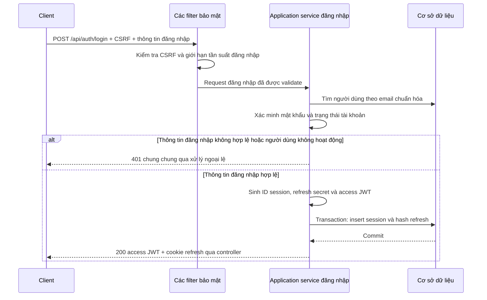
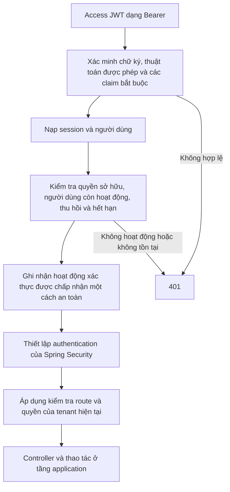

# Hướng dẫn triển khai xác thực

Trạng thái: đề xuất triển khai để người dùng làm theo. Đăng ký và CSRF đã hoạt động trong mã nguồn; đăng nhập, xác thực bằng JWT, refresh và đăng xuất chưa hoàn thiện. Các domain model `AuthSession` và `RefreshToken` đã tồn tại. Các interface repository đang được bổ sung không tự cung cấp khả năng lưu trữ (persistence). Hướng dẫn này không thêm mã ứng dụng chạy được. Các bài kiểm thử tự động vẫn được hoãn lại theo yêu cầu của người dùng.

[Đặc tả xác thực](authentication-authorization.md) định nghĩa API và các quy tắc về tenant. Hướng dẫn này giải thích các quyết định triển khai và luồng xử lý request.

## 1. Giữ thiết kế gọn nhẹ

Dùng các domain model và lớp cấu hình hiện có. Chỉ thêm lớp mới khi nó có một trách nhiệm cụ thể, chứ không phải chỉ để đưa thêm một tầng nữa vào.

`SessionPolicy` từng được đề xuất để gom các giá trị timeout lại và kiểm tra hợp lệ (validate) một lần. Java, Spring, JWT hay domain model đều không bắt buộc phải có nó. Hiện tại, hãy dùng một record `AuthProperties` duy nhất ở tầng infrastructure để bind và validate cấu hình. Không thêm một đối tượng policy thứ hai mang cùng các giá trị đó, cũng không thêm một helper validate dùng chung chỉ cho các trường này.

Cấu hình ở tầng infrastructure có thể truyền các giá trị `Duration` thông thường vào constructor của các application service. Mã ở tầng application và domain không cần import record của tầng infrastructure. Thêm tham số constructor khi service thực sự cần, thay vì dựng sẵn những abstraction mang tính phỏng đoán.

## 2. Mã cấu hình đề xuất

File đề xuất: `identity/infrastructure/configuration/AuthProperties.java`. Đoạn mã này chỉ mang tính tài liệu.

```java
package com.longdnh.onward.identity.infrastructure.configuration;

import java.time.Duration;

import org.hibernate.validator.constraints.time.DurationMin;
import org.springframework.boot.context.properties.ConfigurationProperties;
import org.springframework.validation.annotation.Validated;

import jakarta.validation.constraints.AssertTrue;
import jakarta.validation.constraints.NotNull;

@Validated
@ConfigurationProperties(prefix = "app.auth")
public record AuthProperties(
        @NotNull @DurationMin(inclusive = false)
        Duration accessTokenLifetime,

        @NotNull @DurationMin(inclusive = false)
        Duration idleTimeout,

        @NotNull @DurationMin(inclusive = false)
        Duration absoluteLifetime) {

    @AssertTrue(message = "Access-token lifetime and idle timeout must not exceed absolute lifetime")
    public boolean isLifetimeOrderValid() {
        if (accessTokenLifetime == null || idleTimeout == null || absoluteLifetime == null) {
            return true; // @NotNull reports missing values separately.
        }
        return accessTokenLifetime.compareTo(absoluteLifetime) <= 0
                && idleTimeout.compareTo(absoluteLifetime) <= 0;
    }
}
```

Vai trò của từng phần:

- Record gom các thiết lập liên quan lại với nhau và sinh ra các accessor như `idleTimeout()`.
- `@ConfigurationProperties` bind các property nằm dưới tiền tố `app.auth`.
- `@Validated` bật validation trong quá trình Spring Boot bind cấu hình.
- `@NotNull` từ chối các giá trị bị thiếu.
- `@DurationMin(inclusive = false)` của Hibernate Validator yêu cầu một duration lớn hơn hẳn giá trị tối thiểu mặc định là không. Đây là annotation riêng của provider, không phải tính năng của ngôn ngữ Java hay một ràng buộc duration chuẩn của Jakarta.
- `@AssertTrue` validate getter kiểu boolean. Phép so sánh vẫn cần viết bằng mã: các annotation kiểm tra tính dương không thể so sánh các trường khác nhau với nhau. Trả về true khi có trường bị thiếu giúp tránh lỗi null-pointer; `@NotNull` vẫn sẽ từ chối các trường đó.

Dự án đã khai báo `spring-boot-starter-validation`. Đề xuất này không cần lớp validator tùy chỉnh nào. Lỗi cấu hình là chẩn đoán lúc khởi động, không phải thông điệp hiển thị cho frontend.

Đăng ký record bằng cách thêm import và annotation sau vào `IdentityConfiguration` hiện có, giữ nguyên các method hiện tại của nó:

```java
import org.springframework.boot.context.properties.EnableConfigurationProperties;

@Configuration(proxyBeanMethods = false)
@EnableConfigurationProperties(AuthProperties.class)
public class IdentityConfiguration {
    // Keep the existing beans here.
}
```

Các mục đề xuất trong `application.properties`:

```properties
app.auth.access-token-lifetime=5m
app.auth.idle-timeout=30m
app.auth.absolute-lifetime=12h
```

Spring chuyển các giá trị này thành `Duration`; thiết lập không hợp lệ sẽ làm khởi động thất bại. Phần này không tính toán hạn của session hay phát hành token. Những thao tác đó thuộc về các luồng ở tầng application bên dưới. Xem [Spring Boot configuration binding and validation](https://docs.spring.io/spring-boot/reference/features/external-config.html#features.external-config.typesafe-configuration-properties.validation) và [Hibernate Validator DurationMin](https://docs.hibernate.org/stable/validator/api/org/hibernate/validator/constraints/time/DurationMin.html).

### Khi nào annotation được thực thi

Các annotation ràng buộc chỉ là metadata. Java không tự động validate một đối tượng khi `new` được thực thi. Spring gọi validation tại các ranh giới đã cấu hình, chẳng hạn `@Valid @RequestBody` và quá trình bind cấu hình có validate; mã Java thuần có thể gọi tường minh `Validator.validate(...)`.

`@Positive` chuẩn phù hợp với các giá trị số như `long timeoutSeconds`; nó không phải là ràng buộc khả chuyển (portable) cho `Duration`. Giữ `Duration` giúp tránh nhập nhằng về đơn vị và các phép chuyển đổi lặp đi lặp lại. Cấu hình bằng số giây kèm `@Positive` là một phương án thay thế, không phải một model bổ sung cần triển khai.

Giữ nguyên các kiểm tra ở tầng domain hiện có trong `AuthSession` và `RefreshToken`. Chúng bảo vệ các đối tượng được khởi tạo bên ngoài Spring và bắt buộc tuân thủ các chuyển đổi trạng thái, chẳng hạn từ chối hồi sinh một session đã hết hạn hoặc tiêu thụ một token hai lần. Validation tại ranh giới và bất biến (invariant) của domain phục vụ những mục đích khác nhau.

## 3. Thông tin xác thực và trạng thái

| Mục | Nơi lưu trữ | Mục đích |
| --- | --- | --- |
| Access JWT | Trả về trong JSON; gửi trong `Authorization: Bearer` | Định danh người dùng/session có chữ ký, hiệu lực tối đa năm phút |
| Session ứng dụng | Cơ sở dữ liệu | Quyền sở hữu đăng nhập hiện tại, hoạt động, hết hạn, thu hồi |
| Refresh credential thô | Cookie HttpOnly trên trình duyệt | Bí mật dùng để lấy token thay thế |
| Hash của refresh credential | Cơ sở dữ liệu | Tìm và xác minh trạng thái refresh mà không lưu bí mật thô |
| CSRF token | Luồng cookie CSRF và response/header hiện có | Bảo vệ các request không an toàn từ trình duyệt; không xác thực người dùng |

Dùng UUIDv7 cho ID trong cơ sở dữ liệu. Sinh refresh secret một cách độc lập bằng bộ sinh ngẫu nhiên an toàn về mặt mật mã; ID của bản ghi không phải là credential. Lưu hash SHA-256 như model `RefreshToken` hiện có mong đợi. Mật khẩu tiếp tục dùng hash mật khẩu chậm, có salt như hiện tại.

Các claim của JWT: `sub` là ID người dùng, `sid` là ID session, `iss` xác định bên phát hành, `aud` xác định API này, còn `iat`/`exp` xác định thời điểm phát hành và hết hạn. Không đưa mật khẩu hay refresh credential vào JWT. Ký không đồng nghĩa với mã hóa các claim. Role của tenant hiện tại đến từ kiểm tra membership, không phải từ một claim role toàn cục.

`SessionCreationPolicy.STATELESS` liên quan đến cách Spring Security xử lý `HttpSession` của servlet. Nó không ngăn các bản ghi session do ứng dụng sở hữu. Thiết kế này chủ đích thực hiện kiểm tra cơ sở dữ liệu trên các request đã xác thực.

## 4. Luồng đăng nhập



1. Lấy trạng thái CSRF bằng endpoint hiện có trước khi gửi request đăng nhập không an toàn. Thêm đăng nhập vào các quy tắc phân quyền công khai khi endpoint của nó được triển khai; `permitAll` không bỏ qua CSRF.
2. Áp dụng giới hạn đăng nhập trước bước hash tốn kém. Đặc tả dự kiến năm lần thất bại cho mỗi định danh và ba mươi lần cho mỗi IP trong mười lăm phút, tính cả các định danh không tồn tại.
3. Chuẩn hóa email nhất quán với lúc đăng ký. Giữ nguyên mật khẩu đúng như đã nhập. Không áp dụng quy tắc mật khẩu của đăng ký mới để từ chối những thông tin đăng nhập hiện có vốn hợp lệ.
4. Dùng `PasswordHasher.matches`. Với người dùng không tồn tại, so sánh với một hash giả đã tính sẵn có chi phí tương đương. Người dùng không tồn tại, sai mật khẩu và tài khoản bị vô hiệu hóa đều nhận cùng một lỗi phía client; điều này giảm những khác biệt dễ thấy giúp liệt kê tài khoản, chứ không loại bỏ mọi khác biệt về thời gian.
5. Đặt `createdAt` và `lastSeenAt` từ clock UTC được inject. Đặt hạn tuyệt đối là `now + absoluteLifetime`. Đặt hạn refresh ban đầu không muộn hơn hạn tuyệt đối đó. Hết hạn do không hoạt động (idle) vẫn là một kiểm tra session riêng.
6. Sinh và ký access token trước khi trả về thành công. Đặt hạn của nó là giá trị sớm hơn giữa `now + accessTokenLifetime` và hạn tuyệt đối của session.
7. Lưu session và bản ghi refresh trong cùng một transaction. Kiểm tra lại tính đủ điều kiện của tài khoản bên trong transaction đó trước khi insert. Bước hash mật khẩu nên nằm ngoài transaction ghi cơ sở dữ liệu. Nếu lưu trữ thất bại, không trả về thông tin xác thực.
8. Sau khi commit, tầng web trả về access token và đặt cookie refresh dạng host-only với `HttpOnly`, `Secure` trong môi trường HTTPS, và `SameSite=Lax`. Dùng `Cache-Control: no-store`. Xoay vòng (rotate) trạng thái CSRF khi đăng nhập thành công và để client lấy token mới.

Tên và path chính xác của cookie phải được dùng chung giữa phát hành, xoay vòng và xóa. Path của nó phải bao phủ cả refresh lẫn logout. Transaction phải bao quanh các thao tác ở tầng application, không phải tách riêng quanh từng lệnh insert; hai lời gọi repository thành công tự chúng không đảm bảo tính nguyên tử.

## 5. Luồng request được bảo vệ



Xác minh chữ ký bằng các khóa tin cậy, issuer và audience đã cấu hình, kiểu của các claim bắt buộc, thời điểm hết hạn và thời điểm phát hành hợp lý. Không bao giờ coi các claim đã giải mã nhưng chưa xác minh là định danh. `userId` của session phải bằng `sub` trong JWT; `sid` trong JWT chọn session. Kiểm tra trạng thái người dùng hiện tại và `AuthSession.isActiveAt(now, idleTimeout)`.

Với thiết kế ban đầu này, xác thực được chấp nhận được tính là hoạt động, ngay cả khi kiểm tra quyền tenant sau đó từ chối thao tác. Cập nhật hoạt động phải đơn điệu tăng và có điều kiện là session vẫn còn hoạt động. Dùng lock hoặc cập nhật có điều kiện trong cơ sở dữ liệu; không bao giờ lưu nguyên một đối tượng cũ có thể ghi đè lên một thu hồi diễn ra đồng thời. Không kéo dài hạn tuyệt đối.

Chỉ thiết lập authentication cho request sau khi các kiểm tra này thành công. Sự cố cơ sở dữ liệu là lỗi phía server, không phải bằng chứng mật khẩu sai, cũng không cho phép chấp nhận JWT đơn lẻ. Phân quyền theo tenant vẫn là một kiểm tra riêng ở tầng application, dựa trên membership hiện tại và ID tổ chức lấy từ route.

Logout ảnh hưởng đến các kiểm tra diễn ra sau khi thu hồi của nó được commit. Nó không thể rút lại một request đã vượt qua xác thực; những thao tác thay đổi dữ liệu đặc biệt nhạy cảm có thể cần một kiểm tra nữa bên trong transaction của chính chúng.

## 6. Luồng refresh

1. Client gửi `POST /api/auth/refresh` kèm cookie refresh và CSRF token hợp lệ. Không bắt buộc phải có access JWT đã hết hạn; refresh credential xác thực cho thao tác này.
2. Hash bí mật được gửi lên và tìm bản ghi của nó. Giữ các bản ghi token đã tiêu thụ đủ lâu để phát hiện replay trong suốt vòng đời của session.
3. Trong một transaction, tuần tự hóa các thao tác trên session (ví dụ bằng cách lock hàng của nó), rồi đọc lại trạng thái token. Mọi đường đi của refresh phải dùng cùng một thứ tự lock.
4. Kiểm tra session, tài khoản, liên kết sở hữu và hạn của token. Một token đã tiêu thụ là replay: thu hồi session, commit thu hồi, và chỉ sau đó mới trả về `401`. Việc ném một ngoại lệ gây rollback bên trong transaction đó không được làm mất thu hồi.
5. Với token còn dùng được, sinh bí mật thay thế và bản ghi token mới. Tiêu thụ token cũ, insert bản thay thế, và cập nhật hoạt động session được chấp nhận một cách nguyên tử. Giới hạn (clamp) hạn của token theo hạn tuyệt đối ban đầu của session.
6. Trả về access JWT mới và thay cookie refresh chỉ sau khi hoàn tất thành công. Không trả về refresh secret thô trong JSON hay log.

Hai lần refresh đồng thời không thể cùng thành công. Dưới chính sách chống replay nghiêm ngặt này, lần thứ hai có thể thu hồi session sau khi lần thứ nhất đã thành công. Frontend phải phối hợp các request refresh; một response bị mất rồi dùng lại cookie cũ có thể buộc phải đăng nhập lại. Đây là một trade-off có chủ đích cho phiên bản đầu, không phải một race condition để bỏ qua.

## 7. Luồng đăng xuất

1. Client gửi `POST /api/auth/logout` kèm CSRF và cookie refresh của nó. Cho phép route này mà không cần access JWT còn hạn, để logout vẫn hoạt động sau khi JWT hết hạn.
2. Hash refresh credential và tìm session liên kết, kể cả thông qua một bản ghi token đã tiêu thụ còn được giữ lại. Không bao giờ tin ID session do client cung cấp như bằng chứng sở hữu.
3. Thu hồi session đó trong một transaction. Logout lặp lại giữ nguyên lần thu hồi ban đầu. Credential bị thiếu hoặc không xác định vẫn cho cùng response `204`; lỗi cơ sở dữ liệu thực sự vẫn là lỗi phía server.
4. Sau khi xử lý thành công, làm hết hạn cookie refresh bằng đúng tên và path ban đầu của nó. Xoay vòng/xóa trạng thái CSRF; client hủy access JWT của mình và lấy trạng thái CSRF mới trước thao tác xác thực không an toàn tiếp theo.
5. Các request sau đó dùng access JWT cũ sẽ không qua được kiểm tra session, ngay cả khi chữ ký và hạn của nó vẫn còn hợp lệ.

## 8. Các mốc triển khai

1. Triển khai record cấu hình duy nhất có validate ở trên và việc đăng ký nó.
2. Thêm các bảng session và refresh-token, mapping JPA, và các adapter cho các contract repository. Định nghĩa các thao tác thay đổi dữ liệu an toàn khi đồng thời theo tiến độ xây dựng các use case dùng đến chúng.
3. Thêm sinh refresh secret và ký/xác minh JWT bằng các thư viện bảo mật đã được kiểm chứng. Giữ khóa (key material) ngoài hệ thống quản lý mã nguồn.
4. Triển khai đăng nhập có transaction, giới hạn tần suất đăng nhập, các DTO, hằng số ngoại lệ/thông điệp, và xử lý cookie.
5. Tích hợp xác thực JWT kết hợp session vào Spring Security và mở endpoint `/api/auth/me`. Giữ nguyên CSRF hiện có và các response bảo mật dạng JSON.
6. Thêm xoay vòng refresh nguyên tử và thu hồi replay đã commit, sau đó là logout.

Với mỗi mốc, cung cấp mã đề xuất và giải thích để người dùng triển khai. Không đánh dấu endpoint là hoàn thành chỉ vì interface hay tài liệu đã tồn tại. Tiếp tục hoãn các bài kiểm thử mới cho đến khi người dùng yêu cầu tiếp tục.
