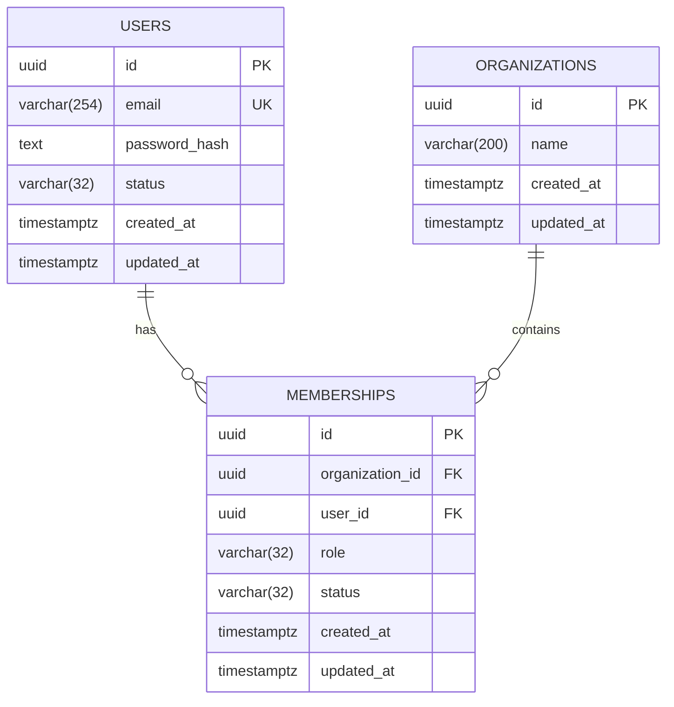

# Data model và domain model

Đây là nền tảng mô hình cho backend xác thực multi-tenant tổng quát được mô tả trong [thiết kế xác thực](authentication-authorization.md). Một user toàn cục kết nối với các organization thông qua các membership. Phần xác thực còn có một session đăng nhập và các refresh token được phát hành cho session đó.

Các domain class, JPA mapping và Flyway migration ban đầu đã được định nghĩa cho user, organization và membership. Persistence cho user, registration service cùng HTTP endpoint, hỗ trợ CSRF, giới hạn tần suất đăng ký, sinh UUIDv7 và hash mật khẩu đã được triển khai. `AuthSession` và `RefreshToken` hiện mới chỉ có domain model; persistence mapping và bảng cho chúng chưa được triển khai. Các application service còn lại, repository, HTTP endpoint và việc sinh refresh/access token là các bước triển khai riêng.

## 1. Domain model so với data model

| Tầng | Mục đích | Ví dụ |
| --- | --- | --- |
| Domain | Biểu diễn trạng thái hợp lệ và các chuyển đổi trạng thái | `User`, `AuthSession`, `RefreshToken`, `Organization`, `Membership`, `Role` |
| Persistence mapping | Chuyển trạng thái domain sang các cột trong cơ sở dữ liệu | `UserEntity`, `OrganizationEntity`, `MembershipEntity` |
| Database | Lưu bản ghi và bảo đảm tính toàn vẹn cấu trúc | `users`, `organizations`, `memberships` |

Các domain class không dùng annotation của Spring hay JPA. Chúng là immutable (bất biến) và chỉ dùng Lombok để sinh getter. Một thao tác như `rename` hay `changeRole` trả về một object mới, và application service phải lưu object đó.

Các kiểm tra dùng chung cho UUIDv7 và chuỗi không rỗng nằm trong `common.Validation`. Các static method của nó trả về giá trị đã được kiểm tra, giữ nguyên thông điệp lỗi theo từng trường và không thực hiện chuẩn hóa nào. Package common chỉ phụ thuộc vào JDK; các giới hạn độ dài và quy tắc vòng đời đặc thù của domain vẫn nằm trong model tương ứng.

Các thông điệp hướng tới client là các hằng `public static final String` trong `common.constants.ClientMessages`. `ApiErrorCodes` trong cùng package định nghĩa các mã phản hồi ổn định cho logic phía frontend. Các validation annotation, exception của đăng ký, HTTP handler và security filter đều dùng lại những hằng này. Thông điệp có chứa giới hạn độ dài dùng template được định dạng theo giới hạn hiện hành của policy và `Locale.ROOT`. Các thông tin chẩn đoán invariant (bất biến) nội bộ vẫn nằm trong model sở hữu chúng và không được đưa ra làm thông điệp cho client.

Các JPA class có các trường persistence khả biến và constructor không tham số ở mức protected, theo yêu cầu của [Jakarta Persistence](https://jakarta.ee/specifications/persistence/3.2/apidocs/jakarta.persistence/jakarta/persistence/Entity.html). Chúng mapping qua `fromDomain(...)` và `toDomain()`; chúng không phải là DTO cho HTTP response.



Sơ đồ này biểu diễn các quan hệ trong cơ sở dữ liệu. Service phải tạo organization cùng với owner đầu tiên của nó trong cùng một lần; chỉ riêng các foreign key thì vẫn cho phép một organization không có membership nào.

## 2. Trách nhiệm của các domain

### User — danh tính toàn cục

`identity.domain.User` chứa `id`, `email`, `passwordHash`, `UserStatus`, một `SystemRole` tùy chọn, `createdAt` và `updatedAt`.

- `User.create(id, email, passwordHash, now)` tạo một tài khoản đang hoạt động.
- Email được cắt khoảng trắng và chuyển về chữ thường bằng `Locale.ROOT`, giữ nguyên dấu chấm và hậu tố `+`. Giá trị chuẩn hóa được giới hạn ở 254 code point Unicode.
- Tham số mật khẩu đã được mã hóa sẵn. Việc hash và kiểm tra định dạng email diễn ra trước khi tạo model.
- `isActive()` phân biệt `ACTIVE` với `DISABLED`; `disable` và `enable` trả về trạng thái mới.
- `SystemRole` (`ADMIN` hoặc không có, cột `system_role` từ migration V5) là role ở phạm vi toàn hệ thống, không phải role của tenant; `promoteToSystemAdmin` cấp role này. Application service quyết định ai được phép gọi các chuyển đổi này.
- Role trong organization và danh sách membership không thuộc model danh tính này.

### AuthSession — một lần đăng nhập

`identity.domain.AuthSession` chứa `id`, `userId`, `createdAt`, `lastSeenAt`, `absoluteExpiresAt` và `revokedAt` có thể null. Đây là session do ứng dụng sở hữu, phục vụ thiết kế JWT, độc lập với `HttpSession` của servlet.

| Thao tác | Hành vi |
| --- | --- |
| `create(id, userId, now, absoluteExpiresAt)` | Tạo một session chưa bị thu hồi với mốc thời gian tạo và hoạt động đều đặt bằng `now` |
| `isActiveAt(now, idleTimeout)` | Kiểm tra trạng thái thu hồi, hết hạn tuyệt đối và không hoạt động; yêu cầu timeout dương |
| `recordActivity(now, idleTimeout)` | Trả về trạng thái mới với thời điểm hoạt động được cập nhật, chỉ khi session còn hoạt động |
| `revoke(now)` | Ghi nhận việc thu hồi; gọi lặp lại vẫn giữ thời điểm thu hồi đầu tiên |

Mọi ID phải là UUIDv7. Thời điểm hết hạn tuyệt đối phải sau thời điểm tạo. Thời điểm hoạt động phải bằng hoặc sau thời điểm tạo và phải nhỏ hơn hẳn thời điểm hết hạn tuyệt đối. Thời điểm thu hồi không thể đứng trước lần hoạt động cuối, nhưng một session đã hết hạn vẫn có thể bị thu hồi. Các thay đổi trạng thái không thể đưa thời điểm hoạt động lùi về trước, và một lần kiểm tra hoạt động với mốc thời gian trước `lastSeenAt` đã ghi nhận sẽ thất bại theo hướng an toàn (fail closed).

Việc hết hạn có hiệu lực đúng tại một trong hai mốc: `now >= absoluteExpiresAt` hoặc thời gian không hoạt động đã trôi qua `>= idleTimeout`. Hoạt động không bao giờ kéo dài mốc hết hạn tuyệt đối, và một session đã hết hạn hay đã bị thu hồi không thể được kích hoạt lại. Trạng thái được suy ra từ các mốc thời gian thay vì lưu dưới dạng cờ `EXPIRED`. Thời gian và chính sách idle-timeout do ứng dụng cung cấp; model không đọc đồng hồ cũng không cấu hình các khoảng thời gian.

### RefreshToken — trạng thái được lưu trữ của một credential

`identity.domain.RefreshToken` chứa `id`, `sessionId`, `tokenHash`, `createdAt`, `expiresAt`, `consumedAt` có thể null và `replacedByTokenId` có thể null.

| Thao tác | Hành vi |
| --- | --- |
| `create(id, sessionId, tokenHash, now, expiresAt)` | Tạo một bản ghi token chưa được sử dụng |
| `isConsumed()` | Nhận diện một token đã được dùng trước đó, kể cả sau khi nó hết hạn |
| `isUsableAt(now)` | Yêu cầu token chưa được sử dụng và `createdAt <= now < expiresAt` |
| `consume(replacementTokenId, now)` | Trả về trạng thái đã sử dụng, liên kết với token thay thế; từ chối việc dùng lại và token đã hết hạn |

Các ID, bao gồm cả ID thay thế tùy chọn, phải là UUIDv7. Thời điểm hết hạn phải sau thời điểm tạo. Thời điểm sử dụng và ID thay thế phải hoặc cùng có mặt hoặc cùng vắng mặt. Việc sử dụng phải diễn ra bằng hoặc sau thời điểm tạo và phải nhỏ hơn hẳn thời điểm hết hạn. Một token không thể tự chỉ định chính nó làm token thay thế.

`tokenHash` dùng digest SHA-256 đã thống nhất, mã hóa thành đúng 64 ký tự thập lục phân chữ thường (`TOKEN_HASH_LENGTH`). Constructor kiểm tra biểu diễn đó; nó không tính digest và cũng không chứng minh rằng đầu vào đến từ một secret được sinh an toàn. Tầng infrastructure sinh và hash credential thô. Domain chỉ lưu digest, và `toString()` bỏ qua giá trị này.

Các kiểm tra này chỉ liên quan tới một bản ghi token. Kiểm tra session/user, việc token thay thế phải thuộc cùng session, hết hạn bị giới hạn bởi mốc hết hạn tuyệt đối của session, và phát hiện credential bị dùng lại đều cần đến application service. Bản thân việc sử dụng token không tạo ra token thay thế cũng không thu hồi session.

### Organization — tenant

`tenancy.domain.Organization` chứa `id`, `name`, `createdAt` và `updatedAt`.

- `create(id, name, now)` tạo trạng thái của organization.
- `rename(name, changedAt)` trả về trạng thái đã đổi tên với cùng ID và cùng thời điểm tạo.
- Tên được cắt khoảng trắng, không được để trống và giới hạn ở 200 code point Unicode. Các organization khác nhau có thể dùng cùng một tên hiển thị.
- Việc khởi tạo owner và quyền đổi tên cần đến một transaction trong application service.

### Membership — quyền truy cập của user trong một tenant

`tenancy.domain.Membership` chứa `id`, `organizationId`, `userId`, `Role`, `MembershipStatus`, `createdAt` và `updatedAt`.

Các role gồm `OWNER`, `ADMIN` và `MEMBER`. Trạng thái là `ACTIVE` hoặc `REMOVED`.

| Thao tác | Hành vi |
| --- | --- |
| `create(id, organizationId, userId, role, now)` | Tạo membership đang hoạt động; `OWNER` được hỗ trợ để khởi tạo organization |
| `changeRole(role, changedAt)` | Đổi role của một membership đang hoạt động; membership đã bị gỡ không thể đổi role |
| `remove(changedAt)` | Đánh dấu membership đã bị gỡ; gỡ lặp lại trả về trạng thái đã gỡ hiện có |
| `reactivate(role, changedAt)` | Khôi phục membership đã bị gỡ với role được gán tường minh; từ chối membership đang hoạt động |

Mọi chuyển đổi đều giữ nguyên ID membership, ID organization, ID user và thời điểm tạo. Các thay đổi không thể đưa `updatedAt` lùi về trước. Việc tham gia lại cập nhật membership hiện có thay vì chèn thêm một dòng khác cho cùng cặp user/organization.

Các thao tác này thực thi các quy tắc trạng thái cục bộ. Chúng không xác lập quyền của người gọi: một application service phải kiểm tra membership trong tenant, ma trận role, các hạn chế về role đích và quy tắc một owner duy nhất (membership của owner chỉ thay đổi thông qua chuyển giao quyền sở hữu) trước khi gọi chúng.

Mọi domain entity so sánh bằng nhau theo ID. So sánh hai object bằng `equals` không so sánh trạng thái hiện tại của chúng. Các chuyển đổi trạng thái của chúng trả về các snapshot immutable mà ứng dụng phải lưu trữ.

## 3. Data model trên PostgreSQL

Schema được tạo bởi [V1__create_identity_and_tenancy_tables.sql](../src/main/resources/db/migration/V1__create_identity_and_tenancy_tables.sql), bao gồm các giới hạn trường đã thống nhất. Nó nhắm tới PostgreSQL 18+, khớp với image trong Compose.

| Bảng | Các constraint quan trọng |
| --- | --- |
| `users` | Khóa chính UUIDv7; email chuẩn hóa duy nhất; email/hash không rỗng; trạng thái tài khoản hợp lệ; các mốc thời gian bắt buộc và đúng thứ tự |
| `organizations` | Khóa chính UUIDv7; tên đã cắt khoảng trắng và không rỗng; các mốc thời gian bắt buộc và đúng thứ tự |
| `memberships` | Khóa chính UUIDv7; foreign key tới user và organization; cặp `(organization_id, user_id)` duy nhất; role/trạng thái hợp lệ; các mốc thời gian bắt buộc và đúng thứ tự |

Mọi cột đều bắt buộc. Email dùng `varchar(254)`, tên organization dùng `varchar(200)`, và hash mật khẩu dùng `text`. Role và trạng thái dùng `varchar(32)` với các check constraint về giá trị cho phép hiện có. JPA lưu tên enum bằng `EnumType.STRING`, nên vị trí ordinal trong Java không bao giờ được lưu xuống.

Giới hạn độ dài email và tên là chính sách ở mức ứng dụng, được thực thi sau khi chuẩn hóa trong Java và bởi độ dài cột của PostgreSQL. Java đếm theo code point Unicode để khớp với giới hạn ký tự của cơ sở dữ liệu. Giới hạn độ dài email không thay thế việc kiểm tra định dạng và cũng không xác lập sự tuân thủ đầy đủ với SMTP/email quốc tế hóa.

Các foreign key dùng `ON DELETE RESTRICT`. Gỡ một membership chỉ thay đổi trạng thái của nó, giữ nguyên dòng quan hệ. Cặp duy nhất áp dụng cho cả membership đang hoạt động lẫn đã bị gỡ.

Index duy nhất theo organization/user hỗ trợ tra cứu membership trong một tenant. Một index bổ sung bắt đầu bằng `user_id` để liệt kê các organization của một user. Một partial unique index trên `organization_id` cho các membership owner đang hoạt động (migration V4) bảo đảm mỗi organization có nhiều nhất một owner đang hoạt động; việc chuyển giao quyền sở hữu còn kiểm tra thêm rằng tài khoản của user nhận phải đang hoạt động.

### ID và mốc thời gian

Mọi ID đều là UUIDv7, do ứng dụng cung cấp cho các constructor của domain. Các JPA mapping cố ý dùng ID được gán sẵn. Không có `UUID.randomUUID()` hay chiến lược sinh UUID tự động của JPA.

PostgreSQL 18 cung cấp `uuidv7()` và `uuid_extract_version()`. Migration dùng `CHECK ((uuid_extract_version(id) = 7) IS TRUE)` để các UUID thuộc variant khác, mà hàm trích xuất trả về null, cũng bị từ chối. Việc sinh UUID vẫn là trách nhiệm của tầng infrastructure; các model này không triển khai nó. [Các hàm UUID của PostgreSQL](https://www.postgresql.org/docs/18/functions-uuid.html)

Application port `IdGenerator` hiện đã có adapter `UuidV7Generator`, dựa trên `timeBasedEpochGenerator()` của Java UUID Generator. Nó dùng lại một instance generator thread-safe. Việc đăng ký lấy mốc thời gian tường minh từ một `Clock` UTC được inject. [Java UUID Generator](https://github.com/cowtowncoder/java-uuid-generator)

Dùng `Instant` của Java và `timestamptz` của PostgreSQL. PostgreSQL lưu các instant với độ chính xác micro giây và hiển thị chúng theo múi giờ của kết nối; nó không giữ lại tên múi giờ gốc. Dùng UTC tại các ranh giới của ứng dụng, và lưu ý đến độ chính xác khi so sánh các mốc thời gian đã lưu. Trường `createdAt` tường minh vẫn là mốc thời gian tạo; không thay nó bằng timestamp trong UUID. [Các kiểu timestamp của PostgreSQL](https://www.postgresql.org/docs/18/datatype-datetime.html)

## 4. Quyền sở hữu của module và persistence mapping

```text
common/
  Validation.java
  constants/ClientMessages.java
  constants/ApiErrorCodes.java

identity/
  domain/User.java
  domain/AuthSession.java
  domain/RefreshToken.java
  application/RegisterService.java
  application/RegistrationPolicy.java
  application/exception/EmailAlreadyExistsException.java
  application/exception/InvalidRegistrationException.java
  application/port/UserRepository.java
  application/port/IdGenerator.java
  application/port/PasswordHasher.java
  infrastructure/persistence/UserEntity.java
  infrastructure/persistence/SpringDataUserRepository.java
  infrastructure/persistence/UserRepositoryAdapter.java
  infrastructure/security/UuidV7Generator.java
  infrastructure/security/SpringPasswordHasher.java
  infrastructure/security/RegistrationRateLimitFilter.java
  infrastructure/configuration/IdentityConfiguration.java
  infrastructure/configuration/SecurityConfiguration.java
  infrastructure/configuration/WebConfiguration.java
  web/AuthController.java
  web/RegisterRequest.java
  web/RegisterResponse.java
  web/CsrfResponse.java

web/error/
  ApiError.java
  ApiErrorWriter.java
  GlobalExceptionHandler.java
  ExceptionHandlingFilter.java

tenancy/
  domain/Organization.java
  domain/Membership.java
  domain/Role.java
  infrastructure/persistence/OrganizationEntity.java
  infrastructure/persistence/MembershipEntity.java
```

Identity sở hữu user, session đăng nhập và refresh token; hiện chỉ `users` có bảng và persistence mapping. Tenancy sở hữu `organizations` và `memberships`. Các quan hệ trong domain dùng tham chiếu UUID: membership và session giữ `userId`, còn refresh token giữ `sessionId`. Membership không có JPA association tới `UserEntity`. Các tham chiếu tới tenant cũng giữ ở dạng ID, tránh việc tải ngầm toàn bộ đồ thị object. Các foreign key trong cơ sở dữ liệu vẫn bảo vệ các quan hệ đã lưu trong monolith.

Mỗi persistence class chỉ mapping cho domain class của riêng nó. Các application service nên phụ thuộc vào các repository interface trả về domain object; các persistence adapter sẽ dùng JPA mapping ở bên trong. Các DTO request và response là một ranh giới khác, nhất là vì cả hai model user đều chứa hash mật khẩu.

Các exception của identity application được gom trong `identity.application.exception`. Package này chỉ chứa các kiểu exception và không có phụ thuộc vào Spring hay HTTP. `GlobalExceptionHandler` thuộc package `web.error` ở phạm vi toàn dự án, nơi nó chuyển các exception đó thành HTTP response. Các exception đặc thù của module trong tương lai nên theo cùng cấu trúc trong module sở hữu chúng.

Luồng persistence cho user được định nghĩa bởi ba kiểu:

1. `UserRepository` là application port. Nó cung cấp `findById`, `findByEmail`, `create` và `save` dùng các domain object `User`, không dùng kiểu nào của Spring hay JPA. Kết quả tra cứu là `Optional<User>`. `create` chỉ thực hiện insert và báo email trùng bằng `EmailAlreadyExistsException`.
2. `SpringDataUserRepository` kế thừa `JpaRepository<UserEntity, UUID>`. Spring Data cung cấp phần triển khai và suy ra truy vấn email từ `findByEmail`.
3. `UserRepositoryAdapter` triển khai port, ủy quyền việc truy cập cơ sở dữ liệu và chuyển đổi qua `UserEntity.fromDomain` và `toDomain`. Constructor injection cung cấp Spring Data repository và `EntityManager` của JPA. Các thao tác đọc chạy trong transaction chỉ đọc; `create` và `save` dùng transaction ghi. Một transaction bao ngoài ở application service có thể bao trùm nhiều lời gọi repository. Xem [Spring Data transactions](https://docs.spring.io/spring-data/jpa/reference/jpa/transactions.html).

`findByEmail` kỳ vọng một email đã được chuẩn hóa sẵn: ứng dụng phải cắt khoảng trắng và chuyển về chữ thường bằng `Locale.ROOT` trước khi gọi. Adapter thực hiện tra cứu khớp chính xác. Nó trả về cả user đã bị vô hiệu hóa để ứng dụng có thể kiểm tra trạng thái của họ. Constraint email duy nhất trong cơ sở dữ liệu vẫn cần thiết ngay cả khi việc đăng ký đã kiểm tra tài khoản tồn tại trước.

`save` mapping entity do Spring Data trả về ngược lại thành domain. Với UUID được gán sẵn như hiện tại và không có trường version, Spring Data dùng `merge`; một user mới có thể phải chịu một lần tra cứu trước khi insert. Việc thực thi SQL và các vi phạm constraint có thể bị trì hoãn tới lúc flush hoặc commit. Việc đăng ký dùng thao tác `create` riêng: `EntityManager.persist` ngăn việc cập nhật một tài khoản đã tồn tại, và `flush` làm lộ vi phạm email duy nhất (vốn không thể trì hoãn) ngay bên trong adapter để chuyển đổi. Xem [Spring Data entity persistence](https://docs.spring.io/spring-data/jpa/reference/jpa/entity-persistence.html).

`RegisterService` kiểm tra đầu vào và kiểm tra email còn khả dụng trước khi hash mật khẩu. Nó tạo một domain user đang hoạt động với UUIDv7 và mốc thời gian do ứng dụng sinh ra, gọi `create`, và chỉ trả về ID của user. Các phụ thuộc của nó được cung cấp qua constructor injection. `IdentityConfiguration` cung cấp một clock UTC, một password encoder của Spring, và registration policy cùng blocklist cục bộ của nó. Việc hash mật khẩu được ủy quyền qua `PasswordHasher`; các phụ thuộc về thuật toán và nhà cung cấp vẫn nằm trong infrastructure. Việc đăng ký không tạo session hay gán role nào.

Package `identity.web` hiện đưa service này ra ngoài thông qua `AuthController`, với các DTO riêng cho request, response, CSRF và lỗi. `InvalidRegistrationException` nhận diện các lỗi đầu vào ở mức ứng dụng để chuyển thành HTTP `400`; các lỗi invariant của domain và lỗi không mong đợi vẫn là lỗi phía server. Các security filter thực thi CSRF và giới hạn tần suất đăng ký trước khi controller được gọi. Xem [hướng dẫn chi tiết về registration API](registration-api.md) để biết luồng đã triển khai và cấu hình.

## 5. Các quy tắc cần đến application service

Những điều sau không thể được bảo đảm bởi một domain object đơn lẻ hay một check constraint thông thường trên dòng:

1. Người gọi được phép truy cập organization được yêu cầu.
2. User đích đang hoạt động trước khi tạo/kích hoạt lại membership.
3. Admin có thể thêm/gỡ thành viên thường nhưng không thể quản lý owner hay các admin khác.
4. Một organization có đúng một owner đang hoạt động. Cơ sở dữ liệu thực thi "nhiều nhất một" thông qua partial unique index; ứng dụng bảo đảm "ít nhất một" bằng cách tạo owner cùng với organization và chỉ thay owner thông qua một lần chuyển giao quyền sở hữu, trong đó hạ cấp owner hiện tại và nâng cấp user đích trong cùng một transaction.
5. Tạo organization cũng tạo owner đầu tiên của nó một cách nguyên tử.
6. Một tài khoản đang sở hữu organization không thể bị vô hiệu hóa; việc vô hiệu hóa thu hồi các session và gỡ các membership khác của user trong cùng một transaction.

Các check constraint của PostgreSQL không thể thực thi an toàn các điều kiện phụ thuộc vào dòng khác, và "ít nhất một" cũng không thể biểu diễn bằng unique index. Vì vậy mọi thao tác thay đổi membership đều chạy trong một transaction: lock dòng organization trước, rồi tải lại actor và đối tượng đích sau khi lock, trước khi ghi. Vì partial unique index được kiểm tra theo từng câu lệnh, việc chuyển giao quyền sở hữu ghi thao tác hạ cấp trước thao tác nâng cấp, và persistence adapter flush ngay từng lần ghi membership để thứ tự câu lệnh khớp với thứ tự gọi. Xuyên suốt các module, thứ tự lock là dòng user trước (FOR UPDATE khi vô hiệu hóa, FOR SHARE khi thêm thành viên hoặc chuyển giao quyền sở hữu), rồi đến dòng organization; phần dọn dẹp membership khi vô hiệu hóa lock các organization theo thứ tự id. Do đó một owner bị vô hiệu hóa chỉ có thể phát sinh từ bên ngoài ứng dụng; trường hợp còn lại đó là hạn chế được chấp nhận của dự án học tập này. [Quy tắc về constraint của PostgreSQL](https://www.postgresql.org/docs/18/ddl-constraints.html)

Mọi truy vấn theo tenant phải bao gồm ID của organization được yêu cầu, kể cả tra cứu theo ID membership và các truy vấn liệt kê/đếm. Foreign key và UUID không cấp quyền cho một request. Row-level security không được cấu hình bởi migration này.

Về xác thực, các application service phải kiểm tra user và session hiện tại trước khi chấp nhận một access JWT hoặc làm mới token. `sub` của JWT phải khớp với `userId` của session. Việc sử dụng token và chèn token thay thế cần một transaction có kiểm soát đồng thời. Phản hồi cho trường hợp replay phải commit mọi thao tác thu hồi session trước khi báo từ chối; ném một exception làm rollback transaction đó sẽ hủy luôn việc thu hồi. Việc cập nhật hoạt động của session không bao giờ được ghi đè một thao tác thu hồi diễn ra đồng thời hay đưa `lastSeenAt` lùi về trước. Các service và cơ chế kiểm soát đồng thời này không được triển khai bởi các domain class.

## 6. Validation

Các test mới được hoãn lại theo yêu cầu của user. Các test hiện có dưới đây bao phủ các model user và tenancy ban đầu, không bao phủ `AuthSession` hay `RefreshToken`. Chạy chúng mà không cần khởi động ứng dụng Spring:

```bash
./gradlew test --tests '*UserTest' --tests '*TenancyModelTest' --tests '*ModelMappingTest'
```

Các test mapping kiểm tra các chuyển đổi trong Java, bao gồm việc giữ nguyên hash, role, trạng thái đã gỡ, tham chiếu tenant và các mốc thời gian. Chúng không khởi động Hibernate và không chứng minh hành vi end-to-end của repository.

[model_constraints.sql](../src/test/resources/db/model_constraints.sql) kiểm tra schema trên một cơ sở dữ liệu PostgreSQL 18+ dùng xong bỏ. Áp dụng V1 trước trong một transaction (ví dụ, `psql -v ON_ERROR_STOP=1 --single-transaction -f V1__create_identity_and_tenancy_tables.sql`), rồi chạy các kiểm tra bằng `psql -v ON_ERROR_STOP=1`. Nó bao phủ các biên độ dài trường, version/variant của UUID, tính duy nhất, foreign key, trạng thái không hợp lệ, thứ tự mốc thời gian và việc dùng lại một membership đã bị gỡ. Transaction fixture của nó được rollback.

Các test tích hợp về phân quyền ở mức ứng dụng và về transaction/đồng thời sẽ cần đến khi tầng service được triển khai.
