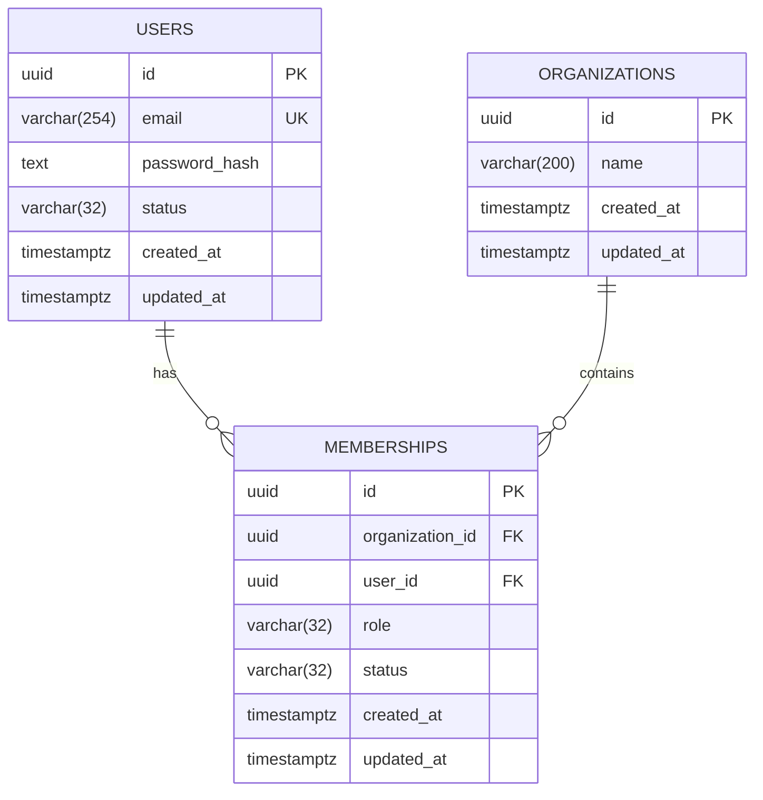

# Data model và domain model

Bản tiếng Anh (bản gốc): [../en/data-and-domain-model.md](../en/data-and-domain-model.md).

Đây là nền tảng model cho backend authentication multi-tenant tổng quát được mô tả trong [thiết kế authentication](authentication-authorization.md). Một user toàn cục kết nối với các organization thông qua membership. Authentication cũng có một session đăng nhập và các refresh token được cấp cho session đó.

Các domain class, JPA mapping và Flyway migration ban đầu đã được định nghĩa cho user, organization và membership. Persistence cho user, service đăng ký và HTTP endpoint, hỗ trợ CSRF, giới hạn tần suất đăng ký, sinh UUIDv7 và hash mật khẩu đã được implement. `AuthSession` và `RefreshToken` hiện mới chỉ có domain model; persistence mapping và table của chúng chưa được implement. Các application service, repository, HTTP endpoint còn lại và việc sinh refresh/access token là các bước implement riêng.

## 1. Domain model so với data model

| Tầng | Mục đích | Ví dụ |
| --- | --- | --- |
| Domain | Diễn đạt trạng thái hợp lệ và các chuyển trạng thái | `User`, `AuthSession`, `RefreshToken`, `Organization`, `Membership`, `Role` |
| Persistence mapping | Chuyển trạng thái domain thành các column trong database | `UserEntity`, `OrganizationEntity`, `MembershipEntity` |
| Database | Lưu record và đảm bảo toàn vẹn cấu trúc | `users`, `organizations`, `memberships` |

Các domain class không dùng annotation của Spring hay JPA. Chúng là immutable và chỉ dùng Lombok để sinh getter. Một thao tác như `rename` hay `changeRole` trả về một object mới, và application service phải lưu object đó.

Các kiểm tra dùng chung về UUIDv7 và chuỗi không trống nằm trong `common.Validation`. Các static method của nó trả về giá trị đã được kiểm tra, giữ nguyên thông báo lỗi theo từng field và không thực hiện chuẩn hóa. Package common chỉ phụ thuộc vào JDK; giới hạn độ dài và quy tắc vòng đời đặc thù của domain nằm cùng với model của chúng.

Các thông báo hướng tới client là các hằng `public static final String` trong `common.constants.ClientMessages`. `ApiErrorCodes` trong cùng package định nghĩa các mã phản hồi ổn định cho logic phía frontend. Các validation annotation, exception đăng ký, HTTP handler và security filter đều dùng lại các hằng này. Thông báo có chứa giới hạn độ dài dùng template được format với giới hạn hiện tại của policy và `Locale.ROOT`. Các chẩn đoán invariant nội bộ vẫn nằm trong model sở hữu chúng và không được đưa ra thành thông báo cho client.

Các JPA class có các persistence field mutable và constructor không tham số ở mức protected, theo yêu cầu của [Jakarta Persistence](https://jakarta.ee/specifications/persistence/3.2/apidocs/jakarta.persistence/jakarta/persistence/Entity.html). Chúng map thông qua `fromDomain(...)` và `toDomain()`; chúng không phải là DTO cho HTTP response.



Sơ đồ này diễn đạt các quan hệ trong database. Service phải tạo một organization cùng với owner đầu tiên của nó; chỉ riêng foreign key thì vẫn cho phép một organization không có membership nào.

## 2. Trách nhiệm của domain

### User — danh tính toàn cục

`identity.domain.User` chứa `id`, `email`, `passwordHash`, `UserStatus`, một `SystemRole` tùy chọn, `createdAt` và `updatedAt`.

- `User.create(id, email, passwordHash, now)` tạo một tài khoản đang hoạt động.
- Email được cắt khoảng trắng và chuyển về chữ thường bằng `Locale.ROOT`, giữ nguyên dấu chấm và hậu tố `+`. Giá trị chuẩn hóa được giới hạn ở 254 Unicode code point.
- Tham số mật khẩu đã được mã hóa sẵn. Việc hash và kiểm tra định dạng email diễn ra trước khi tạo model.
- `isActive()` phân biệt `ACTIVE` với `DISABLED`; `disable` và `enable` trả về trạng thái mới.
- `SystemRole` (`ADMIN` hoặc không có, column `system_role` từ migration V5) là role toàn hệ thống, không phải role của tenant; `promoteToSystemAdmin` cấp role này. Application service quyết định ai được phép gọi các chuyển trạng thái này.
- Role trong organization và danh sách membership không thuộc model danh tính này.

### AuthSession — một lần đăng nhập

`identity.domain.AuthSession` chứa `id`, `userId`, `createdAt`, `lastSeenAt`, `absoluteExpiresAt` và `revokedAt` nullable. Đây là session do application sở hữu cho thiết kế JWT, độc lập với `HttpSession` của servlet.

| Thao tác | Hành vi |
| --- | --- |
| `create(id, userId, now, absoluteExpiresAt)` | Tạo một session chưa bị thu hồi với timestamp tạo và timestamp hoạt động đều đặt bằng `now` |
| `isActiveAt(now, idleTimeout)` | Kiểm tra thu hồi, hết hạn tuyệt đối và không hoạt động; yêu cầu timeout dương |
| `recordActivity(now, idleTimeout)` | Trả về trạng thái mới với thời điểm hoạt động được cập nhật, chỉ khi session còn hoạt động |
| `revoke(now)` | Ghi nhận thu hồi; gọi lặp lại giữ nguyên thời điểm thu hồi đầu tiên |

Mọi ID phải là UUIDv7. Hết hạn tuyệt đối phải sau thời điểm tạo. Hoạt động phải bằng hoặc sau thời điểm tạo và phải trước hết hạn tuyệt đối một cách nghiêm ngặt. Thu hồi không thể diễn ra trước hoạt động gần nhất, nhưng một session đã hết hạn vẫn có thể bị thu hồi. Các thay đổi trạng thái không thể đưa thời điểm hoạt động lùi về trước, và một lần kiểm tra hoạt động ở thời điểm trước `lastSeenAt` đã ghi nhận sẽ thất bại theo hướng an toàn (fail closed).

Hết hạn có hiệu lực đúng tại một trong hai mốc: `now >= absoluteExpiresAt` hoặc thời gian không hoạt động đã trôi qua `>= idleTimeout`. Hoạt động không bao giờ kéo dài mốc hết hạn tuyệt đối, và một session đã hết hạn hoặc bị thu hồi không thể được kích hoạt lại. Trạng thái được suy ra từ các timestamp thay vì lưu thành cờ `EXPIRED`. Thời gian và chính sách idle-timeout do application cung cấp; model không đọc đồng hồ cũng không cấu hình các khoảng thời gian.

### RefreshToken — trạng thái được lưu trữ của một credential

`identity.domain.RefreshToken` chứa `id`, `sessionId`, `tokenHash`, `createdAt`, `expiresAt`, `consumedAt` nullable và `replacedByTokenId` nullable.

| Thao tác | Hành vi |
| --- | --- |
| `create(id, sessionId, tokenHash, now, expiresAt)` | Tạo một record token chưa được dùng |
| `isConsumed()` | Nhận biết một token đã được dùng trước đó, kể cả sau khi nó hết hạn |
| `isUsableAt(now)` | Yêu cầu token chưa được dùng và `createdAt <= now < expiresAt` |
| `consume(replacementTokenId, now)` | Trả về trạng thái đã dùng, liên kết tới token thay thế; từ chối dùng lại và từ chối khi đã hết hạn |

Các ID, bao gồm cả ID thay thế tùy chọn, phải là UUIDv7. Hết hạn phải sau thời điểm tạo. Thời điểm dùng và ID thay thế phải hoặc cùng có mặt hoặc cùng vắng mặt. Việc dùng phải diễn ra bằng hoặc sau thời điểm tạo và phải trước hết hạn một cách nghiêm ngặt. Một token không thể tự đặt chính nó làm token thay thế.

`tokenHash` dùng digest SHA-256 đã thống nhất, được mã hóa thành đúng 64 ký tự hex chữ thường (`TOKEN_HASH_LENGTH`). Constructor kiểm tra biểu diễn đó; nó không tính digest và cũng không chứng minh rằng đầu vào đến từ một secret được sinh an toàn. Infrastructure sinh và hash credential thô. Domain chỉ lưu digest, và `toString()` bỏ qua giá trị này.

Các kiểm tra này chỉ liên quan tới một record token. Kiểm tra session/user, token thay thế có thuộc cùng session hay không, hết hạn bị giới hạn bởi mốc hết hạn tuyệt đối của session, và phát hiện credential bị dùng lại đều cần application service. Việc dùng token tự nó không tạo token thay thế hay thu hồi session.

### Organization — tenant

`tenancy.domain.Organization` chứa `id`, `name`, `createdAt` và `updatedAt`.

- `create(id, name, now)` tạo trạng thái của organization.
- `rename(name, changedAt)` trả về trạng thái đã đổi tên với cùng ID và cùng thời điểm tạo.
- Tên được cắt khoảng trắng, không được trống và được giới hạn ở 200 Unicode code point. Các organization khác nhau có thể dùng cùng một tên hiển thị.
- Việc khởi tạo owner và quyền đổi tên cần một transaction của application service.

### Membership — quyền truy cập của user trong một tenant

`tenancy.domain.Membership` chứa `id`, `organizationId`, `userId`, `Role`, `MembershipStatus`, `createdAt` và `updatedAt`.

Các role là `OWNER`, `ADMIN` và `MEMBER`. Trạng thái là `ACTIVE` hoặc `REMOVED`.

| Thao tác | Hành vi |
| --- | --- |
| `create(id, organizationId, userId, role, now)` | Tạo membership đang hoạt động; `OWNER` được hỗ trợ cho việc khởi tạo organization |
| `changeRole(role, changedAt)` | Đổi role của một membership đang hoạt động; membership đã bị gỡ không thể đổi role |
| `remove(changedAt)` | Đánh dấu membership đã bị gỡ; gỡ lặp lại trả về trạng thái đã gỡ hiện có |
| `reactivate(role, changedAt)` | Khôi phục membership đã bị gỡ với role được gán tường minh; từ chối membership đang hoạt động |

Mọi chuyển trạng thái đều giữ nguyên ID membership, ID organization, ID user và thời điểm tạo. Các thay đổi không thể đưa `updatedAt` lùi về trước. Việc tham gia lại cập nhật membership hiện có thay vì chèn thêm một row khác cho cùng cặp user/organization.

Các thao tác này thực thi quy tắc trạng thái cục bộ. Chúng không xác lập quyền của người gọi: một application service phải kiểm tra membership trong tenant, ma trận role, hạn chế về role đích và quy tắc một owner duy nhất (membership của owner chỉ thay đổi thông qua chuyển giao quyền sở hữu) trước khi gọi chúng.

Mọi domain entity so sánh bằng nhau theo ID. So sánh hai object bằng `equals` không so sánh trạng thái hiện tại của chúng. Các chuyển trạng thái của chúng trả về các snapshot immutable mà application phải lưu lại.

## 3. Data model trên PostgreSQL

Schema được tạo bởi [V1__create_identity_and_tenancy_tables.sql](../src/main/resources/db/migration/V1__create_identity_and_tenancy_tables.sql), bao gồm các giới hạn field đã thống nhất. Nó nhắm tới PostgreSQL 18+, khớp với image trong Compose.

| Table | Các constraint quan trọng |
| --- | --- |
| `users` | Primary key UUIDv7; email chuẩn hóa unique; email/hash không trống; trạng thái tài khoản hợp lệ; các timestamp bắt buộc và đúng thứ tự |
| `organizations` | Primary key UUIDv7; tên đã cắt khoảng trắng và không trống; các timestamp bắt buộc và đúng thứ tự |
| `memberships` | Primary key UUIDv7; foreign key tới user và organization; unique `(organization_id, user_id)`; role/trạng thái hợp lệ; các timestamp bắt buộc và đúng thứ tự |

Mọi column đều bắt buộc. Email dùng `varchar(254)`, tên organization dùng `varchar(200)`, và hash mật khẩu dùng `text`. Role và trạng thái dùng `varchar(32)` với các check constraint về giá trị cho phép hiện có. JPA lưu tên enum bằng `EnumType.STRING`, nên vị trí ordinal trong Java không bao giờ được lưu.

Giới hạn độ dài email và tên là chính sách của application, được thực thi sau khi chuẩn hóa trong Java và bởi độ dài column của PostgreSQL. Java đếm Unicode code point để khớp với giới hạn ký tự của database. Giới hạn độ dài email không thay thế việc kiểm tra định dạng và cũng không xác lập sự tuân thủ đầy đủ với SMTP/email quốc tế hóa.

Các foreign key dùng `ON DELETE RESTRICT`. Gỡ một membership chỉ đổi trạng thái của nó, giữ lại row quan hệ. Cặp unique áp dụng cho cả membership đang hoạt động lẫn đã bị gỡ.

Index unique theo organization/user hỗ trợ tra cứu membership trong một tenant. Một index bổ sung bắt đầu bằng `user_id` để liệt kê các organization của một user. Một partial unique index trên `organization_id` cho các membership owner đang hoạt động (migration V4) đảm bảo mỗi organization có nhiều nhất một owner đang hoạt động; việc chuyển giao quyền sở hữu còn kiểm tra thêm rằng tài khoản của user nhận đang hoạt động.

### ID và timestamp

Mọi ID đều là UUIDv7, do application cung cấp cho các domain constructor. Các JPA mapping cố ý dùng ID được gán sẵn. Không có `UUID.randomUUID()` hay chiến lược UUID tự động của JPA.

PostgreSQL 18 cung cấp `uuidv7()` và `uuid_extract_version()`. Migration dùng `CHECK ((uuid_extract_version(id) = 7) IS TRUE)` để các UUID thuộc variant khác, mà hàm trích xuất trả về null, cũng bị từ chối. Việc sinh UUID vẫn là trách nhiệm của infrastructure; các model này không implement nó. [Các hàm UUID của PostgreSQL](https://www.postgresql.org/docs/18/functions-uuid.html)

Application port `IdGenerator` hiện đã có adapter `UuidV7Generator`, dựa trên `timeBasedEpochGenerator()` của Java UUID Generator. Nó dùng lại một instance generator an toàn với đa luồng. Đăng ký lấy timestamp tường minh từ một `Clock` UTC được inject. [Java UUID Generator](https://github.com/cowtowncoder/java-uuid-generator)

Dùng `Instant` của Java và `timestamptz` của PostgreSQL. PostgreSQL lưu các instant với độ chính xác micro giây và hiển thị chúng theo múi giờ của connection; nó không giữ lại tên múi giờ gốc. Dùng UTC tại các ranh giới của application, và tính đến độ chính xác khi so sánh các timestamp đã lưu. Field `createdAt` tường minh vẫn là timestamp tạo; không thay thế nó bằng timestamp trong UUID. [Các kiểu timestamp của PostgreSQL](https://www.postgresql.org/docs/18/datatype-datetime.html)

## 4. Quyền sở hữu theo module và persistence mapping

```text
common/
  Validation.java
  constants/ClientMessages.java
  constants/ApiErrorCodes.java

identity/
  domain/User.java
  domain/AuthSession.java
  domain/RefreshToken.java
  application/RegisterService.java
  application/RegistrationPolicy.java
  application/exception/EmailAlreadyExistsException.java
  application/exception/InvalidRegistrationException.java
  application/port/UserRepository.java
  application/port/IdGenerator.java
  application/port/PasswordHasher.java
  infrastructure/persistence/UserEntity.java
  infrastructure/persistence/SpringDataUserRepository.java
  infrastructure/persistence/UserRepositoryAdapter.java
  infrastructure/security/UuidV7Generator.java
  infrastructure/security/SpringPasswordHasher.java
  infrastructure/security/RegistrationRateLimitFilter.java
  infrastructure/configuration/IdentityConfiguration.java
  infrastructure/configuration/SecurityConfiguration.java
  infrastructure/configuration/WebConfiguration.java
  web/AuthController.java
  web/RegisterRequest.java
  web/RegisterResponse.java
  web/CsrfResponse.java

web/error/
  ApiError.java
  ApiErrorWriter.java
  GlobalExceptionHandler.java
  ExceptionHandlingFilter.java

tenancy/
  domain/Organization.java
  domain/Membership.java
  domain/Role.java
  infrastructure/persistence/OrganizationEntity.java
  infrastructure/persistence/MembershipEntity.java
```

Identity sở hữu user, session đăng nhập và refresh token; hiện chỉ `users` có table và persistence mapping. Tenancy sở hữu `organizations` và `memberships`. Các quan hệ trong domain dùng tham chiếu bằng UUID: membership và session giữ `userId`, còn refresh token giữ `sessionId`. Membership không có JPA association tới `UserEntity`. Các tham chiếu tới tenant cũng giữ dưới dạng ID, tránh việc ngầm tải toàn bộ đồ thị object. Các foreign key trong database vẫn bảo vệ các quan hệ đã lưu trong monolith.

Mỗi persistence class chỉ map đúng domain class của nó. Các application service nên phụ thuộc vào các repository interface trả về domain object; các persistence adapter sẽ dùng JPA mapping bên trong. Các DTO request và response là một ranh giới khác, đặc biệt vì cả hai user model đều chứa hash mật khẩu.

Các application exception của identity được nhóm trong `identity.application.exception`. Package này chỉ chứa các kiểu exception và không phụ thuộc vào Spring hay HTTP. `GlobalExceptionHandler` thuộc package `web.error` dùng chung toàn project, nơi nó chuyển các exception đó thành HTTP response. Các exception đặc thù của module trong tương lai nên theo cùng cấu trúc này trong module sở hữu chúng.

Luồng persistence cho user được định nghĩa bởi ba kiểu:

1. `UserRepository` là application port. Nó cung cấp `findById`, `findByEmail`, `create` và `save` dùng domain object `User`, không có kiểu nào của Spring hay JPA. Kết quả tra cứu là `Optional<User>`. `create` chỉ insert và báo email trùng bằng `EmailAlreadyExistsException`.
2. `SpringDataUserRepository` kế thừa `JpaRepository<UserEntity, UUID>`. Spring Data cung cấp phần implement và suy ra query email từ `findByEmail`.
3. `UserRepositoryAdapter` implement port, ủy quyền truy cập database và chuyển đổi thông qua `UserEntity.fromDomain` và `toDomain`. Constructor injection cung cấp Spring Data repository và JPA `EntityManager`. Các thao tác đọc chạy trong transaction read-only; `create` và `save` dùng transaction ghi. Một transaction của application service bao ngoài có thể bao trùm nhiều lời gọi repository. Xem [Spring Data transactions](https://docs.spring.io/spring-data/jpa/reference/jpa/transactions.html).

`findByEmail` mong đợi một email đã được chuẩn hóa: application phải cắt khoảng trắng và chuyển về chữ thường bằng `Locale.ROOT` trước khi gọi nó. Adapter thực hiện tra cứu chính xác. Nó trả về cả các user đã bị vô hiệu hóa để application có thể kiểm tra trạng thái của họ. Constraint unique email trong database vẫn cần thiết ngay cả khi việc đăng ký đã kiểm tra tài khoản tồn tại trước.

`save` map entity mà Spring Data trả về ngược lại thành domain. Với UUID được gán sẵn như hiện tại và không có field version, Spring Data dùng `merge`; một user mới có thể phải chịu một lần tra cứu trước khi insert. Việc thực thi SQL và vi phạm constraint có thể bị hoãn tới lúc flush hoặc commit. Đăng ký dùng thao tác `create` riêng: `EntityManager.persist` ngăn việc cập nhật một tài khoản đã tồn tại, và `flush` làm lộ vi phạm unique email không thể hoãn ngay bên trong adapter để chuyển đổi. Xem [Spring Data entity persistence](https://docs.spring.io/spring-data/jpa/reference/jpa/entity-persistence.html).

`RegisterService` kiểm tra đầu vào và kiểm tra email còn trống trước khi hash mật khẩu. Nó tạo một domain user đang hoạt động với UUIDv7 và timestamp do application sinh, gọi `create`, và chỉ trả về ID của user. Các phụ thuộc của nó được cung cấp qua constructor injection. `IdentityConfiguration` cung cấp một clock UTC, một password encoder của Spring, và policy đăng ký cùng blocklist cục bộ của nó. Việc hash mật khẩu được ủy quyền qua `PasswordHasher`; phụ thuộc về thuật toán và provider nằm trong infrastructure. Đăng ký không tạo session hay gán role nào.

Package `identity.web` hiện cung cấp service này thông qua `AuthController`, với các DTO riêng cho request, response, CSRF và lỗi. `InvalidRegistrationException` nhận diện lỗi đầu vào ở mức application để chuyển thành HTTP `400`; các lỗi invariant của domain và lỗi không mong đợi vẫn là lỗi phía server. Các security filter thực thi CSRF và giới hạn tần suất đăng ký trước khi gọi controller. Xem [hướng dẫn API đăng ký](registration-api.md) để biết luồng đã implement và cấu hình.

## 5. Các quy tắc cần application service

Những điều sau không thể được đảm bảo bởi một domain object đơn lẻ hay check constraint thông thường trên row:

1. Người gọi được phép truy cập organization được yêu cầu.
2. User đích đang hoạt động trước khi tạo/kích hoạt lại membership.
3. Một admin có thể thêm/gỡ member thường nhưng không thể quản lý owner hay các admin khác.
4. Một organization có đúng một owner đang hoạt động. Database thực thi "nhiều nhất một" thông qua partial unique index; application đảm bảo "ít nhất một" bằng cách tạo owner cùng với organization và chỉ thay owner thông qua chuyển giao quyền sở hữu, trong đó hạ cấp owner hiện tại và nâng cấp user đích trong cùng một transaction.
5. Tạo một organization cũng tạo owner đầu tiên của nó một cách nguyên tử.
6. Một tài khoản đang sở hữu organization không thể bị vô hiệu hóa; việc vô hiệu hóa thu hồi các session và gỡ các membership khác của user trong cùng một transaction.

Check constraint của PostgreSQL không thể thực thi an toàn các điều kiện phụ thuộc vào row khác, và "ít nhất một" cũng không thể diễn đạt bằng unique index. Do đó mọi thay đổi membership đều chạy trong một transaction mà trước hết lock row organization rồi tải lại actor và target sau khi lock trước khi ghi. Vì partial unique index được kiểm tra theo từng statement, chuyển giao quyền sở hữu ghi việc hạ cấp trước việc nâng cấp, và persistence adapter flush ngay mỗi lần ghi membership để thứ tự statement khớp với thứ tự gọi. Giữa các module, thứ tự lock là row user trước (FOR UPDATE khi vô hiệu hóa, FOR SHARE khi thêm member hoặc chuyển giao quyền sở hữu), rồi tới row organization; việc dọn membership khi vô hiệu hóa lock các organization theo thứ tự id. Do đó một owner bị vô hiệu hóa chỉ có thể phát sinh từ bên ngoài application; trường hợp còn lại đó là một hạn chế được chấp nhận của project học tập này. [Quy tắc constraint của PostgreSQL](https://www.postgresql.org/docs/18/ddl-constraints.html)

Mọi query theo tenant phải bao gồm ID organization được yêu cầu, kể cả tra cứu theo ID membership và các query liệt kê/đếm. Foreign key và UUID không ủy quyền cho một request. Row-level security không được cấu hình bởi migration này.

Về authentication, các application service phải kiểm tra user và session hiện tại trước khi chấp nhận access JWT hay làm mới token. `sub` của JWT phải khớp với `userId` của session. Việc dùng token và chèn token thay thế cần một transaction có kiểm soát đồng thời. Phản hồi cho trường hợp replay phải commit mọi thu hồi session trước khi báo từ chối; ném exception làm rollback transaction đó sẽ hủy luôn việc thu hồi. Cập nhật hoạt động của session không bao giờ được ghi đè một thu hồi đồng thời hay đưa `lastSeenAt` lùi về trước. Các service và cơ chế kiểm soát đồng thời này không được implement bởi các domain class.

## 6. Kiểm chứng

Các test mới được hoãn theo yêu cầu của user. Các test hiện có sau đây bao phủ user model và tenancy model ban đầu, không bao phủ `AuthSession` hay `RefreshToken`. Chạy chúng mà không cần khởi động ứng dụng Spring:

```bash
./gradlew test --tests '*UserTest' --tests '*TenancyModelTest' --tests '*ModelMappingTest'
```

Các test mapping kiểm tra các chuyển đổi trong Java, bao gồm việc giữ nguyên hash, role, trạng thái đã gỡ, tham chiếu tenant và timestamp. Chúng không khởi động Hibernate và không chứng minh hành vi repository đầu cuối.

[model_constraints.sql](../src/test/resources/db/model_constraints.sql) kiểm tra schema trên một database PostgreSQL 18+ dùng xong bỏ. Áp dụng V1 trước trong một transaction (ví dụ `psql -v ON_ERROR_STOP=1 --single-transaction -f V1__create_identity_and_tenancy_tables.sql`), rồi chạy các kiểm tra với `psql -v ON_ERROR_STOP=1`. Nó bao phủ các biên độ dài field, version/variant của UUID, tính unique, foreign key, trạng thái không hợp lệ, thứ tự timestamp và việc dùng lại một membership đã bị gỡ. Transaction fixture của nó được rollback.

Các test tích hợp về authorization ở mức application và về transaction/đồng thời sẽ cần thiết khi tầng service được implement.
