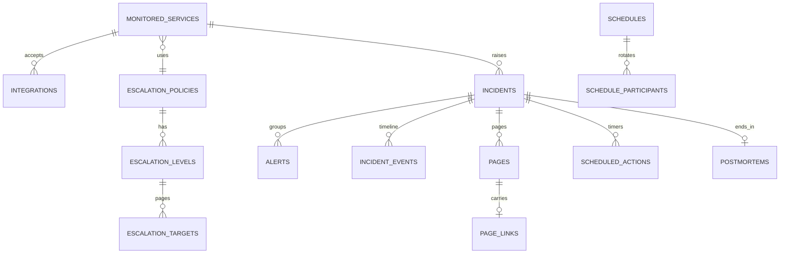
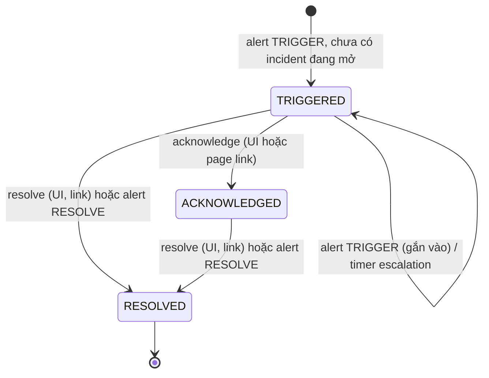

# Kế hoạch Incident service

Trạng thái: **draft, 2026-11-24**. Chưa có gì trong tài liệu này được hiện thực. Các quyết định còn mở ở mục 8 được chốt từng cái một, theo thứ tự, trước khi viết phần code liên quan, như đã làm với các bước Notification và gateway trong [kế hoạch phân rã](microservice-decomposition.md).

Tài liệu này thay thế miền Project/Task được nêu trong kế hoạch phân rã (mục 2 ở đó). Miền nghiệp vụ giờ là **quản lý incident (sự cố) và on-call (trực)** theo phong cách PagerDuty: các công cụ giám sát gửi alert (cảnh báo), alert trở thành incident, incident page (gọi) người đang on-call, page escalate (leo thang) cho đến khi có người acknowledge (xác nhận tiếp nhận), và một incident đã resolve kết thúc bằng một postmortem. Miền này được chọn thay cho project/task vì nó có các quy tắc thật (một state machine, timer, escalation, schedule), vì nó cho mọi hạ tầng đã lên kế hoạch một lý do để tồn tại (Notification, Kafka, Search, realtime), vì hệ thống có thể tự giám sát chính mình làm demo, và vì nó có các use case AI cụ thể, đánh giá được (mục 10).

Đây cũng là service đầu tiên sở hữu dữ liệu nghiệp vụ ngoài Account, nên nó buộc phải chốt quyết định mà kế hoạch phân rã để ngỏ: một service khác Account biết người dùng được làm gì trong một tổ chức bằng cách nào (mục 3).

## 1. Phạm vi

Trong phạm vi của chủ đề này, theo thứ tự của mục 7:

- Một service Java/Spring mới, `onward-incident`, có cơ sở dữ liệu PostgreSQL riêng, chỉ truy cập được qua gateway.
- Account phát các thay đổi membership (tư cách thành viên) dưới dạng event, qua một transactional outbox, và Incident service giữ một bản sao cục bộ của các membership từ các event đó.
- Các monitored service (dịch vụ được giám sát) với integration key; một endpoint ingest cho alert; dedup (khử trùng) alert thành incident; state machine và timeline của incident; note (ghi chú).
- Escalation policy, on-call schedule với rotation theo tuần hoặc theo ngày, và một scheduler bền vững (durable) để escalate các incident chưa được acknowledge.
- Page được gửi bởi Notification service viết bằng Go dưới dạng email có link acknowledge và resolve, và kết quả gửi được ghi ngược vào timeline của incident.
- Frontend gọi gateway thay vì gọi thẳng Account, và một UI cho incident.
- Postmortem, MTTA/MTTR theo từng service, một endpoint ingest tương thích Alertmanager, và một prober trong `docker-compose.yaml` để cả stack tự page chính developer của nó khi gateway sập.

Ngoài phạm vi v1, một cách có chủ đích: các kênh SMS, voice và push; schedule override và schedule nhiều lớp; maintenance window; gộp hoặc tách incident; mở lại một incident đã resolve; status page; SLA; quy tắc urgency (mọi incident đều page); cập nhật realtime; Kafka; các service Search và AI (mục 10 là lộ trình của chúng).

## 2. Mô hình miền (v1)

Mọi quy tắc dưới đây đều do Incident service tự thực thi, trên cơ sở dữ liệu của chính nó; nó không bao giờ đọc các bảng của Account.

### 2.1 Thực thể

| Thực thể | Ghi chú |
| --- | --- |
| `OrganizationMember` | **Read model** (mô hình chỉ đọc) của các membership bên Account (mục 4.1 và 4.2): `organizationId`, `userId`, `membershipId`, `email`, `role`, `status`, `updatedAt`. Không bao giờ được ghi bởi một use case của Incident. |
| `MonitoredService` | Một thứ được giám sát (gateway, cơ sở dữ liệu thanh toán). Thuộc về một tổ chức; có tên, mô tả và đúng một `EscalationPolicy`. Trong code gọi là "monitored service" để tránh từ *service* mang hai nghĩa. |
| `Integration` | Một credential để gửi alert tới một monitored service. Key là ngẫu nhiên, lưu ở dạng **đã hash**, chỉ hiển thị một lần khi tạo (cùng pattern với refresh token và one-time token bên identity). Trạng thái `ACTIVE` hoặc `REVOKED`. |
| `EscalationPolicy` | Thuộc về một tổ chức. Các `levels` có thứ tự, mỗi level có một `timeout` (1 đến 60 phút) và một hoặc nhiều `targets`, target là một user hoặc một schedule. `repeatCount` (0 đến 3) cho biết toàn bộ policy được lặp lại bao nhiêu lần sau khi level cuối hết timeout. |
| `Schedule` | Thuộc về một tổ chức. `timeZone`, `rotationStart`, `rotationLength` (`DAILY` hoặc `WEEKLY`), `participants` có thứ tự (các thành viên đang active). Người on-call tại thời điểm `t` là `participants[floor((t − rotationStart) / rotationLength) mod n]`, tính theo múi giờ của schedule, và không có ai trước `rotationStart`. Một hàm thuần, có unit test. |
| `Alert` | Thứ đã đến endpoint ingest: `dedupKey`, `action` (`TRIGGER` hoặc `RESOLVE`), `severity` (`CRITICAL`, `ERROR`, `WARNING`, `INFO`), `summary`, `source`, `payload` (JSON đúng như nhận được), `receivedAt`, integration và monitored service mà nó đi qua, và incident mà nó được gắn vào (null với một `RESOLVE` không khớp incident đang mở nào). Bất biến sau khi lưu. |
| `Incident` | Được mở bởi alert `TRIGGER` đầu tiên cho một cặp `(monitoredService, dedupKey)` chưa có incident đang mở. `number` là bộ đếm theo từng tổ chức (`#42`), `title` là summary của alert đầu tiên, `severity` là mức cao nhất trong các alert của nó. Trạng thái `TRIGGERED → ACKNOWLEDGED → RESOLVED`; resolved là trạng thái cuối, một `TRIGGER` sau đó sẽ mở incident mới. Ngoài ra còn `currentLevel`, `repeatsRemaining`, `acknowledgedBy/At`, `resolvedBy/At`. |
| `IncidentEvent` | Timeline, chỉ ghi thêm (append-only): `TRIGGERED`, `ALERT_ATTACHED`, `PAGED` (level, user đích), `PAGE_DELIVERED`, `PAGE_FAILED`, `ESCALATED`, `ESCALATION_EXHAUSTED`, `NO_ONE_ON_CALL`, `ACKNOWLEDGED`, `RESOLVED`, `AUTO_RESOLVED`, `NOTE`. Mỗi entry có một actor tùy chọn, một `data` dạng JSON và `occurredAt`. Note là các entry trong timeline; v1 không cho sửa. |
| `Page` | Một lần cố gắng liên lạc với một user cho một incident ở một level: `pageId`, `userId`, `email`, `channel` (v1 chỉ có `EMAIL`), `requestedAt`, `deliveredAt`/`failedAt`. Là đơn vị mà Notification báo kết quả ngược lại. |
| `PageLink` | Credential nằm trong email page: một token ngẫu nhiên lưu ở dạng hash, gắn với một incident và một user, có hiệu lực đến khi incident được resolve hoặc 24 giờ, tùy cái nào đến trước. Không phải dùng một lần, vì acknowledge và resolve là idempotent (8.8). |
| `ScheduledAction` | Một timer bền vững: `incidentId`, `kind` (`ESCALATE`), `dueAt`, `executedAt`, `cancelledAt`. Scheduler ở 5.2 chạy chúng. |
| `Postmortem` | Một bản cho mỗi incident đã resolve: `summary`, `impact`, `rootCause`, `actionItems` (các trường văn bản Markdown), trạng thái `DRAFT` hoặc `PUBLISHED`, tác giả. Timeline không được sao chép vào đây; UI hiển thị cả hai. |



Các quy tắc ở cơ sở dữ liệu chống lưng cho các quy tắc miền, theo tinh thần của migration V4 (partial unique index cho owner duy nhất):

- `incidents`: partial unique index trên `(monitored_service_id, dedup_key) WHERE status <> 'RESOLVED'`. Dedup khi đó là một ràng buộc, không chỉ là một nhánh code; hai `TRIGGER` đồng thời cho cùng một key không thể mở hai incident. Bên thua cuộc đua thử lại và gắn vào.
- `incidents.number`: bộ đếm theo tổ chức giữ trong `incident_counters(organization_id, next_number)`, cập nhật dưới row lock trong transaction mở incident.
- `scheduled_actions`: index trên `(due_at) WHERE executed_at IS NULL AND cancelled_at IS NULL` cho poller.
- Các bảng thuộc phạm vi tổ chức mang `organization_id` trực tiếp, kể cả khi có thể suy ra được, để mọi truy vấn được giới hạn bởi một cột, như quy tắc cô lập tenant trong thiết kế xác thực yêu cầu.

Không có FK từ `organization_id`, `user_id` hay các cột user đích tới `organization_members`: read model có thể được dựng lại, và một thành viên đã bị gỡ vẫn có thể xuất hiện như người từng acknowledge hoặc participant trong quá khứ. Các quy tắc tham chiếu được kiểm tra trong application service.

Các lớp domain tuân theo quy ước hiện có ([tài liệu mô hình dữ liệu, §1](data-and-domain-model.md)): bất biến, không có annotation Spring hay JPA, các chuyển trạng thái trả về đối tượng mới, id UUIDv7 do service sở hữu dòng dữ liệu sinh ra.

### 2.2 Vòng đời incident



Điều gì xảy ra ở mỗi chuyển trạng thái, tất cả trong một transaction khóa dòng incident (`SELECT ... FOR UPDATE`), cùng kiểu tuần tự hóa mà tenancy dùng trên dòng organization:

| Sự kiện | Hiệu ứng |
| --- | --- |
| `TRIGGER`, chưa có incident đang mở cho key | Chèn incident ở level 1 với `repeatsRemaining = policy.repeatCount`; gắn alert; timeline `TRIGGERED`; **page level 1** (bên dưới); lên lịch `ESCALATE` tại `now + level1.timeout`. |
| `TRIGGER`, đã có incident đang mở | Gắn alert; nâng `severity` nếu cao hơn; timeline `ALERT_ATTACHED`. Không page mới. |
| Alert `RESOLVE`, có incident đang mở | Trạng thái `RESOLVED`, `resolvedBy = null`; timeline `AUTO_RESOLVED`; hủy các action đang chờ. |
| Alert `RESOLVE`, không có incident đang mở | Lưu alert với `incidentId = null`, trả về `ignored`. |
| Acknowledge (user) | Chỉ từ `TRIGGERED`; từ `ACKNOWLEDGED` là một 200 idempotent, từ `RESOLVED` là `409 INCIDENT_ALREADY_RESOLVED`. Hủy các action đang chờ; timeline `ACKNOWLEDGED`. |
| Resolve (user) | Từ `TRIGGERED` hoặc `ACKNOWLEDGED`; idempotent từ `RESOLVED`. Hủy các action đang chờ; timeline `RESOLVED`. |
| Timer `ESCALATE` kích hoạt | Nếu incident không còn ở `TRIGGERED`, không làm gì (phòng hờ hai lớp cùng với việc hủy). Ngược lại `currentLevel + 1`; qua level cuối, nếu `repeatsRemaining > 0` thì giảm nó và quay về level 1, nếu không thì timeline `ESCALATION_EXHAUSTED` và dừng. Page level mới; lên lịch `ESCALATE` tiếp theo. |

**Page một level**: với mỗi target, phân giải nó thành một user (target là user thì là chính user đó; target là schedule thì là participant đang on-call lúc này). Mỗi thành viên active riêng biệt được phân giải ra nhận một `Page` và một entry `PAGED` trong timeline, và một message `page.requested` đi ra qua outbox (4.5). Một target phân giải ra không ai cả (schedule trước thời điểm bắt đầu, user không còn là thành viên active) tạo ra một entry `NO_ONE_ON_CALL` trong timeline và escalation tiếp tục theo timer; một level không có target nào liên lạc được không chặn policy.

### 2.3 Ma trận quyền

Mọi hành động đều yêu cầu một membership active trong tổ chức, đọc từ bản sao cục bộ. Kiểm tra membership trước (404 cho người ngoài; tổ chức và mọi thứ trong đó không phân biệt được với không tồn tại), rồi đến role (403), đúng thứ tự mà `OrganizationAccessService.requirePermission` dùng trong tenancy.

| Hành động | OWNER | ADMIN | MEMBER |
| --- | --- | --- | --- |
| Đọc service, integration (không kèm key), policy, schedule, incident, timeline, postmortem, metrics | Có | Có | Có |
| Tạo và cập nhật monitored service, policy, schedule; tạo và thu hồi integration | Có | Có | Không |
| Là target của policy hoặc participant của schedule | Có | Có | Có |
| Mở incident thủ công, acknowledge, resolve, thêm note | Có | Có | Có |
| Viết và publish postmortem | Có | Có | Có |

Responder (người xử lý) chủ ý không phải là một role riêng: ai là thành viên thì có thể on-call và có thể thao tác trên bất kỳ incident nào của tổ chức. Một **integration key** là loại principal (chủ thể) thứ hai, không phải user: nó chỉ được gửi alert tới monitored service của chính nó (mục 4.3). Một **page link** là loại thứ ba: nó chỉ được acknowledge hoặc resolve incident của chính nó thay mặt user của nó.

## 3. Incident service biết role của người gọi bằng cách nào

Kế hoạch phân rã (6.2) liệt kê ba phương án và chưa quyết định. Nêu lại chúng đối chiếu với những gì hiện có:

| Phương án | Cách hoạt động | Cái giá |
| --- | --- | --- |
| Hỏi Account ở mỗi request | Gọi một endpoint introspection như `GET /internal/organizations/{id}/memberships/{userId}` | Account nằm trên hot path của mọi request; chính lý do mục 7 của kế hoạch phân rã đã bác introspection cho session. Cache chỉ che giấu điều đó. |
| Role nằm trong access token | Account đặt `[{org, role}]` vào JWT | User thuộc nhiều tổ chức làm token phình to; một thay đổi role hoặc gỡ thành viên không thấy được cho đến khi token hết hạn (5 phút) và denylist không bao phủ thay đổi role. |
| **Bản sao cục bộ nuôi bằng event** | Account phát mọi thay đổi membership; Incident service giữ `organization_members` và đọc nó trong transaction của chính mình | Nhất quán cuối cùng (eventual consistency): một thành viên đã bị gỡ vẫn giữ quyền truy cập trong khoảng trễ lan truyền (bình thường là dưới một giây khá nhiều). Account cần một outbox để một thay đổi không thể commit mà thiếu event của nó. Một consumer mới cần cách để bắt kịp lịch sử. |

**Khuyến nghị: bản sao cục bộ.** Đây là phương án duy nhất giữ Account ngoài hot path và giữ "các request sau dùng role hiện tại" trong vòng vài giây thay vì vài phút, và là bước dạy đúng thứ dự án này đặt ra để học tiếp: transactional outbox (được nêu ở 6.2 là thứ cần thêm "cho các event mà mất là bug"), event-carried state transfer (truyền trạng thái theo event), và một consumer idempotent, chịu được sai thứ tự.

```mermaid
sequenceDiagram
    participant O as Owner (client)
    participant G as Gateway
    participant A as Account
    participant DB as Account DB
    participant R as RabbitMQ
    participant I as Incident service
    participant IDB as Incident DB
    O->>G: DELETE /api/organizations/{org}/memberships/{m}
    G->>A: chuyển tiếp (token đã xác minh, denylist đã kiểm tra)
    A->>DB: UPDATE memberships ... ; INSERT outbox_messages (cùng transaction)
    A-->>O: 204
    A->>DB: poll outbox (mỗi 500 ms, SKIP LOCKED)
    A->>R: publish membership.changed (persistent, publisher confirm)
    A->>DB: đánh dấu đã publish
    R->>I: giao message
    I->>IDB: upsert organization_members where incoming updated_at >= stored
    I->>R: ack
```

## 4. Hợp đồng (contract)

Cùng quy tắc với mục 4 của kế hoạch phân rã: JSON, không có `__TypeId__`, tên type có phiên bản, instant ISO-8601 UTC, `messageId` UUIDv7 đồng thời được đặt làm `message_id` của AMQP, `delivery_mode` 2. Producer tự serialize bằng tay, như `RabbitAuthNotifier` đang làm.

### 4.1 Account → Incident: event membership

Topic exchange **`onward.account`** (durable), do Account khai báo. Incident service khai báo quorum queue riêng `incident.memberships` bind với `membership.#`, dead-letter exchange `onward.account.dlx` và queue `incident.memberships.dlq`, giống như Notification.

Một loại event duy nhất mang **toàn bộ trạng thái hiện tại** của membership (event-carried state transfer); consumer không bao giờ cần biết đó là thêm, đổi role hay gỡ. Nó chỉ upsert.

| Routing key | `type` |
| --- | --- |
| `membership.changed` | `onward.account.membership-changed.v1` |

```json
{
  "messageId": "01a1cb46-40e6-798d-b0e4-0c25206cfb0a",
  "type": "onward.account.membership-changed.v1",
  "occurredAt": "2026-11-24T09:12:33.120Z",
  "membershipId": "019a2f9c-0c3e-7d1a-9f30-1e2e5b5a6c01",
  "organizationId": "019a2f9b-4d21-7e8a-8a11-6b3f2c9d0e02",
  "userId": "019a2f8a-9b7e-7c3d-b2a4-0d1e2f3a4b03",
  "email": "alice@example.com",
  "role": "ADMIN",
  "status": "ACTIVE",
  "updatedAt": "2026-11-24T09:12:33.118Z"
}
```

Được phát, trong cùng transaction, bởi mọi đường ghi của tenancy làm thay đổi một dòng membership: tạo tổ chức (membership của owner), thêm thành viên, kích hoạt lại, đổi role, gỡ, chuyển quyền sở hữu (hai event), và `removeAllMembershipsOf` khi vô hiệu hóa tài khoản (một event cho mỗi membership). Các lần ghi membership được tuần tự hóa bởi row lock trên organization, nên `updatedAt` tăng nghiêm ngặt theo từng membership và đóng vai trò phiên bản.

Quy tắc consumer: `INSERT ... ON CONFLICT (organization_id, user_id) DO UPDATE ... WHERE excluded.updated_at >= organization_members.updated_at`. Message trùng lặp và giao lại sai thứ tự đều vô hại, nên không cần kho idempotency riêng, khác với Notification mà side effect (một email) không idempotent. Message không hợp lệ đi vào dead-letter queue.

`email` được đưa vào để page, timeline và schedule có thể hiển thị người mà không phải gọi Account. Hiện chưa có tính năng đổi email; nếu được thêm, Account phát một `membership.changed` cho mỗi membership của user đó.

### 4.2 Account → Incident: snapshot membership (bootstrap và đối soát)

RabbitMQ bỏ các message được publish trước khi queue của consumer tồn tại và không giữ gì sau khi đã ack, nên một instance Incident mới không có cách nào bắt kịp từ broker. Vì vậy Account cung cấp, ngoài API công khai:

```text
GET /internal/memberships?page=0&size=500
Authorization: Bearer <internal token>
```

trả về các trang gồm các đối tượng của 4.1 (không có `messageId`, `type`, `occurredAt`), tất cả membership kể cả `REMOVED`, sắp xếp theo `updated_at`. Incident service gọi nó lúc khởi động khi `organization_members` rỗng và khi operator kích hoạt resync. Khởi động consumer trước, rồi mới nạp snapshot; quy tắc upsert làm phần chồng lấn trở nên vô hại.

Bảo vệ: gateway không có route cho `/internal/**`, và Account yêu cầu một bearer token tĩnh lấy từ môi trường (`APP_INTERNAL_TOKEN`) trên đường dẫn đó. Đủ cho một caller trên mạng riêng; client credentials là bước nâng cấp khi có thêm service (8.4).

### 4.3 Công cụ giám sát → Incident: ingest alert

Hợp đồng công khai cho bất cứ thứ gì gửi alert, mô phỏng theo Events API của PagerDuty. Xác thực bằng integration key, không phải user token; gateway liệt kê nó là public path và Incident service tự kiểm tra key.

```text
POST /api/ingest/v1/alerts
X-Integration-Key: <key shown once at integration creation>
Content-Type: application/json

{
  "dedupKey": "gateway-health",
  "action": "trigger",
  "severity": "critical",
  "summary": "Gateway health check failed (3 consecutive)",
  "source": "prober@dev-laptop",
  "occurredAt": "2026-11-24T10:00:03Z",
  "payload": { "url": "http://gateway:8081/actuator/health", "status": 0 }
}
```

| Phản hồi | Khi nào |
| --- | --- |
| `202 {"alertId", "incidentId", "result": "triggered" \| "attached" \| "resolved" \| "ignored"}` | Đã chấp nhận. `202` dù v1 xử lý đồng bộ (8.7), để hợp đồng vẫn đứng vững khi chuyển sang ingest bất đồng bộ. |
| `401 INTEGRATION_KEY_INVALID` | Key thiếu, không biết hoặc đã bị thu hồi. Không gợi ý là trường hợp nào. |
| `400 VALIDATION_FAILED` | Thiếu `dedupKey`, `action` hoặc `summary`; `dedupKey` quá 255 ký tự; `payload` quá 64 KB. |

`dedupKey` là toàn bộ câu chuyện dedup trong v1: một `trigger` thứ hai với cùng key trong lúc incident đang mở sẽ gắn vào nó. Vì thế một công cụ giám sát retry webhook không gây hại gì; bộ lọc trùng chính xác theo event id là không cần thiết. `occurredAt` là tùy chọn và mặc định là thời điểm nhận.

Một endpoint thứ hai, `POST /api/ingest/v1/alertmanager`, nhận body webhook của Prometheus Alertmanager và dịch từng mục sang dạng ở trên (`fingerprint` → `dedupKey`, `status` → action, `labels.severity` → severity, `annotations.summary` → summary). Nó tồn tại cho demo tự giám sát (bước 7) và giữ phần dịch này nằm ngoài phần lõi.

Rate limit: gateway giới hạn `/api/ingest/**` theo integration key (header, đã hash, làm khóa bucket) thay vì theo địa chỉ client, vì một công cụ với một key là một tenant. Đây là cấu hình limiter thứ hai trong gateway với một key resolver khác; limiter public-auth hiện có không đổi.

### 4.4 HTTP API của Incident service

Nằm sau gateway, chỉ bearer token, không cookie, nên không có CSRF. Lỗi dùng dạng `ApiError`; các mã lỗi được thêm vào hợp đồng đã tài liệu hóa, không thêm vào code dùng chung.

| Method và path | Ai | Ghi chú |
| --- | --- | --- |
| `GET` / `POST /api/organizations/{organizationId}/services` | member / owner, admin | `{name, description, escalationPolicyId}` → 201 |
| `GET` / `PATCH /api/services/{serviceId}` | member / owner, admin | |
| `POST /api/services/{serviceId}/integrations` | owner, admin | `{name}` → 201 kèm key, **một lần duy nhất** |
| `DELETE /api/integrations/{integrationId}` | owner, admin | Thu hồi; 204 idempotent |
| `GET` / `POST /api/organizations/{organizationId}/escalation-policies` | member / owner, admin | |
| `GET` / `PUT /api/escalation-policies/{policyId}` | member / owner, admin | `PUT` thay thế toàn bộ các level; target phải là thành viên active hoặc schedule của tổ chức, nếu không `409 TARGET_NOT_MEMBER` |
| `GET` / `POST /api/organizations/{organizationId}/schedules` | member / owner, admin | |
| `GET` / `PUT /api/schedules/{scheduleId}` | member / owner, admin | |
| `GET /api/schedules/{scheduleId}/on-call?at=` | member | Ai đang on-call tại `at` (mặc định là bây giờ) |
| `GET /api/organizations/{organizationId}/incidents` | member | Phân trang; lọc theo `status`, `serviceId`; mới nhất trước |
| `POST /api/organizations/{organizationId}/incidents` | member | Incident thủ công `{serviceId, title, severity}`; page như một trigger |
| `GET /api/incidents/{incidentId}` | member | Kèm số lượng alert, level hiện tại, các page |
| `GET /api/incidents/{incidentId}/timeline` | member | Phân trang, cũ nhất trước |
| `POST /api/incidents/{incidentId}/acknowledge` | member | 200, idempotent; `409 INCIDENT_ALREADY_RESOLVED` |
| `POST /api/incidents/{incidentId}/resolve` | member | 200, idempotent |
| `POST /api/incidents/{incidentId}/notes` | member | `{body}` → 201 entry trong timeline |
| `GET` / `PUT /api/incidents/{incidentId}/postmortem` | member | Chỉ khi đã resolve: `409 INCIDENT_NOT_RESOLVED` |
| `POST /api/page-links/{token}/acknowledge`, `.../resolve` | **page link** | Public path ở gateway; `401 PAGE_LINK_INVALID` khi không biết, hết hạn hoặc incident đã resolve. Route frontend `/p/{token}` gọi các endpoint này. |
| `GET /api/organizations/{organizationId}/metrics?from=&to=` | member | Theo từng service: số incident, MTTA, MTTR |

Mã lỗi mới: `SERVICE_NOT_FOUND`, `POLICY_NOT_FOUND`, `SCHEDULE_NOT_FOUND`, `INCIDENT_NOT_FOUND`, `INTEGRATION_KEY_INVALID`, `PAGE_LINK_INVALID`, `INCIDENT_ALREADY_RESOLVED`, `INCIDENT_NOT_RESOLVED`, `TARGET_NOT_MEMBER`. `INSUFFICIENT_PERMISSION` và `ORGANIZATION_NOT_FOUND` giữ nguyên ý nghĩa như bên Account.

### 4.5 Incident ↔ Notification: page và kết quả gửi

Topic exchange **`onward.incident`** (durable), do Incident service khai báo, mang hai loại message. Cả hai được ghi qua outbox riêng của Incident service (mục 5): mất một page là bug, khác với mất một email xác thực.

| Routing key | `type` | Consumer |
| --- | --- | --- |
| `page.requested` | `onward.incident.page-requested.v1` | Notification, queue `notification.pages` bind với `page.#` |
| `incident.changed` | `onward.incident.incident-changed.v1` | Chưa ai trong v1; là móc nối cho Search và AI (mục 10). Toàn bộ trạng thái incident, như 4.1. |

```json
{
  "messageId": "…",
  "type": "onward.incident.page-requested.v1",
  "occurredAt": "2026-11-24T10:00:04Z",
  "pageId": "…",
  "incidentId": "…",
  "incidentNumber": 42,
  "serviceName": "gateway",
  "title": "Gateway health check failed (3 consecutive)",
  "severity": "CRITICAL",
  "level": 1,
  "userId": "…",
  "email": "alice@example.com",
  "acknowledgeUrl": "http://localhost:5173/p/<token>?action=acknowledge",
  "resolveUrl": "http://localhost:5173/p/<token>?action=resolve",
  "incidentUrl": "http://localhost:5173/incidents/<id>"
}
```

Các URL do Incident service dựng vì token là dữ liệu của nó; vì vậy `app.frontend-base-url` chuyển từ cấu hình của Notification sang Incident service cho các email này (Notification giữ cấu hình riêng cho email xác thực). Không có gì trong message là bí mật ngoài page token, mà token này chỉ có thể acknowledge hoặc resolve một incident; lập luận ở 6.1 vẫn áp dụng với rủi ro thấp hơn.

Notification xử lý một page đúng như xử lý một email token (dedup theo `messageId` trong Redis, ghi nhớ rồi gửi) và sau đó **publish kết quả** trên topic exchange riêng **`onward.notification`**, do Notification khai báo:

| Routing key | `type` | Body |
| --- | --- | --- |
| `page.delivered` | `onward.notification.page-delivered.v1` | `messageId`, `occurredAt`, `pageId`, `channel: "email"` |
| `page.failed` | `onward.notification.page-failed.v1` | như trên cộng thêm `reason` |

Incident service tiêu thụ chúng trên queue `incident.page-results` và ghi `PAGE_DELIVERED` / `PAGE_FAILED` vào timeline, idempotent theo `pageId` (kết quả cho một page không biết hoặc đã chốt được ack và bỏ qua). Notification publish sau khi gửi, không qua outbox: Go không có cơ sở dữ liệu, và một kết quả bị mất chỉ để lại một page không có dấu đã gửi trong timeline, điều này nhìn thấy được và vô hại.

Điều này làm Notification lần đầu trở thành producer và Incident service thành consumer của một service Go, mới ở cả hai chiều.

### 4.6 Gateway

Thêm một route, **đặt trước** route `/api/**` của Account: `Path=/api/organizations/*/services/**,/api/organizations/*/escalation-policies/**,/api/organizations/*/schedules/**,/api/organizations/*/incidents/**,/api/organizations/*/metrics,/api/services/**,/api/integrations/**,/api/escalation-policies/**,/api/schedules/**,/api/incidents/**,/api/ingest/**,/api/page-links/**` tới `http://localhost:8082`. Public path được thêm: `/api/ingest/**` và `/api/page-links/**`. Limiter ingest ở 4.3. Gateway làm những gì nó đã làm cho mọi thứ khác (JWKS, denylist); Incident service xác minh token một lần nữa qua cùng JWKS và không gì thêm.

## 5. Outbox và scheduler

### 5.1 Transactional outbox, trong Account và trong Incident service

Vì sao là lúc này: một lần gỡ membership mà event bị mất sẽ để lại thành viên đã gỡ vẫn có quyền truy cập trong Incident service cho đến lần thay đổi tiếp theo của membership đó, mà lần đó có thể không bao giờ đến. Một page bị mất để lại một incident không ai hay biết. Cả hai đều là bug, nên lối tắt "publish sau commit" đã chọn cho email xác thực (kế hoạch phân rã 6.2) không áp dụng được.

Bảng `outbox_messages`, cùng cấu trúc ở cả hai service:

| Cột | Ghi chú |
| --- | --- |
| `id` uuid PK | UUIDv7; đồng thời là `messageId` của message được publish |
| `exchange`, `routing_key`, `type` | Publish cái gì và tới đâu |
| `payload` jsonb | Body đúng như khi publish, serialize lúc ghi dòng |
| `created_at` timestamptz | |
| `published_at` timestamptz null | Do publisher đặt |

Cơ chế:

- Một port `OutboxWriter` ở tầng application; adapter của nó chèn dòng trong transaction của caller (`Propagation.MANDATORY`, như các kiểm tra truy cập). Use case gọi nó ngay sau khi lưu aggregate, để thay đổi và event của nó cùng commit hoặc cùng rollback.
- Một `OutboxPublisher` chạy theo lịch mỗi 500 ms: `SELECT ... WHERE published_at IS NULL ORDER BY created_at LIMIT 100 FOR UPDATE SKIP LOCKED`, publish từng dòng với **publisher confirms** (`spring.rabbitmq.publisher-confirm-type=correlated`), chỉ đặt `published_at` khi đã được confirm. Một sự cố crash giữa lúc publish và lúc đánh dấu sẽ publish lại ở tick tiếp theo; đó là nguồn gốc của at-least-once và là lý do mọi consumer trong kế hoạch này đều idempotent.
- Một tác vụ dọn dẹp hằng ngày xóa các dòng đã publish cũ hơn 7 ngày.
- `SKIP LOCKED` giữ cho nhiều instance không publish cùng một dòng cùng lúc; thứ tự giữa các instance không được đảm bảo, điều mà các event mang trạng thái hấp thụ được.

Email xác thực vẫn đi theo đường publish-sau-commit theo các quyết định 6.1/6.2 (token thô không được lưu trữ). Hai đường publish tồn tại là có chủ đích.

Code được viết hai lần, mỗi service một lần, theo quy tắc không dùng thư viện chung. Khoảng 150 dòng; nếu nó phình to hoặc phân kỳ, đó là tín hiệu để xem lại quy tắc, không phải trước đó.

### 5.2 Timer bền vững cho escalation

Escalation cần "làm X tại thời điểm T trừ khi bị hủy", và phải sống sót qua restart: một incident được trigger một phút trước khi deploy vẫn phải escalate bốn phút sau. Vì thế timer trong bộ nhớ (`@Scheduled` kèm state, `ScheduledExecutorService`) bị loại. Các phương án ở 8.5; phương án khuyến nghị dùng cùng cơ chế với outbox:

- Các dòng `scheduled_actions` được chèn trong transaction quyết định ra chúng (lúc trigger, mỗi lần escalation).
- Một poller mỗi giây: `SELECT ... WHERE due_at <= now() AND executed_at IS NULL AND cancelled_at IS NULL ORDER BY due_at LIMIT 50 FOR UPDATE SKIP LOCKED`, và với mỗi dòng, trong cùng transaction, khóa dòng incident, kiểm tra lại trạng thái, áp dụng escalation của 2.2, ghi action tiếp theo và các dòng outbox, đánh dấu action đã thực thi.
- Acknowledge và resolve đánh dấu các action đang chờ là đã hủy trong transaction của chính chúng. Việc kiểm tra lại trạng thái lúc thực thi bao phủ cuộc đua khi timer và acknowledge chạy cùng một thời điểm: bên nào lấy được lock incident sau sẽ thấy kết quả của bên kia.

Độ trễ tối đa là một tick cộng chi phí poll, ổn với các timeout tính bằng phút. Khái niệm mới: scheduler bền vững, thực thi timer idempotent, và cuộc đua ack-với-timer.

## 6. Bố cục service

Repository `onward-incident`, cạnh `onward-gateway` và `onward-notification`, cổng **8082**. Spring Boot 4.1 trên Java 21, cùng thiết lập Gradle và `shell.nix` như Account. Các package phản chiếu bố cục hexagonal của Account:

```text
com.longdnh.onward.incident
├── common            sao chép, không dùng chung: ApiError/ApiErrorWriter/GlobalExceptionHandler, Validation, IdGenerator, phân trang
├── membership        read model: OrganizationMember, OrganizationAccessService, consumer RabbitMQ, bộ nạp snapshot
├── catalog           MonitoredService, Integration, EscalationPolicy, Schedule (dữ liệu cấu hình) và tầng web của chúng
├── incident          Alert, Incident, IncidentEvent, Page, PageLink, Postmortem, ingest, escalation, scheduler, web
└── infrastructure    security (JWKS resource server, filter integration-key và page-link), messaging, outbox, persistence
```

`catalog` và `incident` là hai package tách biệt vì chúng thay đổi với tốc độ khác nhau và vì đường ingest chỉ *đọc* catalog. Chúng ở trong cùng một service và một cơ sở dữ liệu: một incident tham chiếu policy và schedule của nó lúc escalation và lần đọc đó phải nhất quán với catalog, điều mà một service tách riêng không thể cho được nếu không có thêm một read model nữa.

Bảo mật: `spring.security.oauth2.resourceserver.jwt.jwk-set-uri=http://localhost:8080/.well-known/jwks.json`, issuer và audience được xác thực như ở gateway; `sub` và `sid` được đọc như `SessionJwtAuthenticationConverter` làm nhưng **không kiểm tra cơ sở dữ liệu** (service không có bảng `users` hay `sessions`). Thêm hai filter xác thực nữa, mỗi cái giới hạn trong tiền tố đường dẫn của nó: integration key trên `/api/ingest/**` và page link trên `/api/page-links/**`. Hệ quả, ghi rõ ra: một token bị thu hồi ở Account bị gateway từ chối ngay lập tức nhưng vẫn được Incident service chấp nhận khi gọi trực tiếp vào 8082 cho đến khi hết hạn (5 phút). Cổng này không được mở ra ngoài máy phát triển.

Cơ sở dữ liệu: một container PostgreSQL thứ hai `postgres-incident` ở cổng host 5433 trong `docker-compose.yaml`, database `onward_incident`. Một instance với hai database cũng thỏa "mỗi service một database"; container thứ hai làm ranh giới hiện rõ và không cần script khởi tạo. Các migration Flyway nằm trong repository mới.

Cấu hình: `spring.rabbitmq.*`; `app.account.internal-base-url` và `APP_INTERNAL_TOKEN` cho snapshot; `app.messaging.account-exchange` (`onward.account`), `app.messaging.incident-exchange` (`onward.incident`), `app.messaging.notification-exchange` (`onward.notification`); `app.frontend-base-url` cho page link; `app.escalation.poll-interval` (1 s), `app.outbox.poll-interval` (500 ms).

Frontend: `proxy.conf.json` trỏ tới gateway (`http://localhost:8081`) thay vì Account, thời điểm mà "client tiếp tục gọi thẳng Account cho đến khi gateway làm được mọi thứ chúng cần" (kế hoạch phân rã 7.1) không còn đúng nữa. Các interceptor đã gửi bearer token trên mọi lời gọi và CSRF chỉ trên các lời gọi không có token, nên không có gì thay đổi với các endpoint mới. Các thư mục feature mới `features/catalog` (service, integration, policy, schedule) và `features/incidents` (danh sách, chi tiết kèm timeline, acknowledge, resolve, note, postmortem), cộng với route công khai `/p/:token` cho page link.

## 7. Các bước hiện thực

Mỗi bước là một pull request cho mỗi repository và tự nó dùng được. Khái niệm mới giới hạn ở một hoặc hai cho mỗi bước, như trước.

| Bước | Repository | Xây dựng gì | Khái niệm mới | Xong khi |
| --- | --- | --- | --- | --- |
| 1 | `onward` | Bảng outbox và publisher (5.1); `membership.changed` phát từ mọi đường ghi của tenancy (4.1); khai báo exchange `onward.account`; endpoint snapshot `/internal/memberships` với internal token (4.2) | Transactional outbox, publisher confirms, event-carried state transfer | Mọi thay đổi membership xuất hiện trong RabbitMQ management UI trong vòng một giây với body đúng như tài liệu; dừng RabbitMQ trong lúc thay đổi rồi khởi động lại thì event vẫn được publish; snapshot trả về đúng các dòng đó |
| 2 | `onward-incident`, `onward-gateway`, `onward-fe` | Khung service: repository, database, migration `organization_members`, JWKS resource server, consumer với quy tắc upsert, bộ nạp snapshot lúc khởi động, `GET /api/organizations/{id}/services` trả về trang rỗng; route ở gateway; proxy frontend tới gateway | Một service Java thứ hai; một service tin tưởng gateway về trạng thái session; consumer idempotent, chịu được sai thứ tự; gateway định tuyến tới hai backend | Qua gateway: thành viên nhận `[]`, người không phải thành viên nhận 404, thành viên bị gỡ nhận 404 trong vòng một giây sau khi gỡ; các màn hình frontend hiện có hoạt động không đổi qua gateway |
| 3 | `onward-incident`, `onward-gateway` | Monitored service và integration (key đã hash); escalation policy và schedule dưới dạng dữ liệu kèm validation và hàm on-call; endpoint ingest với filter integration-key, dedup qua partial unique index, mở/gắn/tự resolve incident, timeline, acknowledge/resolve thủ công, note; public path và limiter ingest ở gateway | Một principal không phải user (integration key); dedup như một ràng buộc cơ sở dữ liệu | `curl` trigger mở `#1`; trigger thứ hai gắn vào; `resolve` đóng nó; hai trigger đồng thời không bao giờ mở hai incident (kiểm thử bằng một script đồng thời nhỏ); `GET .../on-call?at=` khớp với rotation tính tay qua một lần đổi giờ DST |
| 4 | `onward-incident` | Outbox của Incident; page một level (2.2) tạo ra các dòng `Page` và message `page.requested`; scheduler của 5.2 với escalation, lặp lại và cạn kiệt; hủy khi acknowledge/resolve; event `incident.changed` | Scheduler bền vững, cuộc đua timer-với-acknowledge | Với một policy hai level và timeout 1 phút: trigger → một `page.requested` cho người on-call level 1 trong management UI; sau một phút có một cái cho level 2; acknowledge ở giữa thì không tạo cái nào; khởi động lại service giữa lúc chờ timeout vẫn escalate đúng giờ |
| 5 | `onward-notification`, `onward-incident`, `onward-gateway` | Consumer Go cho `notification.pages`, template email page với hai link, exchange `onward.notification` và các kết quả; consumer bên Incident đưa kết quả vào timeline; endpoint và filter page-link; public path ở gateway | Go làm producer; một consumer Java của một service Go; một credential nằm trong email mà không phải user token | Trigger → email trong Mailpit → bấm acknowledge đánh dấu incident đã acknowledge và dừng escalation; timeline hiển thị `PAGED`, `PAGE_DELIVERED`, `ACKNOWLEDGED` kèm timestamp |
| 6 | `onward-fe` | Các màn hình catalog, danh sách và chi tiết incident, acknowledge, resolve, note, `/p/:token` | | Một thành viên làm được mọi thứ trong 2.3 từ trình duyệt; route page-link hoạt động khi chưa đăng nhập |
| 7 | `onward-incident`, `onward`, `onward-fe` | Endpoint và màn hình postmortem; endpoint metrics; ingest tương thích Alertmanager; một container `prober` trong `docker-compose.yaml` poll health của gateway mỗi 10 s và gửi `trigger`/`resolve` với một integration key cố định đọc từ `.env` | Không có gì mới về hạ tầng; bài tập là demo đầu cuối | `docker compose stop gateway` → trong vòng 30 s có email page trong Mailpit → `docker compose start gateway` → incident tự resolve; MTTA/MTTR hiển thị cho service đó |

Bước 1 kiểm thử được bằng RabbitMQ management UI trước khi có bất kỳ code Incident nào, đó là lý do nó đi đầu. Bước 3 là bước lớn nhất và có thể tách tại "ingest và incident" so với "policy và schedule dưới dạng dữ liệu"; chúng được giữ chung vì đường ingest cần một policy tồn tại và hàm on-call là code thuần không cần hạ tầng.

### Kiểm thử

Giữ mức hiện tại và thêm những gì các rủi ro mới cần: unit test domain cho các chuyển trạng thái incident, hàm on-call (bao gồm múi giờ và DST) và ma trận quyền; một test consumer nạp các message `membership.changed` trùng lặp và sai thứ tự rồi kiểm tra read model; một test outbox khẳng định một thay đổi bị rollback không để lại dòng outbox nào; một test scheduler chạy một action đến hạn trên một incident đã acknowledge và khẳng định không có page; và một kịch bản end-to-end thủ công được tài liệu hóa (đăng ký hai user, tạo tổ chức, thêm thành viên, service với policy và schedule, trigger, quan sát page, acknowledge bằng link, resolve, gỡ thành viên, quan sát 404) chạy qua gateway.

## 8. Các quyết định còn mở

Theo thứ tự này. Mỗi quyết định sẽ có một dòng "decided" kèm ngày, như trong kế hoạch phân rã.

### 8.1 Incident service lấy role của người gọi từ đâu

Các phương án và cái giá ở mục 3. **Khuyến nghị: bản sao cục bộ nuôi bằng event qua một outbox.**

### 8.2 Broker cho event membership và incident

| Phương án | Ủng hộ | Phản đối |
| --- | --- | --- |
| **RabbitMQ, broker hiện có** | Không phải vận hành gì mới; code producer và thói quen bên Go đã có; một topic exchange cho mỗi service producer mở rộng tự nhiên sang `onward.incident` và `onward.notification` | Không có lịch sử: consumer mới cần endpoint snapshot (4.2); dead-letter queue là cách replay duy nhất |
| Kafka với compacted topic khóa theo membership id | Replay miễn phí: consumer mới đọc từ đầu và kết thúc với trạng thái hiện tại | Một broker thứ hai, consumer group, offset, partition và compaction, trong cùng một bước với outbox và service mới; Notification vẫn ở trên RabbitMQ |

**Khuyến nghị: RabbitMQ lúc này.** Kafka được dành cho luồng alert khi ingest trở thành bất đồng bộ và có nhiều consumer đọc nó (mục 10), nơi replay mới là nhu cầu thực sự. Chuyển event membership sau này chỉ thay đổi một producer và một consumer, và endpoint snapshot vẫn hữu ích làm công cụ đối soát.

### 8.3 Bootstrap read model

Endpoint snapshot (4.2); hoặc kỷ luật vận hành (khởi động Incident service trước khi tạo bất kỳ tổ chức nào), cách này hỏng ngay lần đầu queue bị xóa hoặc database bị reset; hoặc Kafka (8.2). **Khuyến nghị: endpoint snapshot.** Nhỏ, là câu trả lời thẳng thắn cho "nếu consumer bỏ lỡ gì đó thì sao", dùng lại nguyên trạng nếu đổi broker.

### 8.4 Bảo vệ endpoint nội bộ

Không được gateway định tuyến cộng với một bearer token tĩnh từ môi trường; hoặc token client-credentials do Account cấp, điều này biến Account thành authorization server cho các service và là một chủ đề riêng; hoặc chỉ dựa vào mạng, cách này không dạy được gì. **Khuyến nghị: token tĩnh**, ghi nhận là một lỗ hổng đã biết.

### 8.5 Cơ chế timer cho escalation

| Phương án | Ủng hộ | Phản đối |
| --- | --- | --- |
| **Bảng `scheduled_actions` và một poller (5.2)** | Cùng pattern với outbox, nên chỉ một cơ chế để học và debug; timer và thay đổi trạng thái dùng chung transaction; hủy là một `UPDATE`; nhìn thấy được bằng SQL | Độ phân giải một giây; một lần poll mỗi giây cho mỗi instance |
| RabbitMQ delayed delivery (TTL theo message và dead-letter ngược lại, hoặc plugin delayed-message) | Không có poller | Không thể hủy, nên mọi message được kích hoạt vẫn phải kiểm tra lại trạng thái; TTL theo message chỉ hết hạn ở đầu queue, một cái bẫy đã biết; plugin không có trong image chuẩn |
| Quartz với JDBC job store | Trưởng thành, hỗ trợ cluster | Một framework với các bảng và mô hình riêng phải học, cho một loại job |

**Khuyến nghị: bảng và poller.** Quy tắc timer-kích-hoạt-phải-kiểm-tra-lại-trạng-thái cần có ở mọi phương án; bảng làm các timer đang chờ có thể xem và hủy được.

### 8.6 Schedule override trong v1

Một override ("Bob trực thay Alice từ 18:00 thứ Sáu đến 09:00 thứ Hai") là một bảng thứ hai và một quy tắc ưu tiên trong hàm on-call. **Khuyến nghị: không đưa vào v1.** Thêm nó như một bước nhỏ riêng sau bước 7, khi hàm rotation đã được vận hành thử; không có gì trong các hợp đồng thay đổi.

### 8.7 Xử lý ingest: đồng bộ bây giờ, bất đồng bộ sau

v1 validate, lưu alert và cập nhật incident ngay trong request, giữ row lock của incident, và trả lời `202`. Dưới một cơn bão alert, việc này tuần tự hóa trên lock theo từng `dedupKey`, cũng chính là bảo đảm về tính đúng đắn; các key khác nhau không tranh chấp nhau. **Khuyến nghị: đồng bộ trong v1**, với hợp đồng `202` được giữ sẵn để việc chuyển sang "validate, publish lên Kafka, trả lời" (mục 10) không làm thay đổi client nào.

### 8.8 Credential của page link

Một token ngẫu nhiên lưu ở dạng hash, có hiệu lực đến khi incident được resolve hoặc 24 giờ, dùng lại được (khuyến nghị); hoặc một JWT có chữ ký trong URL, cần một khóa ký trong Incident service và không thể thu hồi khi incident resolve; hoặc một token dùng một lần nghiêm ngặt, sẽ hỏng khi mail client prefetch link. **Khuyến nghị: token hash dùng lại được.** Acknowledge và resolve là idempotent, nên việc dùng lại không có tác dụng gì ngoài cú bấm đầu tiên.

### 8.9 Lưu trữ integration key

Hash, hiển thị một lần khi tạo, thu hồi được (khuyến nghị, pattern đã dùng cho refresh token và one-time token); hoặc lưu dạng rõ để UI có thể hiển thị lại, cách một số sản phẩm làm và là thứ một database bị lộ sẽ phơi ra. **Khuyến nghị: hash.** Mất key nghĩa là tạo integration mới; công cụ giám sát được cấu hình lại, không gì khác thay đổi.

## 9. Các lỗ hổng đã biết, chủ ý để lại

- Một thành viên bị gỡ vẫn giữ quyền truy cập các incident của tổ chức trong khoảng trễ lan truyền event (mục 3), và vẫn là participant của schedule hoặc target của policy cho đến khi admin sửa schedule hoặc policy; việc page phân giải họ thành không ai cả và ghi `NO_ONE_ON_CALL`.
- Mọi incident đều page, bất kể severity. Quy tắc urgency (incident severity thấp không page vào ban đêm) là tính năng sau này.
- Email là kênh duy nhất; Notification không có retry qua dead-letter queue (kế hoạch phân rã 5.3), nên một lỗi SMTP vĩnh viễn cho một page làm tiến trình Go khởi động lại liên tục.
- Internal token là một bí mật tĩnh dùng chung (8.4).
- Incident service khi được gọi trực tiếp, bỏ qua gateway, vẫn chấp nhận token đã thu hồi cho đến khi nó hết hạn (mục 6).
- Outbox publisher và scheduler là poller; độ trễ tối đa một tick, và các event đã publish không có thứ tự giữa các instance. Change data capture là giải pháp thay thế cấp production và không được lên kế hoạch.
- Account giữ việc kiểm tra session trong database ở mỗi request (kế hoạch phân rã 7.1); xem lại khi frontend đi qua gateway, điều xảy ra ở bước 2.
- Alertmanager tự nhóm alert trước khi gửi; phần dịch ở 4.3 lấy từng alert trong nhóm riêng lẻ và dựa vào `fingerprint` để dedup. Ngữ nghĩa ở cấp nhóm bị bỏ qua.

## 10. Sau v1: lộ trình mà miền này mở ra

Chưa lên kế hoạch chi tiết; liệt kê để các quyết định v1 không chặn chúng, theo thứ tự dự định.

| Bước | Gì | Vì sao miền này làm nó thành thật |
| --- | --- | --- |
| AI 1: tóm tắt bàn giao | Tiêu thụ `incident.changed` khi acknowledge và resolve, gửi timeline và các alert tới một LLM, ghi bản tóm tắt ngược lại thành một entry trong timeline | Lời gọi LLM thuần, không cần hạ tầng; đánh giá bằng cách đọc. Chốt câu hỏi ngôn ngữ: Spring AI trong Java giữ quy tắc chỉ-một-ngôn-ngữ-thứ-hai; một service Python là ngoại lệ phải ghi rõ nếu được chọn. |
| Kafka cho luồng alert | Ingest validate và publish lên một Kafka topic; Incident service, Search và AI tiêu thụ nó | Luồng đầu tiên có nhiều consumer và khối lượng thật (bão alert), nơi replay và partition theo `dedupKey` có ý nghĩa. Hợp đồng `202` đã sẵn sàng. |
| Ingest bằng Go | Phần validate-và-publish của ingest chuyển sang một service Go nhỏ | Lần tách đầu tiên vì throughput thay vì vì ranh giới dữ liệu; Incident service giữ trạng thái. |
| Realtime | SSE hoặc WebSocket từ Notification, nuôi bằng `incident.changed` | Danh sách incident cập nhật không cần polling; kênh đã lên kế hoạch cho Notification trong kế hoạch phân rã. |
| Search và AI 2: incident tương tự | Read model OpenSearch của các incident; embedding của title và payload alert; truy vấn kNN "các incident tương tự trong quá khứ và cách chúng được resolve" | Precision@k trên các cặp gán nhãn tay; Search service từ kế hoạch phân rã. |
| AI 3: runbook | Runbook Markdown cho mỗi monitored service; RAG gợi ý các bước khi trigger | Đánh giá bằng việc bước gợi ý có khớp với việc đã làm hay không. |
| AI 4: nhóm alert | Nhóm các alert thành một incident vượt ra ngoài `dedupKey` chính xác (năm mươi pod lỗi là một incident) | Khó đánh giá nhất; làm cuối. |
| AI 5: bản nháp postmortem | Từ timeline và các note | |
