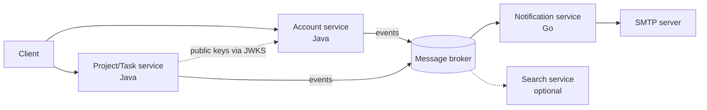

# Kế hoạch tách microservice

Bản tiếng Anh (bản gốc): [../en/microservice-decomposition.md](../en/microservice-decomposition.md).

Trạng thái: kế hoạch được thống nhất ngày 2026-11-10; **bước 5 (Notification service bằng Go) đã triển khai ngày 2026-11-16**, xem 5.1 và 5.3; **endpoint JWKS đã triển khai ngày 2026-11-17** và mô hình xác thực cho các service tiếp theo đã được quyết định, xem 4 và 7. Backend vẫn là một ứng dụng Spring Boot duy nhất với hai module, `identity` và `tenancy`, dùng chung một cơ sở dữ liệu PostgreSQL; mail xác thực hiện được gửi bởi Go service riêng thông qua RabbitMQ.

Đây là một dự án học tập. Mục tiêu là chuyển dần từ modular monolith sang microservice, mỗi bước học một hoặc hai khái niệm mới. Tính năng mới được xây dựng thành các service riêng bên cạnh monolith thay vì viết lại monolith trước (cách tiếp cận *strangler*).

## 1. Điểm xuất phát

Ứng dụng hiện tại đã có các module theo kiến trúc hexagonal, nhưng `identity` và `tenancy` cố ý dựa vào **một transaction cơ sở dữ liệu** để có ba đảm bảo:

| Điểm ràng buộc | Ở đâu | Đảm bảo điều gì |
| --- | --- | --- |
| `UserDisabledEvent` được tenancy xử lý đồng bộ | `tenancy.infrastructure.event.UserDisabledListener` | Vô hiệu hóa user và xóa các membership của họ cùng commit hoặc cùng rollback |
| Tenancy lock dòng `users` (`FOR SHARE`) trước dòng organization | `tenancy.infrastructure.persistence.adapter.UserAccountLookupAdapter` | Thứ tự lock user → organization; user đã bị vô hiệu hóa không bao giờ trở thành owner |
| Identity đọc trực tiếp bảng `memberships` | `identity.infrastructure.persistence.adapter.OrganizationOwnershipCheckAdapter` | Owner không thể bị vô hiệu hóa |

Ngoài ra còn có foreign key `memberships.user_id → users`. Tách identity và tenancy thành hai service riêng sẽ mất toàn bộ các đảm bảo này và thay chúng bằng saga cùng các trạng thái tạm thời không nhất quán. **Chúng ở cùng nhau** trong một service.

Những điều đã sẵn có giúp cho việc tách:

- Access JWT được ký bằng RS256. Các service khác có thể xác minh chỉ với public key.
- Mail xác thực đã được gửi sau commit, bất đồng bộ và theo kiểu fire-and-forget (`AuthMailListener`), nên email là ranh giới sạch nhất trong codebase.

## 2. Miền nghiệp vụ

Ứng dụng trước đây chưa có miền nghiệp vụ. Miền được chọn là **quản lý công việc và dự án** (kiểu Trello), xây trên mô hình organization, membership và role sẵn có: project thuộc về một organization, và task do các thành viên của organization đó thực hiện. Mô hình miền chi tiết chưa được thiết kế.

## 3. Các service mục tiêu

| Service | Trách nhiệm | Công nghệ | Dữ liệu sở hữu |
| --- | --- | --- | --- |
| **Account** | Đăng ký, đăng nhập, session, refresh token, xác minh email, đặt lại mật khẩu, organization, membership, role, system admin | Java / Spring (ứng dụng hiện tại) | `users`, session, token, `organizations`, `memberships` |
| **Project/Task** | Project, task, phân công, bình luận, quyền trên task | Java / Spring, PostgreSQL | Cơ sở dữ liệu riêng |
| **Notification** | Gửi email; sau này là push realtime (WebSocket hoặc SSE) | **Go** | Chỉ trạng thái của riêng nó (ví dụ, các message ID đã xử lý) |
| **Search** (tùy chọn, sau này) | Tìm kiếm toàn văn trên task, được cấp dữ liệu từ event | OpenSearch | Một read model được dựng lại từ event |



Quy tắc:

- **Mỗi service một cơ sở dữ liệu.** Một service không bao giờ đọc bảng của service khác. Các lần đọc bảng trực tiếp ở mục 1 chỉ chấp nhận được vì Account là một service duy nhất.
- **Chỉ một ngôn ngữ thứ hai.** Go được dùng cho Notification vì nó nhỏ, thiên về I/O và có ít quy tắc nghiệp vụ, nên chi phí học ngôn ngữ thấp. Miền lõi vẫn ở Java, nơi cấu trúc sẵn có có thể được tái sử dụng.
- **Mặc định là PostgreSQL.** Chỉ thêm cơ sở dữ liệu khác khi có lý do cụ thể. OpenSearch là ngoại lệ duy nhất đã lên kế hoạch, để học cách giữ một read model đồng bộ.

## 4. Hợp đồng giữa các service

Mọi thứ vượt qua ranh giới service phải trung lập về ngôn ngữ, vì các service Java và Go phải hiểu được nhau. Không dùng thư viện Java chung (như package `common` hiện tại) giữa các service.

| Vấn đề | Thỏa thuận |
| --- | --- |
| Xác thực | Mỗi service tự xác minh access JWT RS256 (`iss`, `aud`, `exp`). Account công bố public key của mình qua một endpoint JWKS thay vì phân phối file PEM. **Đã triển khai (2026-11-17):** `GET /.well-known/jwks.json`, công khai, có thể cache trong 5 phút. Cặp khóa được giữ dưới dạng một JWK với `kid` là thumbprint RFC 7638 của public key; mọi header token đều mang `kid` đó, và Account xác minh token của chính mình từ cùng bộ khóa, chọn theo `kid`, đúng như một bên tiêu thụ từ xa sẽ làm. Xoay khóa nghĩa là thêm khóa kế tiếp vào bộ và giữ khóa cũ cho đến khi các token của nó hết hạn. Bên tiêu thụ bằng Spring đặt `jwk-set-uri`; bên tiêu thụ bằng Go dùng bất kỳ thư viện client JWKS nào. |
| Định dạng event | JSON với schema viết thành văn bản (JSON Schema hoặc AsyncAPI), hoặc Protobuf/Avro. Mỗi event có một tên kiểu ổn định, tường minh. Các JSON message converter của Spring cho Kafka và RabbitMQ mặc định thêm header `__TypeId__` chứa tên class Java. Phải tắt điều này, nếu không bên tiêu thụ bằng Go sẽ hỏng hoặc phụ thuộc vào tên class Java. |
| Lỗi HTTP | Hình dạng `ApiError` và `ApiErrorCodes` hiện tại trở thành hợp đồng được tài liệu hóa (OpenAPI), không phải code dùng chung. |
| Tracing | OpenTelemetry với header W3C `traceparent`, để có thể theo dõi một request xuyên qua các service viết bằng các ngôn ngữ khác nhau. |
| ID | UUIDv7 ở mọi nơi. Mỗi service tự sinh ID cho dữ liệu nó sở hữu. |

## 5. Bước đầu tiên: Notification service bằng Go

Mail xác thực rời khỏi tiến trình Account:

```text
Monolith (one process):  service → Spring event (in memory) → AuthNotificationListener → compose → SMTP
After the split:         Account (Java) → RabbitMQ (stored on disk) → Notification (Go) → compose → SMTP
```

Giao tiếp là **bất đồng bộ qua message broker** vì việc gửi email không cần chặn request. Nếu Notification ngừng hoạt động, message chờ trong broker và Account không bị ảnh hưởng. Cái giá là message không còn chỉ nằm trong bộ nhớ: broker lưu nó xuống đĩa để không bị mất.

Khái niệm mới ở bước này: message broker, nhắn tin bất đồng bộ, giao nhận at-least-once, consumer idempotent, và bản thân ngôn ngữ Go.

### 5.1 Phía Account — đã triển khai (2026-11-11)

`app.mail.mode` chọn đường gửi; các service và event không thay đổi.

| Mode | Điều gì xảy ra sau commit | Ở đâu |
| --- | --- | --- |
| `log` (mặc định) | Mail được soạn trong Account và ghi ra log | `identity.infrastructure.mail` |
| `smtp` | Mail được soạn trong Account và gửi qua `spring.mail.*` | `identity.infrastructure.mail` |
| `rabbit` | Chính event được publish lên RabbitMQ; Notification soạn và gửi mail | `identity.infrastructure.messaging` |

Port ứng dụng `AuthNotifier` có một adapter cho mỗi đường. `AuthNotificationListener` vẫn chạy sau commit và bất đồng bộ, vẫn nuốt lỗi sau khi ghi log, nên quyết định publish-sau-commit (6.2) là hành vi sẵn có, không phải code mới. Với mode `rabbit`, Account khai báo exchange lúc khởi động và `app.mail.frontend-base-url` không còn được Account dùng: đường link thuộc về cấu hình của Notification service.

Profile local dùng mode `rabbit`; `docker-compose.yaml` chạy RabbitMQ 4 với giao diện quản trị tại <http://localhost:15672> (guest/guest). Chuyển về `smtp` để kiểm thử mà không cần Go service.

### 5.2 Hợp đồng message

Topic exchange **`onward.auth`** (durable; cấu hình qua `app.messaging.exchange`). Mỗi message là một body JSON với các thuộc tính AMQP chuẩn và **không có header tùy chỉnh**: không có `__TypeId__`, nên consumer không cần gì từ codebase Java.

| Routing key | `type` (trong body và trong thuộc tính AMQP `type`) |
| --- | --- |
| `auth.email-verification-requested` | `onward.auth.email-verification-requested.v1` |
| `auth.password-reset-requested` | `onward.auth.password-reset-requested.v1` |

Body, hiện giống nhau cho cả hai kiểu:

```json
{
  "messageId": "01a1cb46-40e6-798d-b0e4-0c25206cfb0a",
  "type": "onward.auth.email-verification-requested.v1",
  "occurredAt": "2026-11-11T15:42:21.414012331Z",
  "email": "alice@example.com",
  "token": "<raw one-time token>",
  "expiresAt": "2026-11-12T15:42:21.398937438Z"
}
```

- `messageId` là một UUIDv7, cũng được đặt làm thuộc tính AMQP `message_id`. Đây là khóa để phát hiện trùng lặp ở consumer.
- Các mốc thời gian theo ISO-8601 ở UTC. `expiresAt` là giá trị mail phải hiển thị ("có hiệu lực đến …"); consumer không được tự tính từ `occurredAt`.
- `delivery_mode` là 2 (persistent), `content_type` là `application/json`.
- Thay đổi trường là một phiên bản kiểu mới (`.v2`); các phiên bản hiện có không bao giờ bị sửa.

Exchange do Account sở hữu và khai báo. Queue, binding của nó (`auth.#` hoặc hai key ở trên), và dead-letter queue do Notification sở hữu và khai báo. Message được publish trước khi queue đó tồn tại sẽ bị exchange bỏ đi, điều này chấp nhận được với các mail có thể yêu cầu gửi lại.

### 5.3 Phía Notification — đã triển khai bằng Go (2026-11-16)

Repository `onward-notification`, một binary, chỉ cấu hình qua biến môi trường (giá trị mặc định khớp với `docker-compose.yaml` trên localhost; service `notification` trong file đó ghi đè các hostname). Build và chạy cục bộ bằng `go run ./cmd/notification`, hoặc `docker compose up -d --build` từ `onward-be`.

Các package, với hướng import `main → rabbit, mail, dedup, config` và `rabbit, mail → event`:

| Package | Sở hữu |
| --- | --- |
| `event` | Hợp đồng message: struct `TokenMail`, hai tên kiểu, giải mã và kiểm tra hợp lệ (đủ mọi trường, kiểu đã biết). Không import gì từ các package khác. |
| `rabbit` | Kết nối, khai báo queue và dead-letter, vòng lặp consume. Khai báo các interface `Handler` và `Dedup` mà nó cần; phần hiện thực được tiêm từ `main`. |
| `mail` | Template (phản chiếu composer cũ của Account), gửi SMTP, và handler chọn template theo kiểu. |
| `dedup` | Adapter Redis: `SET NX EX` để chiếm một `messageId`, `DEL` để nhả nó. |
| `config` | Đọc `RABBITMQ_URL`, `RABBITMQ_EXCHANGE`, `RABBITMQ_QUEUE`, `RABBITMQ_PREFETCH`, `SMTP_HOST`, `SMTP_PORT`, `MAIL_FROM`, `FRONTEND_BASE_URL`, `REDIS_ADDR`, `DEDUP_TTL`. |

Các đối tượng broker do Notification khai báo: quorum queue `notification.auth-mail` bind vào `onward.auth` với `auth.#`, đối số `x-dead-letter-exchange` = `onward.auth.dlx`; fanout exchange `onward.auth.dlx`; quorum queue `notification.auth-mail.dlq` bind vào exchange đó. Đối số của queue là bất biến trên broker: thay đổi chúng nghĩa là phải xóa queue trước (chấp nhận được khi phát triển; production sẽ dùng policy thay thế).

Điều gì xảy ra với một lần giao nhận, với prefetch 10 và xác nhận thủ công:

| Kết quả | Hành động | Lý do |
| --- | --- | --- |
| JSON không hợp lệ, thiếu trường, kiểu không biết | `nack` không requeue → dead-letter queue | Lỗi vĩnh viễn; cần có người xem xét. Header `x-death` ghi lại nguồn gốc. |
| `messageId` đã được chiếm trong Redis | `ack`, bỏ qua | Đã xử lý rồi (6.2: ghi nhớ trước, rồi mới gửi). |
| `expiresAt` đã qua | `ack`, bỏ qua | Gửi là vô ích và không ai cần xem xét. |
| Không kết nối được SMTP hoặc Redis | nhả claim, trả về, tiến trình thoát với mã 1 | Lỗi tạm thời. Message vẫn chưa được xác nhận và được giao lại sau khi khởi động lại (compose `restart: unless-stopped`). |
| Mail đã gửi | `ack` | |

Tắt tiến trình: `SIGINT`/`SIGTERM` hủy một context chỉ được kiểm tra giữa các message; message đang xử lý chạy trên một context không có việc hủy đó và có timeout 30 giây, nên nó được hoàn tất và xác nhận trước khi tiến trình thoát với mã 0. Các message đã prefetch nhưng chưa xác nhận quay về queue khi kết nối đóng. `token` không bao giờ được ghi log.

**Khoảng trống đã biết, cố ý để lại:** lỗi SMTP vĩnh viễn cho một message (ví dụ, địa chỉ bị từ chối) được coi là tạm thời và sẽ khiến tiến trình khởi động lại liên tục; cách khắc phục là một vòng retry qua dead-letter queue với TTL quay về queue chính và giới hạn số lần `x-death`. Dead-letter queue không có TTL và không có cảnh báo. Không có logic kết nối lại: tiến trình thoát và được khởi động lại.

## 6. Các quyết định còn mở

Những điều này được quyết định từng cái một, theo thứ tự này, trước khi viết code liên quan.

### 6.1 Token dùng một lần ở dạng thô vượt qua ranh giới service — đã quyết: A

Quyết định (2026-11-11): **phương án A**. Token thô đi trong message, với các biện pháp giảm thiểu liệt kê bên dưới. Các comment trong code ở `EmailVerificationRequested` và `OneTimeTokenIssuer` nói rằng token thô không bao giờ được lưu trữ sẽ được cập nhật khi triển khai việc tách Notification.

`EmailVerificationRequested` và `PasswordResetRequested` mang **token thô** sẽ được đưa vào đường link trong email. Thiết kế hiện tại chỉ giữ nó trong bộ nhớ và chỉ lưu hash của nó. Khi Notification là một service riêng, token thô phải nằm trong broker. Bất kỳ ai đọc được broker khi token còn hiệu lực đều có thể đặt lại mật khẩu của người khác (thời hạn token 30 phút) hoặc xác minh một địa chỉ email không thuộc về mình (thời hạn token 24 giờ).

| Phương án | Cách tiếp cận | Chi phí |
| --- | --- | --- |
| **A** | Giữ token thô trong message và giảm rủi ro: không bao giờ ghi log payload, xóa message ngay khi xử lý xong, hạn chế ai được đọc broker. Token vốn đã dùng một lần và có hạn. | Quyết định "không bao giờ lưu trữ" bị thay thế; tài liệu hiện có phải được cập nhật. |
| **B** | Mã hóa token chỉ dành cho Notification (JWE: Account mã hóa bằng public key của Notification; chỉ Go service giải mã được). Broker chỉ thấy bản mã. | Quản lý khóa ở cả Java và Go; khó debug hơn; nặng cho bước đầu tiên. |
| **C** | Email chứa bí mật ở lại Account. Notification chỉ nhận các event không có bí mật (task được giao, bình luận mới, …). | Chưa thể chuyển gì đi; phải xây Project/Task service trước. |

Khuyến nghị: **A**. Đường link vốn đã đi qua các máy chủ SMTP, nhà cung cấp mail và hộp thư của người dùng, nên chưa bao giờ là bí mật với hạ tầng; broker thêm một nơi có mức phơi bày tương đương, và token mất giá trị khi đã dùng hoặc hết hạn. B là bài tập nâng cao tốt cho sau này. C an toàn nhất nhưng trì hoãn Notification.

### 6.2 Các quyết định sau

| Quyết định | Phương án | Ghi chú |
| --- | --- | --- |
| Nội dung message — **đã quyết (2026-11-11): event nghiệp vụ** | Publish mail đã soạn (`to`, `subject`, `body`), hoặc event (`email`, `token`, `expiresAt`) và để Notification soạn | Với mail đã soạn, Notification chỉ là một SMTP relay và mỗi service sẽ giữ template riêng. Sở hữu template, ngôn ngữ và kênh (mail hôm nay, push sau này) là điều khiến Notification thành một service. Xem 5.2 về hợp đồng. |
| Outbox hay publish trực tiếp — **đã quyết (2026-11-11): publish sau commit** | Account publish message sau khi transaction của nó commit, như `AuthMailListener` làm hôm nay. Một sự cố crash hoặc broker ngừng hoạt động giữa commit và publish sẽ làm mất email. | Chấp nhận vì người dùng có thể yêu cầu gửi lại, và vì outbox sẽ lưu token thô trong cơ sở dữ liệu và bản sao lưu của Account, trái với tinh thần của 6.1. Outbox sẽ được đưa vào sau cho các event mà việc mất là một bug (ví dụ, việc xóa membership phải đến được Project/Task service). Consumer Go vẫn phải chịu được message trùng lặp. |
| Broker — **đã quyết (2026-11-11): RabbitMQ** cho bước Notification | RabbitMQ xóa message ngay khi được xác nhận, nên token thô (6.1) không nằm lại; gửi email là một lệnh cho một consumer, đúng với mục đích của queue; ít khái niệm phải học cùng lúc hơn. | Kafka vẫn được lên kế hoạch cho các event miền sau này mà nhiều consumer đọc và cần replay (event của Project/Task cấp cho Notification, Search và audit). Chạy cả hai broker là chấp nhận được. |
| Kho idempotency — **đã quyết (2026-11-15): Redis**, các ID đã xử lý giữ 48 giờ | Nơi Notification ghi nhớ các `messageId` đã xử lý: trong bộ nhớ (vô dụng, bản trùng đến đúng sau khi khởi động lại); bảng PostgreSQL với job dọn dẹp; key Redis cho mỗi ID với TTL; file SQLite | Redis là ngoại lệ của "mặc định là PostgreSQL" vì nhu cầu đúng là điều `SET NX EX` làm: kiểm tra, ghi và lên lịch hết hạn trong một lệnh nguyên tử, an toàn với nhiều instance consumer. Mất dữ liệu này chỉ gây một mail trùng, nên độ bền của Postgres không mua được gì. Thời gian lưu giữ được suy ra từ lúc một bản trùng trở nên vô hại: một bản sao đến muộn dù sao cũng bị bỏ khi `expiresAt` (tối đa 24 giờ) đã qua, nên 24 giờ là đủ và 48 giờ cho thêm dư địa. Redis chạy trong `docker-compose.yaml`; Notification đọc `REDIS_ADDR` và `DEDUP_TTL`. |
| Thứ tự "ghi nhớ" và "gửi" — **đã quyết (2026-11-15): ghi nhớ trước, rồi gửi** (at-most-once) | Ghi ID trước khi gửi: crash ở giữa làm mất mail. Gửi trước khi ghi: crash ở giữa gửi hai lần. | Cùng lý lẽ với quyết định outbox: mail bị mất có thể yêu cầu lại, mail trùng làm người dùng bối rối. Cửa sổ mất chỉ là một lần crash giữa hai bước; khi SMTP chỉ đơn thuần thất bại, Notification xóa ID đi trước khi thoát, nên lần giao lại không bị coi là trùng. |
| Kiểm tra session ở các service khác — **đã quyết (2026-11-17): một lần, ở API gateway, đối chiếu với denylist do Account duy trì trong Redis**; xem mục 7 | Chỉ xác minh JWT, chấp nhận rằng logout, thu hồi và vô hiệu hóa tài khoản có hiệu lực muộn tới 5 phút (thời hạn access token); hoặc hỏi Account ở mỗi request; hoặc kiểm tra một lần ở gateway | Hôm nay `SessionJwtAuthenticationConverter` kiểm tra session và user trong cơ sở dữ liệu ở mỗi request, điều mà service khác không thể tự làm. Hỏi Account ở mỗi request giữ được hành vi đó nhưng biến Account thành phụ thuộc lúc chạy của mọi lời gọi, làm mất ý nghĩa của việc tách. |
| Project/Task biết role của user trong organization bằng cách nào | Gọi Account ở mỗi request; giữ bản sao cục bộ của membership cập nhật từ event; đặt role trong JWT | Role thay đổi và một user thuộc nhiều organization, nên role trong JWT sẽ lỗi thời và làm token phình to. Chưa thảo luận. |
| Điểm vào của client — **đã quyết (2026-11-17): một API gateway** | Client gọi trực tiếp từng service, hoặc đi qua một API gateway | Suy ra từ quyết định kiểm tra session: gateway là nơi việc kiểm tra session chạy một lần. |

## 7. Xác thực cho mọi service phía sau gateway

Quyết định ngày 2026-11-17. Xác thực hôm nay có hai lớp, cả hai đều nằm trong Account: chữ ký và các claim của access token (chỉ cần public key), và một lần kiểm tra cơ sở dữ liệu rằng session còn hoạt động, user không bị vô hiệu hóa, hoạt động gần nhất được ghi lại và system role là hiện hành (cần các bảng `sessions` và `users` của Account). Service thứ hai có thể lặp lại lớp thứ nhất qua JWKS nhưng, theo quy tắc mỗi service một cơ sở dữ liệu, không bao giờ làm được lớp thứ hai. Phải có thứ gì đó đảm nhận lớp thứ hai.

| Phương án | Service thứ hai làm gì | Chi phí |
| --- | --- | --- |
| Chỉ xác minh JWT | Chỉ lớp thứ nhất; tin vào các claim trong token | Logout, thu hồi và vô hiệu hóa có hiệu lực muộn tới thời hạn access token (5 phút); không thể áp idle timeout. |
| Hỏi Account ở mỗi request | Gọi một endpoint introspection của Account | Giữ ngữ nghĩa hôm nay, nhưng mọi service phụ thuộc vào độ trễ và tính sẵn sàng của Account ở mọi lời gọi. |
| Kiểm tra một lần ở gateway | Một gateway đứng trước mọi service làm lớp thứ hai; các service phía sau chỉ xác minh chữ ký | Thêm một thành phần; gateway vẫn cần trạng thái session từ đâu đó. |

Đã chọn: gateway, với trạng thái session được cung cấp dưới dạng **denylist trong Redis do Account sở hữu**:

- Account ghi vào Redis khi một session kết thúc hoặc bị thu hồi (key theo session id) và khi một user bị vô hiệu hóa (key theo user id), với TTL bằng thời hạn access token, vì sau đó token dù sao cũng không còn hợp lệ.
- Gateway xác minh token qua JWKS, rồi kiểm tra rằng cả session id lẫn subject đều không bị từ chối. Một request hợp lệ không bao giờ chạm tới Account.
- Idle timeout vẫn thuộc về Account; xem 7.3 về lý do gateway không cần theo dõi hoạt động.
- Các service phía sau gateway vẫn tự xác minh chữ ký và claim của token qua JWKS. Việc này rẻ và đảm bảo một service bị gọi trực tiếp, bỏ qua gateway, không chấp nhận token giả mạo. Chỉ phần kiểm tra session được bỏ qua ở đó.

Vì sao chọn cách này thay vì các phương án khác: phương án gọi trực tiếp từ bỏ "logout có hiệu lực ngay lập tức", điều thiết kế hiện tại cố ý cung cấp; phương án introspection giữ Account trên đường nóng của mọi request. Denylist giữ được đảm bảo đó và giữ Account ngoài đường nóng. Hai tiến trình dùng chung một Redis, điều này bẻ cong "mỗi service một cơ sở dữ liệu"; chấp nhận được vì Redis ở đây là cache của các quyết định mà nguồn sự thật vẫn nằm trong PostgreSQL của Account, và mất nó chỉ có nghĩa là một token đã bị thu hồi được chấp nhận trong tối đa 5 phút, giống như phương án thứ nhất.

### 7.1 Khung gateway — đã triển khai (2026-11-18)

Công nghệ được quyết ngày 2026-11-18: **Spring Cloud Gateway (WebFlux)**, Spring Cloud 2025.1.x trên Boot 4.1. Đã cân nhắc: biến thể Server MVC (cùng mô hình lập trình với Account, ít tính năng và ví dụ hơn), một reverse proxy viết tay bằng Go (nhỏ và có tính hướng dẫn, nhưng dạy cách viết proxy chứ không phải dùng gateway, và trộn lẫn bug của proxy với sai lầm thiết kế trong khi thiết kế còn đang thay đổi), và một sản phẩm có sẵn như Kong, Traefik hoặc Envoy (kiểm tra denylist sẽ cần một plugin trong lại một hệ sinh thái khác nữa). Biến thể WebFlux được chọn vì logic tùy chỉnh duy nhất là kiểm tra denylist, một filter vài chục dòng, và nó mang theo một Redis rate limiter có thể sau này thay thế `PublicAuthRateLimitFilter`. Viết lại gateway bằng Go khi hành vi của nó đã ổn định là một bài tập hợp lý cho sau này; nó sẽ thay thế gateway này chứ không chạy bên cạnh.

Repository `onward-gateway`, cổng 8081 trong khi Account vẫn ở 8080; client tiếp tục gọi Account trực tiếp cho đến khi gateway làm được mọi thứ họ cần. Hôm nay nó làm gì:

- Một route: `/api/**` và `/.well-known/**` tới Account.
- Xác minh access token qua JWKS của Account (`gateway.auth.jwk-set-uri`), với cùng quy tắc như Account: RS256, issuer, audience, bắt buộc có hạn, không cho phép lệch đồng hồ. Khóa được cache; một `kid` không biết kích hoạt một lần tải lại, đó là cách việc xoay khóa được nhận biết.
- Một danh sách cấu hình các đường dẫn công khai (`gateway.auth.public-paths`) không cần token: các luồng xác thực công khai của Account và tài liệu JWKS. Mọi thứ khác bị từ chối với 401 trước khi tới service. Do đó mọi service phía sau gateway phải khai báo các route công khai của mình với gateway; điều này là cố hữu khi gateway đảm nhận xác thực.
- 401 và 403 dùng hình dạng JSON `ApiError` của Account, nên client thấy một hợp đồng lỗi duy nhất dù bên nào từ chối.
- CSRF không được gateway áp dụng; nó chuyển tiếp cookie và header, và Account tiếp tục áp dụng trên các endpoint dựa vào cookie. Đã xác minh đầu cuối: register, verify, login, refresh (cookie), logout và `/api/auth/me` qua gateway hành xử như khi gọi trực tiếp.

Đã quyết (2026-11-19): **Account giữ kiểm tra cơ sở dữ liệu theo từng request của riêng mình** bên cạnh kiểm tra denylist của gateway. Phía sau gateway, kiểm tra này là dư thừa, hai truy vấn mỗi request, nhưng nó giữ Account an toàn khi bị gọi trực tiếp và tránh phải chuyển system-admin role ra khỏi cơ sở dữ liệu lúc này. Xem xét lại khi Project/Task service đã tồn tại và client thực sự đi qua gateway, khi đó có thứ để đo. Rate limit theo client của các endpoint xác thực công khai đã chuyển sang gateway (7.4), vì phía sau gateway Account chỉ thấy địa chỉ của gateway.

### 7.2 Denylist do Account ghi — đã triển khai (2026-11-18)

Đã quyết ngày 2026-11-18: Account ghi denylist **trực tiếp vào Redis** thay vì publish một event để gateway tiêu thụ. Denylist tồn tại để làm cho việc thu hồi hiển thị ngay lập tức; đặt một broker giữa hai bên sẽ thêm độ trễ và, khi gateway ngừng hoạt động, để các thu hồi chờ trong queue. Cái giá là một định dạng key dùng chung bởi hai service, được ghi ở đây thành hợp đồng như hợp đồng message ở 5.2. Cũng đã quyết: gateway **fail-open** khi không kết nối được Redis. Khi đó nó lùi về chỉ xác minh token, nên một token đã bị thu hồi được chấp nhận trong tối đa thời hạn access token, cùng mức mất mát với phương án "chỉ xác minh JWT" ở mục 7, trong khi một gateway fail-closed sẽ biến Redis thành điểm hỏng duy nhất cho mọi request.

Hợp đồng key, Redis database 0:

| Key | Giá trị | Hết hạn | Ý nghĩa với gateway |
| --- | --- | --- | --- |
| `denied:session:<sessionId>` | `1` | thời hạn access token (5 phút) | Từ chối mọi token có claim `sid` bằng `<sessionId>`. |
| `denied:user:<userId>` | Unix time tính bằng giây của lần thu hồi | thời hạn access token (5 phút) | Từ chối mọi token có claim `sub` bằng `<userId>` và `iat` **không sau** thời điểm đó. Session mở sau mang `iat` muộn hơn và được chấp nhận, nên user đặt lại mật khẩu có thể đăng nhập lại ngay. |

Thời gian hết hạn suy ra từ thời hạn token: sau đó, mọi token phát hành trước lần thu hồi đã tự hết hạn, nên mục này không còn gì để chặn. Bất kỳ service nào thay đổi thời hạn access token đều phải giữ hai giá trị này đồng bộ.

Nơi Account ghi, tất cả nằm trong module identity:

| Kích hoạt | Mục |
| --- | --- |
| Logout | session |
| Phát hiện tái sử dụng refresh token (session bị thu hồi vì đã bị xâm phạm) | session |
| Đặt lại mật khẩu (mọi session bị thu hồi) | user |
| Tài khoản bị vô hiệu hóa, bởi user hoặc bởi admin (mọi session bị thu hồi) | user |

Cơ chế: service publish một application event (`SessionRevoked`, `UserTokensRevoked`) bên trong transaction thực hiện thu hồi trong PostgreSQL; một listener chạy **sau commit** và gọi port `SessionDenylist`, mà adapter Redis của nó phát một lệnh `SET ... EX`. Sau commit, để một lần thu hồi bị rollback không bao giờ chặn một session còn sống; đồng bộ, khác với listener mail, để mục đó tồn tại trước khi client nhận phản hồi. Ghi thất bại được ghi log và nuốt: việc thu hồi đã bền vững trong PostgreSQL, chỉ mất phần từ chối sớm ở gateway, trong tối đa một thời hạn token. Redis chạy từ `docker-compose.yaml`; Account đọc `spring.data.redis.*` từ profile local với timeout lệnh 500 ms, nên một Redis bị treo không thể giữ một request logout.

Dung lượng lưu trữ bị giới hạn bởi lưu lượng trong cửa sổ hết hạn, không phải bởi thời gian: số lần logout, đặt lại và vô hiệu hóa trong năm phút, mỗi mục khoảng một trăm byte. Account xác minh token của chính mình với cơ sở dữ liệu như trước; nó không đọc denylist.

### 7.3 Kiểm tra denylist ở gateway — đã triển khai (2026-11-19)

Một `WebFilter` được đăng ký ngay sau bước ủy quyền của Spring Security, nên nó chỉ thấy các request có token đã được xác minh; request ẩn danh tới đường dẫn công khai bỏ qua nó. Với mỗi request đã xác thực, nó phát một lệnh `MGET` cho `denied:session:<sid>` và `denied:user:<sub>` và từ chối với cùng JSON 401 như các lớp khác khi mục session tồn tại, hoặc khi mục user tồn tại và `iat` của token không sau giá trị của mục đó. Đã xác minh: một session còn sống trở thành 401 ở gateway ngay khi mục của nó được ghi, trong khi gọi trực tiếp Account vẫn thành công; một mục user cũ hơn `iat` của token để token đi qua; một lần logout thật qua gateway khiến token cũ thành 401 ngay lập tức.

Fail-open như đã quyết ở 7.2: việc tra cứu có timeout riêng (`gateway.auth.denylist-timeout`, 200 ms) và bất kỳ lỗi hoặc timeout nào cũng cho request đi qua chỉ dựa trên token, kèm một cảnh báo trong log. Đã xác minh với gateway trỏ vào một cổng không có gì lắng nghe: các request thành công, mỗi request kèm cảnh báo. Cái giá là một vòng Redis cho mỗi request đã xác thực.

**Idle timeout không được gateway kiểm tra, theo quyết định (2026-11-19).** Access token sống 5 phút, nên một client đang hoạt động phải gọi `refresh` ít nhất với tần suất đó, và refresh chạy trong Account, nơi áp idle timeout với cơ sở dữ liệu và ghi lại hoạt động. Client ngừng gọi thì ngừng refresh, và lần refresh tiếp theo sau 30 phút sẽ thất bại. Do đó idle timeout đã được áp dụng, với độ chi tiết bằng một thời hạn access token, và theo dõi hoạt động gần nhất ở gateway sẽ thêm một lần ghi Redis mỗi request mà không được gì. Nó cũng không hợp với fail-open: một mục hoạt động bị thiếu không thể phân biệt với một mục đã hết hạn.

Điều gateway hiện đảm bảo cho mọi service phía sau nó: token là thật, chưa hết hạn, dành cho hệ thống này, và thuộc về một session mà Account chưa thu hồi trong thời hạn token gần nhất. Service tin gateway có thể bỏ qua kiểm tra cơ sở dữ liệu mà Account vẫn làm. Bản thân Account giữ kiểm tra đó lúc này (xem 7.1).

### 7.4 Rate limit chuyển sang gateway — đã triển khai (2026-11-19)

Đã quyết ngày 2026-11-19: giới hạn theo client trên `register`, `verification/resend` và `forgot-password` được gateway áp dụng, và `PublicAuthRateLimitFilter` trong tiến trình Account bị gỡ bỏ. Phương án thay thế, Account chỉ tin `X-Forwarded-For` khi kết nối đến từ gateway, sẽ phải lặp lại và giữ đúng ở mọi service; giới hạn là việc của gateway, làm một lần ở nơi địa chỉ client còn nhìn thấy được.

Cùng chính sách như trước, 10 request mỗi client mỗi đường dẫn mỗi giờ, nay biểu diễn thành token bucket trong Redis dùng `RedisRateLimiter` của Spring Cloud Gateway: bucket chứa lượng token của một giờ và nạp lại một token mỗi giây, một request tốn một phần mười bucket, nên client mới có ngay mười request rồi thêm một request mỗi sáu phút. Script của bucket chạy nguyên tử bên trong Redis, nên nhiều instance gateway dùng chung một giới hạn, điều filter trong bộ nhớ cũ không làm được. Phản hồi giữ hợp đồng của Account: `429` với body `RATE_LIMITED` và `Retry-After` tính từ số token còn thiếu. Redis lỗi thì request được cho qua (fail-open, như denylist). Limiter lấy key theo địa chỉ kết nối và bỏ qua `X-Forwarded-For`; nếu gateway có lúc được đặt sau một load balancer, đó là nơi duy nhất cần cấu hình trusted proxy.

Filter không được cấu hình như route filter (`RequestRateLimiter`) vì cái đó trả lời với body rỗng; nó là một `WebFilter` trong chuỗi security, trước xác thực, gọi cùng limiter và ghi lỗi JSON.
