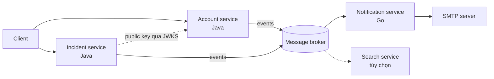

# Kế hoạch tách microservice

Trạng thái: kế hoạch được thống nhất ngày 2026-11-10; **bước 5 (Notification service viết bằng Go) đã implemented ngày 2026-11-16**, xem 5.1 và 5.3; **JWKS endpoint đã implemented ngày 2026-11-17** và mô hình xác thực cho các service tiếp theo đã decided, xem mục 4 và 7. Backend vẫn là một ứng dụng Spring Boot với hai module, `identity` và `tenancy`, dùng chung một database PostgreSQL; mail xác thực hiện đã được gửi bởi service Go tách riêng thông qua RabbitMQ. **Chủ đề tiếp theo: Incident service**, được lên kế hoạch trong [incident-service.md](incident-service.md) (bản nháp, 2026-11-24); business domain đã thay đổi vào ngày đó, xem mục 2.

Đây là một dự án để học. Mục tiêu là chuyển dần từ modular monolith sang microservice, mỗi bước học một hoặc hai khái niệm mới. Tính năng mới được xây thành các service riêng đặt cạnh monolith thay vì viết lại monolith trước (cách tiếp cận *strangler*).

## 1. Điểm xuất phát

Ứng dụng hiện tại đã có các module theo kiến trúc hexagonal, nhưng `identity` và `tenancy` chủ ý dựa vào **một database transaction** để có ba đảm bảo sau:

| Điểm phụ thuộc | Ở đâu | Đảm bảo điều gì |
| --- | --- | --- |
| `UserDisabledEvent` được tenancy xử lý đồng bộ | `tenancy.infrastructure.event.UserDisabledListener` | Vô hiệu hóa user và gỡ các membership của user đó cùng commit hoặc cùng rollback |
| Tenancy lock dòng `users` (`FOR SHARE`) trước dòng organization | `tenancy.infrastructure.persistence.adapter.UserAccountLookupAdapter` | Thứ tự lock user → organization; một user đã bị vô hiệu hóa không bao giờ có thể trở thành owner |
| Identity đọc trực tiếp bảng `memberships` | `identity.infrastructure.persistence.adapter.OrganizationOwnershipCheckAdapter` | Một owner không thể bị vô hiệu hóa |

Ngoài ra còn có foreign key `memberships.user_id → users`. Tách identity và tenancy thành hai service riêng sẽ làm mất toàn bộ các đảm bảo này và thay chúng bằng saga cùng các trạng thái không nhất quán tạm thời. **Chúng ở lại cùng nhau** trong một service.

Những thứ đã sẵn có lợi cho việc tách:

- Access JWT được ký bằng RS256. Các service khác có thể xác minh chúng chỉ với public key.
- Mail xác thực đã được gửi sau commit, bất đồng bộ và theo kiểu fire-and-forget (`AuthMailListener`), nên email là ranh giới sạch nhất trong codebase.

## 2. Business domain

Ứng dụng trước đây chưa có business domain. Domain được chọn ngày 2026-11-10 là quản lý task và project (kiểu Trello). **Sửa đổi ngày 2026-11-24: domain là quản lý incident và on-call** (kiểu PagerDuty), xây trên mô hình organization, membership và role hiện có: các service được giám sát, alert và incident thuộc về một organization, và các thành viên của organization đó được page (gọi báo) và escalation (leo thang) theo schedule và policy. Domain này được ưu tiên vì có các quy tắc thực sự (state machine, timer, escalation), cho mọi thành phần hạ tầng đã lên kế hoạch một lý do để tồn tại, có thể giám sát chính stack này làm demo, và có các use case AI cụ thể. Domain model được thiết kế trong [incident-service.md](incident-service.md).

## 3. Các service mục tiêu

| Service | Trách nhiệm | Công nghệ | Dữ liệu sở hữu |
| --- | --- | --- | --- |
| **Account** | Đăng ký, đăng nhập, session, refresh token, xác minh email, đặt lại mật khẩu, organization, membership, role, system admin | Java / Spring (ứng dụng hiện tại) | `users`, sessions, tokens, `organizations`, `memberships` |
| **Incident** (là Project/Task cho đến 2026-11-24) | Các service được giám sát, integration, tiếp nhận alert, incident và timeline, escalation policy, on-call schedule, page, postmortem | Java / Spring, PostgreSQL | Database riêng, cộng thêm một read model của memberships được cấp dữ liệu từ các event của Account |
| **Notification** | Gửi email; sau này là realtime push (WebSocket hoặc SSE) | **Go** | Chỉ trạng thái của riêng nó (ví dụ, các message ID đã xử lý) |
| **Search** (tùy chọn, sau này) | Tìm kiếm full-text task, được cấp dữ liệu từ event | OpenSearch | Một read model được dựng lại từ event |



Quy tắc:

- **Mỗi service một database.** Một service không bao giờ đọc bảng của service khác. Các lần đọc bảng trực tiếp ở mục 1 chỉ chấp nhận được vì Account là một service duy nhất.
- **Chỉ một ngôn ngữ thứ hai.** Go được dùng cho Notification vì service này nhỏ, thiên về I/O và có ít quy tắc nghiệp vụ, nên chi phí học ngôn ngữ là thấp. Core domain vẫn ở Java, nơi có thể tái sử dụng cấu trúc hiện có.
- **Mặc định là PostgreSQL.** Chỉ thêm một database khác khi có lý do cụ thể. OpenSearch là ngoại lệ duy nhất đã lên kế hoạch, như một cách để học giữ cho read model đồng bộ.

## 4. Các contract liên service

Bất cứ thứ gì đi qua ranh giới service đều phải trung lập về ngôn ngữ, vì các service Java và Go phải hiểu được nhau. Không dùng chung thư viện Java nào (chẳng hạn package `common` hiện tại) giữa các service.

| Vấn đề | Thỏa thuận |
| --- | --- |
| Xác thực | Mỗi service tự xác minh access JWT RS256 (`iss`, `aud`, `exp`). Account công bố public key của mình qua một JWKS endpoint thay vì phân phối file PEM. **Đã implemented (2026-11-17):** `GET /.well-known/jwks.json`, public, có thể cache trong 5 phút. Cặp khóa được giữ dưới dạng một JWK có `kid` là thumbprint RFC 7638 của public key; header của mọi token đều mang `kid` đó, và Account xác minh token của chính mình từ cùng bộ khóa này, chọn theo `kid`, đúng như một consumer từ xa sẽ làm. Xoay khóa nghĩa là thêm khóa kế tiếp vào bộ khóa và giữ khóa cũ cho đến khi các token của nó hết hạn. Một consumer trong Spring đặt `jwk-set-uri`; consumer trong Go dùng bất kỳ thư viện JWKS client nào. |
| Định dạng event | JSON với schema được viết ra (JSON Schema hoặc AsyncAPI), hoặc Protobuf/Avro. Mỗi event có một tên type ổn định và tường minh. Các JSON message converter của Spring cho Kafka và RabbitMQ mặc định thêm header `__TypeId__` chứa tên class Java. Phải tắt cái này, nếu không consumer Go hoặc sẽ hỏng hoặc sẽ phụ thuộc vào tên class Java. |
| Lỗi HTTP | Cấu trúc `ApiError` và `ApiErrorCodes` hiện tại trở thành một contract có tài liệu (OpenAPI), không phải code dùng chung. |
| Tracing | OpenTelemetry với header `traceparent` theo chuẩn W3C, để có thể theo dõi một request xuyên qua các service viết bằng những ngôn ngữ khác nhau. |
| ID | UUIDv7 ở mọi nơi. Mỗi service tự sinh ID cho dữ liệu mình sở hữu. |

## 5. Bước đầu tiên: Notification service bằng Go

Mail xác thực rời khỏi process của Account:

```text
Monolith (một process):  service → Spring event (trong bộ nhớ) → AuthNotificationListener → soạn mail → SMTP
Sau khi tách:            Account (Java) → RabbitMQ (lưu trên đĩa) → Notification (Go) → soạn mail → SMTP
```

Giao tiếp là **bất đồng bộ qua message broker** vì việc gửi email không cần chặn request. Nếu Notification ngừng hoạt động, message chờ trong broker và Account không bị ảnh hưởng. Cái giá phải trả là message không còn chỉ nằm trong bộ nhớ: broker lưu nó trên đĩa để không bị mất.

Khái niệm mới trong bước này: message broker, asynchronous messaging, at-least-once delivery, idempotent consumer, và bản thân Go.

### 5.1 Phía Account — đã implemented (2026-11-11)

`app.mail.mode` chọn đường gửi; các service và event không thay đổi.

| Mode | Điều gì xảy ra sau commit | Ở đâu |
| --- | --- | --- |
| `log` (mặc định) | Mail được soạn trong Account và ghi ra log | `identity.infrastructure.mail` |
| `smtp` | Mail được soạn trong Account và gửi qua `spring.mail.*` | `identity.infrastructure.mail` |
| `rabbit` | Chính event được publish lên RabbitMQ; Notification soạn và gửi mail | `identity.infrastructure.messaging` |

Application port `AuthNotifier` có một adapter cho mỗi đường. `AuthNotificationListener` vẫn chạy sau commit và bất đồng bộ, và vẫn nuốt lỗi sau khi ghi log, nên quyết định publish-sau-commit (6.2) là hành vi sẵn có, không phải code mới. Với mode `rabbit`, Account khai báo exchange lúc khởi động và `app.mail.frontend-base-url` không còn được Account dùng nữa: đường link thuộc về cấu hình của Notification service.

Profile local dùng mode `rabbit`; `docker-compose.yaml` chạy RabbitMQ 4 với giao diện quản trị tại <http://localhost:15672> (guest/guest). Chuyển về `smtp` để test mà không cần service Go.

### 5.2 Message contract

Topic exchange **`onward.auth`** (durable; cấu hình được qua `app.messaging.exchange`). Mỗi message là một JSON body với các thuộc tính AMQP chuẩn và **không có custom header**: không có `__TypeId__`, nên consumer không cần gì từ codebase Java.

| Routing key | `type` (trong body và trong thuộc tính AMQP `type`) |
| --- | --- |
| `auth.email-verification-requested` | `onward.auth.email-verification-requested.v1` |
| `auth.password-reset-requested` | `onward.auth.password-reset-requested.v1` |

Body, hiện giống hệt nhau cho cả hai type:

```json
{
  "messageId": "01a1cb46-40e6-798d-b0e4-0c25206cfb0a",
  "type": "onward.auth.email-verification-requested.v1",
  "occurredAt": "2026-11-11T15:42:21.414012331Z",
  "email": "alice@example.com",
  "token": "<raw one-time token>",
  "expiresAt": "2026-11-12T15:42:21.398937438Z"
}
```

- `messageId` là một UUIDv7, đồng thời được đặt làm thuộc tính AMQP `message_id`. Đây là khóa để phát hiện trùng lặp ở consumer.
- Các mốc thời gian theo ISO-8601 ở múi giờ UTC. `expiresAt` là giá trị mail phải hiển thị ("có hiệu lực đến …"); consumer không được tính nó từ `occurredAt`.
- `delivery_mode` là 2 (persistent), `content_type` là `application/json`.
- Thay đổi trường nào là ra một phiên bản type mới (`.v2`); các phiên bản hiện có không bao giờ bị sửa.

Exchange do Account sở hữu và khai báo. Queue, binding của nó (`auth.#` hoặc hai key ở trên) và dead-letter queue do Notification sở hữu và khai báo. Các message được publish trước khi queue đó tồn tại sẽ bị exchange bỏ đi, điều này chấp nhận được với những mail có thể yêu cầu gửi lại.

### 5.3 Phía Notification — đã implemented bằng Go (2026-11-16)

Repository `onward-notification`, một binary, cấu hình chỉ qua biến môi trường (giá trị mặc định khớp với `docker-compose.yaml` trên localhost; service `notification` trong file đó ghi đè các hostname). Build và chạy local bằng `go run ./cmd/notification`, hoặc `docker compose up -d --build` từ `onward-be`.

Các package, với hướng import `main → rabbit, mail, dedup, config` và `rabbit, mail → event`:

| Package | Sở hữu |
| --- | --- |
| `event` | Message contract: struct `TokenMail`, hai tên type, giải mã và kiểm tra hợp lệ (đủ mọi trường, type đã biết). Không import gì từ các package khác. |
| `rabbit` | Kết nối, khai báo queue và dead-letter, vòng lặp consume. Khai báo các interface `Handler` và `Dedup` mà nó cần; các implementation được inject từ `main`. |
| `mail` | Template (phản chiếu composer trước đây của Account), gửi qua SMTP, và handler chọn template theo type. |
| `dedup` | Adapter Redis: `SET NX EX` để chiếm (claim) một `messageId`, `DEL` để nhả nó. |
| `config` | Đọc `RABBITMQ_URL`, `RABBITMQ_EXCHANGE`, `RABBITMQ_QUEUE`, `RABBITMQ_PREFETCH`, `SMTP_HOST`, `SMTP_PORT`, `MAIL_FROM`, `FRONTEND_BASE_URL`, `REDIS_ADDR`, `DEDUP_TTL`. |

Các đối tượng broker do Notification khai báo: quorum queue `notification.auth-mail` bind vào `onward.auth` với `auth.#`, argument `x-dead-letter-exchange` = `onward.auth.dlx`; fanout exchange `onward.auth.dlx`; quorum queue `notification.auth-mail.dlq` bind vào exchange đó. Argument của queue là bất biến trên broker: muốn thay đổi thì phải xóa queue trước (chấp nhận được khi phát triển; production sẽ dùng policy thay vào đó).

Điều gì xảy ra với một lần giao message, với prefetch 10 và acknowledgement thủ công:

| Kết quả | Hành động | Lý do |
| --- | --- | --- |
| JSON không hợp lệ, thiếu trường, type không biết | `nack` không requeue → dead-letter queue | Lỗi vĩnh viễn; cần có người xem xét. Header `x-death` ghi lại nguồn gốc. |
| `messageId` đã được chiếm trong Redis | `ack`, bỏ qua | Đã xử lý rồi (6.2: ghi nhớ trước, rồi mới gửi). |
| `expiresAt` đã qua | `ack`, bỏ qua | Gửi cũng vô ích và không ai cần xem xét nó. |
| Không kết nối được SMTP hoặc Redis | nhả claim, return, process thoát với mã 1 | Lỗi tạm thời. Message vẫn chưa được acknowledge và sẽ được giao lại sau khi khởi động lại (compose `restart: unless-stopped`). |
| Mail đã gửi | `ack` | |

Tắt process: `SIGINT`/`SIGTERM` hủy một context chỉ được kiểm tra giữa các message; message đang xử lý chạy trên một context không có lệnh hủy đó và có timeout 30 giây, nên nó được hoàn tất và acknowledge trước khi process thoát với mã 0. Các message đã prefetch mà chưa acknowledge sẽ quay về queue khi kết nối đóng. `token` không bao giờ được ghi log.

**Các lỗ hổng đã biết, chủ ý để lại:** một lỗi SMTP vĩnh viễn với một message (ví dụ, địa chỉ bị từ chối) bị coi là tạm thời và sẽ khiến process khởi động lại liên tục; cách sửa là một vòng retry qua dead-letter queue với TTL quay về queue chính và một giới hạn trên số đếm `x-death`. Dead-letter queue không có TTL và không có alert. Không có logic reconnect: process thoát và được khởi động lại.

## 6. Các quyết định còn mở

Những quyết định này được chốt từng cái một, theo thứ tự sau, trước khi viết code liên quan.

### 6.1 Raw one-time token đi qua ranh giới service — decided: A

Quyết định (2026-11-11): **phương án A**. Raw token đi trong message, với các biện pháp giảm thiểu liệt kê bên dưới. Các comment trong code ở `EmailVerificationRequested` và `OneTimeTokenIssuer` nói rằng raw token không bao giờ được lưu trữ sẽ được cập nhật khi việc tách Notification được triển khai.

`EmailVerificationRequested` và `PasswordResetRequested` mang **raw token** sẽ đi vào đường link trong email. Thiết kế hiện tại chỉ giữ nó trong bộ nhớ và chỉ lưu hash của nó. Khi Notification là một service riêng, raw token buộc phải nằm trong broker. Bất kỳ ai đọc được broker trong lúc token còn hiệu lực đều có thể đặt lại mật khẩu của user khác (token sống 30 phút) hoặc xác minh một địa chỉ email không thuộc về mình (token sống 24 giờ).

| Phương án | Cách tiếp cận | Chi phí |
| --- | --- | --- |
| **A** | Giữ raw token trong message và giảm rủi ro: không bao giờ log payload, xóa message ngay khi đã xử lý, hạn chế ai được đọc broker. Token vốn đã dùng một lần và có hạn. | Quyết định "không bao giờ lưu trữ" bị thay thế; tài liệu hiện có phải được cập nhật. |
| **B** | Mã hóa token chỉ dành cho Notification (JWE: Account mã hóa bằng public key của Notification; chỉ service Go giải mã được). Broker chỉ thấy ciphertext. | Quản lý khóa ở cả Java và Go; khó debug hơn; nặng nề cho một bước đầu tiên. |
| **C** | Các email chứa bí mật ở lại Account. Notification chỉ nhận các event không có bí mật (task được giao, comment mới, …). | Chưa thể chuyển gì đi được; phải xây Project/Task service trước. |

Khuyến nghị: **A**. Đường link vốn đã đi qua các SMTP server, nhà cung cấp mail và hộp thư của user, nên nó chưa bao giờ là bí mật đối với hạ tầng; broker chỉ thêm một chỗ có mức phơi nhiễm tương đương, và token mất giá trị ngay khi đã dùng hoặc hết hạn. B là một bài tập nâng cao tốt cho sau này. C an toàn nhất nhưng trì hoãn Notification.

### 6.2 Các quyết định sau

| Quyết định | Phương án | Ghi chú |
| --- | --- | --- |
| Nội dung message — **decided (2026-11-11): business event** | Publish mail đã soạn (`to`, `subject`, `body`), hoặc publish event (`email`, `token`, `expiresAt`) và để Notification soạn | Với mail đã soạn sẵn, Notification chỉ là một SMTP relay và mỗi service sẽ phải giữ template riêng của mình. Sở hữu template, ngôn ngữ và kênh (mail hôm nay, push sau này) chính là điều khiến Notification là một service. Xem 5.2 về contract. |
| Outbox hay publish trực tiếp — **decided (2026-11-11): publish sau commit** | Account publish message sau khi transaction của nó commit, như `AuthMailListener` làm hôm nay. Một crash hoặc sự cố broker giữa commit và publish sẽ làm mất email. | Chấp nhận được vì user có thể yêu cầu gửi lại, và vì một outbox sẽ lưu raw token trong database và bản backup của Account, trái với tinh thần của 6.1. Outbox sẽ được đưa vào sau cho những event mà việc mất chúng là bug (ví dụ, việc gỡ membership phải đến được Project/Task service). Consumer Go vẫn phải chịu được message trùng lặp. |
| Broker — **decided (2026-11-11): RabbitMQ** cho bước Notification | RabbitMQ xóa message ngay khi nó được acknowledge, nên raw token (6.1) không nằm lại lâu; gửi email là một command cho một consumer, đúng với mục đích của queue; ít khái niệm phải học cùng lúc hơn. | Kafka vẫn được lên kế hoạch cho các domain event sau này mà nhiều consumer cùng đọc và cần replay (event của Project/Task cấp cho Notification, Search và audit). Chạy cả hai broker là chấp nhận được. |
| Kho lưu idempotency — **decided (2026-11-15): Redis**, các ID đã xử lý giữ 48 giờ | Nơi Notification ghi nhớ các `messageId` đã xử lý: trong bộ nhớ (vô dụng, bản trùng đến đúng sau khi khởi động lại); bảng PostgreSQL với job dọn dẹp; key Redis cho mỗi ID với TTL; file SQLite | Redis là ngoại lệ của "mặc định là PostgreSQL" vì nhu cầu ở đây đúng là thứ `SET NX EX` làm: kiểm tra, ghi và hẹn giờ hết hạn trong một lệnh atomic, an toàn với nhiều instance consumer. Mất dữ liệu này chỉ gây ra một mail trùng, nên độ bền của Postgres không mang lại gì. Thời gian lưu được suy ra từ lúc một bản trùng trở nên vô hại: bản đến muộn dù sao cũng bị bỏ khi `expiresAt` (tối đa 24 giờ) đã qua, nên 24 giờ là đủ và 48 giờ cho thêm dư địa. Redis chạy trong `docker-compose.yaml`; Notification đọc `REDIS_ADDR` và `DEDUP_TTL`. |
| Thứ tự "ghi nhớ" và "gửi" — **decided (2026-11-15): ghi nhớ trước, rồi mới gửi** (at-most-once) | Ghi ID trước khi gửi: crash ở giữa làm mất mail. Gửi trước khi ghi: crash ở giữa làm gửi hai lần. | Cùng lập luận với quyết định về outbox: mail bị mất có thể yêu cầu lại, mail trùng làm user bối rối. Cửa sổ mất mát chỉ là một crash giữa hai bước; khi SMTP chỉ đơn thuần thất bại, Notification xóa ID đi trước khi thoát, nên lần giao lại không bị coi là trùng. |
| Kiểm tra session ở các service khác — **decided (2026-11-17): một lần, tại API gateway, đối chiếu với một denylist do Account duy trì trong Redis**; xem mục 7 | Chỉ xác minh JWT, chấp nhận rằng logout, thu hồi và vô hiệu hóa tài khoản có hiệu lực muộn tới 5 phút (thời gian sống của access token); hoặc hỏi Account ở mọi request; hoặc kiểm tra một lần tại gateway | Hôm nay `SessionJwtAuthenticationConverter` kiểm tra session và user trong database ở mọi request, điều mà một service khác không thể tự làm. Hỏi Account ở mọi request giữ được hành vi đó nhưng khiến Account thành phụ thuộc runtime của mọi lời gọi, làm mất ý nghĩa của việc tách. |
| Incident service biết role của user trong một organization bằng cách nào | Gọi Account ở mỗi request; giữ một bản sao local của memberships cập nhật từ event; đưa role vào JWT | Role thay đổi và một user thuộc nhiều organization, nên role trong JWT sẽ cũ đi và làm token phình to. Các phương án đã được cân nhắc và bản sao local cấp dữ liệu bằng outbox event được khuyến nghị trong [incident-service.md](incident-service.md), mục 3; chưa decided. |
| Điểm vào cho client — **decided (2026-11-17): một API gateway** | Client gọi trực tiếp từng service, hoặc đi qua một API gateway | Hệ quả của quyết định về kiểm tra session: gateway là nơi việc kiểm tra session chạy một lần. |

## 7. Xác thực cho mọi service đứng sau gateway

Decided ngày 2026-11-17. Xác thực hôm nay có hai tầng, cả hai đều nằm trong Account: chữ ký và các claim của access token (chỉ cần public key), và một lần kiểm tra database rằng session còn hoạt động, user chưa bị vô hiệu hóa, hoạt động gần nhất được ghi lại và system role là mới nhất (cần các bảng `sessions` và `users` của Account). Một service thứ hai có thể lặp lại tầng thứ nhất qua JWKS nhưng, theo quy tắc mỗi service một database, không bao giờ làm được tầng thứ hai. Phải có thứ gì đó đảm nhận tầng thứ hai đó.

| Phương án | Service thứ hai làm gì | Chi phí |
| --- | --- | --- |
| Chỉ xác minh JWT | Chỉ tầng thứ nhất; tin vào các claim trong token | Logout, thu hồi và vô hiệu hóa có hiệu lực muộn tới một thời gian sống của access token (5 phút); không thể cưỡng chế idle timeout. |
| Hỏi Account ở mọi request | Gọi một introspection endpoint của Account | Giữ ngữ nghĩa hiện nay, nhưng mọi service phụ thuộc vào độ trễ và tính sẵn sàng của Account ở mọi lời gọi. |
| Kiểm tra một lần tại gateway | Một gateway đứng trước mọi service làm tầng thứ hai; các service phía sau chỉ xác minh chữ ký | Thêm một thành phần; gateway vẫn cần trạng thái session từ đâu đó. |

Được chọn: gateway, với trạng thái session được cung cấp dưới dạng một **denylist trong Redis do Account sở hữu**:

- Account ghi vào Redis khi một session kết thúc hoặc bị thu hồi (key theo session id) và khi một user bị vô hiệu hóa (key theo user id), với TTL bằng thời gian sống của access token, vì sau đó token dù sao cũng không còn hợp lệ.
- Gateway xác minh token qua JWKS, rồi kiểm tra rằng cả session id lẫn subject đều không bị từ chối. Một request hợp lệ không bao giờ chạm tới Account.
- Idle timeout vẫn thuộc về Account; xem 7.3 về lý do gateway không cần theo dõi hoạt động.
- Các service sau gateway vẫn tự xác minh chữ ký và claim của token qua JWKS. Việc này rẻ và đồng nghĩa một service bị gọi trực tiếp, bỏ qua gateway, không chấp nhận token giả mạo. Chỉ có bước kiểm tra session là bỏ qua ở đó.

Vì sao chọn cách này thay vì các phương án khác: phương án gọi trực tiếp từ bỏ "logout có hiệu lực ngay lập tức", điều mà thiết kế hiện tại chủ ý cung cấp; phương án introspection giữ Account trên hot path của mọi request. Denylist giữ được đảm bảo đó và giữ Account ngoài hot path. Hai process dùng chung một Redis, điều này bẻ cong "mỗi service một database"; chấp nhận được vì Redis ở đây là một cache của các quyết định mà nguồn sự thật vẫn nằm trong PostgreSQL của Account, và mất nó chỉ có nghĩa là một token đã thu hồi được chấp nhận thêm tối đa 5 phút, giống như phương án thứ nhất.

### 7.1 Khung gateway — đã implemented (2026-11-18)

Công nghệ decided ngày 2026-11-18: **Spring Cloud Gateway (WebFlux)**, Spring Cloud 2025.1.x trên Boot 4.1. Đã cân nhắc: biến thể Server MVC (cùng mô hình lập trình với Account, ít tính năng và ví dụ hơn), một reverse proxy viết tay bằng Go (nhỏ và có tính học hỏi, nhưng nó dạy viết một proxy thay vì dùng một gateway, và trộn lẫn bug của proxy với sai lầm thiết kế trong khi thiết kế vẫn đang thay đổi), và một sản phẩm có sẵn như Kong, Traefik hoặc Envoy (kiểm tra denylist sẽ cần một plugin ở thêm một hệ sinh thái nữa). Biến thể WebFlux được chọn vì logic tùy biến duy nhất là kiểm tra denylist, một filter vài chục dòng, và nó mang theo một Redis rate limiter có thể thay thế `PublicAuthRateLimitFilter` sau này. Viết lại gateway bằng Go khi hành vi của nó đã ổn định là một bài tập hợp lý cho sau này; nó sẽ thay thế cái này chứ không chạy song song.

Repository `onward-gateway`, port 8081 trong khi Account vẫn ở 8080; client tiếp tục gọi thẳng Account cho đến khi gateway làm được mọi thứ chúng cần. Hôm nay nó làm gì:

- Một route: `/api/**` và `/.well-known/**` tới Account.
- Xác minh access token qua JWKS của Account (`gateway.auth.jwk-set-uri`), với cùng quy tắc như Account: RS256, issuer, audience, bắt buộc có expiry, không cho phép lệch đồng hồ. Khóa được cache; một `kid` lạ kích hoạt một lần fetch lại, đó là cách việc xoay khóa được nhận biết.
- Một danh sách cấu hình các đường dẫn public (`gateway.auth.public-paths`) không cần token: các luồng auth public của Account và tài liệu JWKS. Mọi thứ khác bị từ chối với 401 trước khi đến được service. Vì vậy mọi service sau gateway phải khai báo các route public của mình với gateway; đó là điều tất yếu khi gateway đảm nhận xác thực.
- 401 và 403 dùng cấu trúc JSON `ApiError` của Account, nên client thấy một contract lỗi duy nhất bất kể ai từ chối chúng.
- CSRF không được gateway cưỡng chế; nó chuyển tiếp cookie và header, còn Account tiếp tục cưỡng chế trên các endpoint dựa trên cookie của mình. Đã kiểm chứng end to end: register, verify, login, refresh (cookie), logout và `/api/auth/me` qua gateway hoạt động như khi gọi trực tiếp.

Decided (2026-11-19): **Account giữ kiểm tra database theo từng request của riêng mình** bên cạnh kiểm tra denylist của gateway. Sau gateway, kiểm tra này là thừa, hai query mỗi request, nhưng nó giữ Account an toàn khi bị gọi trực tiếp và tránh phải chuyển role system-admin ra khỏi database vào lúc này. Xem lại khi Incident service đã tồn tại và client thực sự đi qua gateway, lúc đó mới có thứ để đo. Rate limit theo từng client của các auth endpoint public đã được chuyển sang gateway (7.4), vì sau gateway Account chỉ thấy địa chỉ của gateway.

### 7.2 Denylist do Account ghi — đã implemented (2026-11-18)

Decided ngày 2026-11-18: Account ghi denylist **trực tiếp vào Redis** thay vì publish một event để gateway consume. Denylist tồn tại để một lần thu hồi được thấy ngay lập tức; đặt một broker giữa hai bên sẽ thêm độ trễ và, khi gateway ngừng hoạt động, để các lần thu hồi chờ trong queue. Cái giá là một định dạng key dùng chung bởi hai service, được ghi lại ở đây như một contract giống message contract ở 5.2. Cũng decided: gateway **fail-open** khi không kết nối được Redis. Khi đó nó quay về chỉ xác minh token, nên một token đã thu hồi được chấp nhận thêm tối đa một thời gian sống của access token, cùng mức mất mát với phương án "chỉ xác minh JWT" ở mục 7, trong khi một gateway fail-closed sẽ biến Redis thành điểm hỏng đơn lẻ cho mọi request.

Key contract, Redis database 0:

| Key | Giá trị | Hết hạn | Ý nghĩa với gateway |
| --- | --- | --- | --- |
| `denied:session:<sessionId>` | `1` | thời gian sống của access token (5 phút) | Từ chối mọi token có claim `sid` bằng `<sessionId>`. |
| `denied:user:<userId>` | Unix time tính bằng giây của lần thu hồi | thời gian sống của access token (5 phút) | Từ chối mọi token có claim `sub` bằng `<userId>` và có `iat` **không sau** thời điểm đó. Một session mở sau đó mang `iat` muộn hơn và được cho qua, nên user đặt lại mật khẩu có thể đăng nhập lại ngay. |

Thời hạn hết hạn suy ra từ thời gian sống của token: sau đó, mọi token phát hành trước lần thu hồi đã tự hết hạn, nên entry không còn gì để chặn. Bất kỳ service nào thay đổi thời gian sống của access token đều phải giữ hai giá trị này đồng bộ.

Nơi Account ghi, tất cả đều trong module identity:

| Kích hoạt | Entry |
| --- | --- |
| Logout | session |
| Phát hiện tái sử dụng refresh token (session bị thu hồi vì bị xâm phạm) | session |
| Đặt lại mật khẩu (mọi session bị thu hồi) | user |
| Tài khoản bị vô hiệu hóa, bởi user hoặc bởi admin (mọi session bị thu hồi) | user |

Cơ chế: service publish một application event (`SessionRevoked`, `UserTokensRevoked`) bên trong transaction thực hiện thu hồi trong PostgreSQL; một listener chạy **sau commit** và gọi port `SessionDenylist`, mà adapter Redis của nó phát một lệnh `SET ... EX`. Sau commit, để một lần thu hồi bị rollback không bao giờ chặn một session đang sống; đồng bộ, khác với mail listener, để entry tồn tại trước khi client nhận được phản hồi. Ghi thất bại thì được log và nuốt đi: việc thu hồi đã bền vững trong PostgreSQL, chỉ mất phần từ chối sớm tại gateway, trong tối đa một thời gian sống của token. Redis chạy từ `docker-compose.yaml`; Account đọc `spring.data.redis.*` từ profile local với command timeout 500 ms, nên một Redis bị treo không thể giữ chân một request logout.

Dung lượng lưu trữ bị giới hạn bởi lưu lượng trong cửa sổ hết hạn, không phải theo thời gian: số lần logout, đặt lại mật khẩu và vô hiệu hóa trong năm phút, mỗi cái khoảng một trăm byte. Account xác minh token của chính mình đối chiếu với database như trước; nó không đọc denylist.

### 7.3 Kiểm tra denylist tại gateway — đã implemented (2026-11-19)

Một `WebFilter` được đăng ký ngay sau bước authorization của Spring Security, nên nó chỉ thấy các request mà token đã được xác minh; các request ẩn danh tới đường dẫn public bỏ qua nó. Với mỗi request đã xác thực, nó phát một lệnh `MGET` cho `denied:session:<sid>` và `denied:user:<sub>` và từ chối với cùng JSON 401 như các tầng khác khi entry session tồn tại, hoặc khi entry user tồn tại và `iat` của token không sau giá trị của nó. Đã kiểm chứng: một session đang sống trở thành 401 tại gateway ngay khoảnh khắc entry của nó được ghi, trong khi gọi trực tiếp Account vẫn thành công; một entry user cũ hơn `iat` của token cho token đi qua; một lần logout thật qua gateway làm token cũ thành 401 ngay lập tức.

Fail-open như đã decided ở 7.2: lần tra cứu có timeout riêng (`gateway.auth.denylist-timeout`, 200 ms) và bất kỳ lỗi hay timeout nào cũng cho request đi qua chỉ dựa trên token, kèm một cảnh báo trong log. Đã kiểm chứng với gateway trỏ tới một port không có gì lắng nghe: các request thành công, mỗi request kèm cảnh báo. Cái giá là một vòng round trip Redis cho mỗi request đã xác thực.

**Idle timeout không được gateway kiểm tra, theo quyết định (2026-11-19).** Access token sống 5 phút, nên một client đang hoạt động phải gọi `refresh` ít nhất với tần suất đó, và refresh chạy trong Account, nơi cưỡng chế idle timeout đối chiếu với database và ghi lại hoạt động. Một client ngừng gọi thì ngừng refresh, và lần refresh tiếp theo của nó sau 30 phút sẽ thất bại. Vì vậy idle timeout đã được cưỡng chế sẵn, với độ chi tiết bằng một thời gian sống của access token, và theo dõi hoạt động gần nhất tại gateway sẽ thêm một lần ghi Redis mỗi request mà chẳng được gì. Nó cũng không hợp với fail-open: một entry hoạt động bị thiếu không thể phân biệt được với một entry đã hết hạn.

Điều gateway hiện đảm bảo cho mọi service phía sau nó: token là thật, chưa hết hạn, dành cho hệ thống này, và thuộc về một session mà Account chưa thu hồi trong vòng một thời gian sống token gần nhất. Một service tin tưởng gateway có thể bỏ qua kiểm tra database mà Account vẫn làm. Bản thân Account hiện vẫn giữ kiểm tra đó (xem 7.1).

### 7.4 Rate limit chuyển sang gateway — đã implemented (2026-11-19)

Decided ngày 2026-11-19: giới hạn theo từng client trên `register`, `verification/resend` và `forgot-password` được gateway cưỡng chế, và `PublicAuthRateLimitFilter` trong process của Account bị gỡ bỏ. Phương án thay thế, Account chỉ tin `X-Forwarded-For` khi kết nối đến từ gateway, sẽ phải lặp lại và giữ cho đúng ở mọi service; giới hạn là việc của gateway, làm một lần ở nơi địa chỉ client còn nhìn thấy được.

Cùng chính sách như trước, 10 request mỗi client mỗi path mỗi giờ, nay được biểu diễn thành một token bucket trong Redis dùng `RedisRateLimiter` của Spring Cloud Gateway: bucket chứa lượng token của một giờ và nạp lại một token mỗi giây, và một request tốn một phần mười bucket, nên một client mới có ngay mười request rồi sau đó cứ sáu phút thêm một request. Script của bucket chạy atomic bên trong Redis, nên nhiều instance gateway dùng chung một giới hạn, điều mà filter in-memory cũ không làm được. Phản hồi giữ contract của Account: `429` với body `RATE_LIMITED` và một `Retry-After` tính từ số token còn thiếu. Lỗi Redis cho request đi qua (fail-open, như denylist). Limiter lấy key theo địa chỉ kết nối và bỏ qua `X-Forwarded-For`; nếu có lúc gateway được đặt sau một load balancer, đó là nơi duy nhất cần cấu hình trusted proxy.

Filter này không được cấu hình làm route filter (`RequestRateLimiter`) vì cái đó trả lời với body rỗng; nó là một `WebFilter` trong security chain, trước bước xác thực, gọi cùng limiter đó và ghi ra lỗi JSON.
